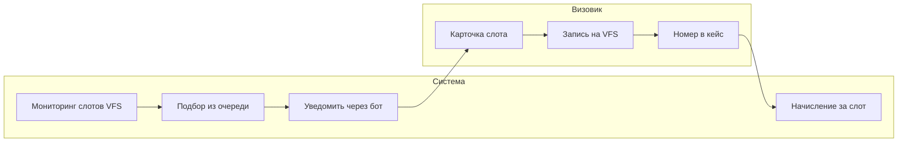
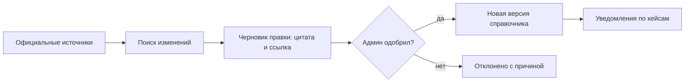

# PRD — CRM для визовика

> Экспорт из Claude Docs от 15.10.2026. Источник правды по продукту — этот файл; при изменении решений обновляйте его и docs/decisions.md.

Oct 5, 2026 · @Maksim Rubanets

## Обзор продукта

CRM для визовика, который ведёт клиентов под ключ: визы в ЕС и UK, дополнительно в другие страны. Сначала системой пользуется один визовик, затем она открывается другим визовикам как платный SaaS.

**Проблема.** Дела клиентов разбросаны по мессенджерам, таблицам и папкам со сканами. Слоты на VFS появляются непредсказуемо и быстро исчезают. Требования консульств меняются без предупреждения, и устаревший чек-лист ведёт к отказу.

**Цель.** Одна система, в которой визовик ведёт личные дела, собирает пакеты документов по шаблонам, ловит слоты и держит клиента в курсе через бота, не тратя время на ручную рутину.

**Модель работы.** Всё ведёт визовик. Клиент не входит в систему и не имеет доступа к аккаунту VFS: он получает статусы и напоминания через Telegram-бота и отвечает на запросы документов.

**Метрики успеха** (целевые значения уточняются, см. открытые вопросы):

| Метрика | Что показывает |
| --- | --- |
| Время сборки пакета документов на кейс | Эффект шаблонов и чек-листов |
| Время от появления слота до записи клиента | Эффект чекера и очереди |
| Активных кейсов на одного визовика | Пропускная способность |
| Доля одобрений по странам | Качество подготовки |
| Платящие визовики и поступления по календарю оплат | Результат SaaS-этапа |

## Роли и интерфейсы

Система состоит из двух интерфейсов на общей базе: админ-панели владельца платформы и кабинета визовика. У клиента нет входа в систему, с ним работает бот.

| Роль | Интерфейс | Что доступно | С какого этапа |
| --- | --- | --- | --- |
| Администратор платформы | Админ-панель | Редактирование любых данных: справочник стран и виз, общие шаблоны, визовики, модули, тарифы. Одобрение правок AI-агента, журнал действий, начисления и споры | 0–1 |
| Визовик | Кабинет визовика | Все рабочие инструменты без исключения: дела, кейсы, документы, слоты, боты, финансы, аналитика. Админских инструментов не видит | 1 |
| Сотрудник визовика | Кабинет визовика | Только инструменты и кейсы, которые открыл визовик | 0–1 |
| Клиент | Telegram-бот | Статусы, напоминания, запросы документов. Нет входа в систему и доступа к VFS | 4 |

Кабинет визовика и админ-панель — разные интерфейсы, а не скрытые пункты меню: визовик работает без лишних экранов. Владелец платформы, который сам работает визовиком, имеет обе роли и переключается между ними.

## Карта модулей

Продукт состоит из 23 модулей, и каждый включается отдельно, поэтому визовику можно открыть любой набор. Этап в последней колонке показывает, когда модуль появляется; его можно менять прямо в таблице.

Детальная спецификация модуля клиентов — в [clients-module.md](clients-module.md).

| Модуль | Блок | Что делает | Этап |
| --- | --- | --- | --- |
| Личные дела клиентов | Ядро | Анкета, паспорта, семья или группа заявителей, история виз и отказов, сканы, контроль сроков действия документов | 1 · Ядро |
| Кейсы | Ядро | Путь от лида до выдачи или отказа, чек-лист под страну и тип визы, история действий | 1 · Ядро |
| Сейф учётных записей | Ядро | Логины и зашифрованные пароли клиентов от сайтов ВЦ, посольств и почты, резервные почты визовика, генератор паролей по правилам сайта, журнал показов | 1 · Ядро |
| Финансы кейсов | Ядро | Стоимость, платежи в валютах по курсу Нацбанка, остаток, талон регистратору, выплата партнёру, налог, прочие расходы и прибыль по кейсу | 1 · Ядро |
| Задачи и календарь | Ядро | Дедлайны, даты подач и биометрии, напоминания визовику | 1 · Ядро |
| Справочник стран и виз | Ядро | Требования, документы, сборы, сроки, визовые центры. Общий для всех визовиков, редактирует админ | 1 · Ядро |
| Шаблоны документов | Документы | Спонсорские письма, справки, cover letter, доверенности, договор; автоподстановка из дела | 2 · Документы |
| Автозаполнение анкет | Документы | Шенгенская анкета, UK-форма, данные для профиля VFS из личного дела | 2 · Документы |
| Распознавание паспорта | Документы | Чтение MRZ, проверка срока действия | 2 · Документы |
| Проверка пакета | Документы | Сверка документов кейса с чек-листом страны, подсветка недостающего | 2 · Документы |
| Калькулятор 90/180 | Доп. инструменты | Допустимые дни пребывания по истории поездок | 2 · Документы |
| AI-помощник по документам | Документы | Черновики писем, переводы, подсказки по рискам отказа | 2 · Документы |
| Telegram-бот клиента | Коммуникации | Статусы, напоминания, запросы документов | 4 · Коммуникации и финансы |
| Telegram-бот визовика | Коммуникации | Новые слоты, дедлайны, новые лиды | 4 · Коммуникации и финансы |
| Единый inbox | Коммуникации | Переписка с клиентами, шаблоны сообщений, рассылки | 4 · Коммуникации и финансы |
| Счета и оплаты | Финансы | Прайс, счета клиенту, консульские и сервисные сборы; продолжение финансов кейса | 4 · Коммуникации и финансы |
| Договоры | Финансы | Договор из шаблона, электронная подпись | 4 · Коммуникации и финансы |
| Калькулятор стоимости | Доп. инструменты | Цена визы под ключ: сборы плюс услуги | 4 · Коммуникации и финансы |
| Главный экран и аналитика | Аналитика | Виджеты дня, воронка по каналам прихода, подачи и выдачи по странам, визовые центры, очереди, финансы | 1 · Ядро |
| AI-агент изменений | Знания | Мониторинг официальных источников и правки в справочник (раздел ниже) | 5 · AI-агент и знания |
| База отказов | Знания | Причины отказов и что сработало при повторной подаче | 5 · AI-агент и знания |
| Подсказки по процессу | Аналитика | Где зависают кейсы и какие этапы тормозят работу | 5 · AI-агент и знания |
| Модуль слотов VFS | Слоты | Мониторинг, очередь, сейф аккаунтов, запись, учёт успешных слотов (раздел ниже) | 6 · Слоты |

## Модуль слотов VFS

Модуль находит слоты и подбирает под них клиента, а саму запись делает визовик. Он подключается визовику отдельно, оплата — за каждый успешный слот.

_Капчу и финальное подтверждение на VFS всегда проходит визовик._

Система ведёт процесс до карточки слота, визовик записывает клиента и вносит номер, после чего система начисляет оплату за слот.

### Мониторинг

- Первая очередь — визовые центры в Беларуси, России, Грузии, Армении, Казахстане, Азербайджане, Турции и Сербии.
- Подписка задаётся страной, визовым центром, категорией визы и диапазоном дат.
- Событие — новая доступная дата в центре; повторные уведомления по одному слоту не рассылаются.
- Частота проверок ограничена лимитами на центр (см. нефункциональные требования).

Кроме VFS, мониторинг нужен для TLScontact, BLS и других операторов: канал для каждой пары стран — в разделе «Операторы визовых центров».

### Очередь ожидания

- Каждый кейс, которому нужна запись, стоит в очереди с параметрами: центр, категория, желаемые и недоступные даты, приоритет.
- При появлении слота система предлагает подходящих клиентов по приоритету. Если подходящего нет, слот пишется в журнал для аналитики.

### Сейф аккаунтов VFS

- Логины от аккаунтов VFS хранятся зашифрованно и привязаны к делу.
- Использует их только визовик, каждое открытие пишется в журнал. У клиента доступа нет.

### Запись и поэтапная автоматизация

| Шаг | Сейчас | Цель автоматизации |
| --- | --- | --- |
| Обнаружение слота | Автоматически | Автоматически |
| Подбор клиента | Система предлагает, визовик выбирает | Автоматически по правилам приоритета |
| Ввод данных заявителя | Данные из дела под рукой, визовик вводит сам | Предзаполнение полей, пока визовик на странице |
| Капча и подтверждение | Визовик | Визовик |
| Фиксация результата | Визовик вносит номер записи | Распознавание письма-подтверждения VFS |

### Успешный слот и оплата

- Успешный слот — подтверждённая запись на VFS с номером на клиента конкретного кейса. Засчитывается сразу после записи, явка клиента на это не влияет.
- Доказательство в кейсе: номер записи плюс письмо или скриншот от VFS.
- Каждый успешный слот создаёт начисление по цене, которую задаёт админ. Отмены, переносы и споры разбирает админ в админ-панели.

## Операторы визовых центров

Запись в странах первой очереди идёт через девять каналов, а не только через VFS. Из 168 пар «страна назначения × страна подачи» на VFS приходится 73, на запись прямо в посольство — 22, на TLScontact — 13, на BLS — 10, ещё 8 — на GVC World, VisaMetric, VMS/Almaviva и Capago. 42 пары пока не подтверждены. Данные собраны 5 октября 2026 из каталогов самих операторов и сайтов посольств.

| Страна назначения | Беларусь | Россия | Грузия | Армения | Казахстан | Азербайджан |
| --- | --- | --- | --- | --- | --- | --- |
| Австрия | VFS | VFS | Посольство | VFS | VFS | VFS |
| Бельгия | ? | VFS | ? | → Германия (TLS) | ? | ? |
| Болгария | VFS | VFS | Посольство | Посольство | VFS | VFS |
| Великобритания | VFS | VFS | VFS | VFS | VFS | VFS |
| Венгрия | VFS | VFS | Посольство | → Литва (VFS) | VFS | BLS |
| Германия | Посольство | VisaMetric | Посольство (лист ожидания) | TLS | TLS | TLS |
| Греция | GVC World | GVC World | ? | GVC World | GVC World | ? |
| Дания | VFS | VFS | → Эстония (посольство) | → Литва (VFS) | VFS | ? |
| Ирландия | VFS | VFS | VFS | ? | VFS | VFS |
| Испания | BLS | BLS | ? | BLS | BLS | ? |
| Италия | VFS (с 01.05.2026) | VMS (Москва), Almaviva (регионы) | Посольство (Prenot@mi) | TLS | BLS | VFS |
| Кипр | BLS | BLS | VFS | VFS | BLS | ? |
| Латвия | VFS | — | Посольство | VFS | VFS | VFS |
| Литва | VFS | VFS | Посольство | VFS | VFS | VFS |
| Люксембург | ? | ? | ? | → Германия (TLS) | ? | ? |
| Мальта | VFS (только D) | VFS | ? | → Италия (TLS); D — VFS | VFS (только D) | VFS (только D) |
| Нидерланды | → Германия (посольство) | VFS | Посольство | → Литва (VFS) | → Австрия или Венгрия (VFS) | → Франция (Capago) |
| Польша | VFS | — | Посольство | Посольство | ? | ? |
| Португалия | ? | BLS | ? | → Франция (TLS) | ? | ? |
| Румыния | ? | ? | Посольство | Посольство | ? | ? |
| Словакия | VFS | VFS (с 02.2025) | Посольство | BLS или VFS ? | VFS или BLS ? | VFS |
| Словения | ? | VFS | ? | → Польша (посольство) | ? | ? |
| Финляндия | VFS | VFS | ? | → Италия (TLS) | VFS | ? |
| Франция | TLS | VFS | Посольство | TLS | VFS | Capago |
| Хорватия | VFS | VFS | ? | VFS | VFS | VFS |
| Чехия | VFS | — | Посольство | TLS | VFS | VFS |
| Швеция | → Венгрия (VFS) | VFS | Посольство | → Германия (TLS) | ? | ? |
| Эстония | VFS | VFS | Посольство | → Литва (VFS) | VFS | ? |

«→ страна» — страна сама не принимает, заявление подаётся в представительство указанной страны, в скобках — её канал. «Только D» — через VFS принимаются только национальные визы. «?» — не подтверждено. «—» — оператор не найден в каталогах; по неофициальной сводке от февраля 2025 эти страны не выдают визы гражданам РФ. «Посольство» в Грузии поставлено по списку посольств EEAS и отсутствию операторов в каталогах; напрямую подтверждено для Германии, Франции, Италии и Нидерландов.

По словам визовика, в Беларуси через лист ожидания сейчас работают Польша, Латвия, Италия, Германия, Австрия, Бельгия, Нидерланды, Люксембург и Словения. В лист клиента ставят регистраторы через свои системы или сам визовик вручную.

### Что это меняет в модуле слотов

- **Коннекторы по системам записи.** Модуль строится из отдельных коннекторов. Порядок: VFS (73 пары), затем TLScontact (13, ключевой для Армении), затем BLS (10, вся Испания и Кипр).
- **Представительства.** Пара «→ страна» мониторится через центр представляющей страны: Нидерланды из Армении — это центр VFS Литвы.
- **Посольства.** В Грузии почти все шенгенские страны принимают напрямую: Германия — через лист ожидания, Италия — через Prenot@mi. Это отдельный тип коннектора, его стоит отложить.
- **Оператор — поле справочника.** Операторы меняются: Словакия в России перешла с BLS на VFS в феврале 2025, Италия в Беларуси — с TLScontact на VFS в мае 2026. Каталоги VFS и BLS при этом расходятся по Словакии в Армении и Казахстане. Поэтому оператор для каждой пары хранится в справочнике и обновляется через AI-агента изменений.
- **Статус приёма.** Наличие оператора не означает, что приём открыт для граждан РФ и РБ: часть стран ограничила выдачу виз. Статус приёма по гражданству — отдельное поле справочника.

### Источники

- Каталоги операторов: [VFS Global](https://www.vfsglobal.com/en/individuals/index.html), [TLScontact](https://www.tlscontact.com/en/start-your-visa-journey/), [BLS International](https://www.blsinternational.com/)
- [Schengen Visa Guide для Армении (EEAS, 2026)](https://www.eeas.europa.eu/sites/default/files/2026/documents/Schengen_Visa_Guide_FINAL_ENG_22.06.26.pdf)
- [GOV.UK: Find a visa application centre](https://www.gov.uk/find-a-visa-application-centre)
- Netherlands Worldwide: [Армения](https://netherlandsworldwide.nl/visa-the-netherlands/schengen-visa/apply-armenia), [Азербайджан](https://www.netherlandsworldwide.nl/visa-the-netherlands/schengen-visa/apply-azerbaijan), [Беларусь](https://www.netherlandsworldwide.nl/visa-the-netherlands/schengen-visa/apply-belarus), [Грузия](https://www.netherlandsworldwide.nl/visa-the-netherlands/schengen-visa/apply-georgia), [Казахстан](https://www.netherlandsworldwide.nl/visa-the-netherlands/schengen-visa/apply-kazakhstan)
- Грузия: [посольство Германии](https://tiflis.diplo.de/ge-de/service/visum/1683010-1683010), [France-Visas](https://france-visas.gouv.fr/georgie), [посольство Италии](https://ambtbilisi.esteri.it/ka/servizi-consolari-e-visti/servizi-per-il-cittadino-straniero/visti/dove-chiedere-un-visto/), [список посольств EEAS](https://www.eeas.europa.eu/sites/default/files/documents/EEAS_DelegationGeorgia_6_%20Travel_Study_%20paragraph%201_%20Link%20to%20EUMS_EN.pdf), [Дания через Эстонию](https://um.dk/ukraine/en/news/consular/)
- Чехия: [Казахстан](https://mzv.gov.cz/astana/ru/vizy_i_konzulskie/x2012_02_29/x2026_04_30.html), [Азербайджан](https://mzv.gov.cz/baku/en/visa_and_consular_information/visa_up_to_90_days/visa_centr_in_baku.html)
- [Capago, Франция в Баку](https://fr-az.capago.eu/az_information_en)
- [Италия в Минске: смена оператора (Наша Ніва, 15.04.2026)](https://nashaniva.com/ru/392946)
- [Германия в России: VisaMetric (Aviasales, 28.07.2026)](https://www.aviasales.ru/psgr/article/kak-poluchit-vizu-v-germaniyu)
- [Италия в России: VMS и Almaviva (АТОР)](https://samokatus.ru/travel-telegram-feed/atorus/39672)
- [Словакия в России: переход на VFS (АТОР, 30.01.2025)](https://samokatus.ru/travel-telegram-feed/atorus/36309)
- [Италия в Казахстане: контракт BLS (TravelDailyNews, 2023)](https://www.traveldailynews.com/?p=316597)
- [Сводка по России, неофициальная (awd.is, 24.02.2025)](https://awd.is/ofitsialnyi-vizovyi-tsentr/)

## AI-агент изменений

AI-агент проверяет официальные источники и готовит правки в справочник, но в базу правка попадает только после одобрения админом.

Ошибка в требованиях стоит клиенту отказа, поэтому агент ничего не публикует сам: он замечает изменение и готовит правку с доказательством.

- **Источники.** Сайты консульств и МИД, страницы VFS по странам и центрам, gov.uk (UKVI), Еврокомиссия (визовый кодекс, EES, ETIAS). Список ведёт админ: добавляет, отключает, задаёт частоту проверки.
- **Поиск изменений.** Агент сравнивает страницу с прошлой версией, отбрасывает косметические правки и относит изменение к типу: документы, сборы, сроки, порядок записи, законодательство.
- **Черновик правки.** Поле справочника, было и стало, цитата из источника, ссылка, дата обнаружения, уверенность агента.
- **Решение админа.** Принять, отредактировать и принять или отклонить с причиной. Причины отклонений используются для настройки агента.
- **Публикация.** Принятая правка создаёт новую версию справочника с датой вступления в силу. Затронутые чек-листы помечаются, визовики получают список своих затронутых кейсов.
- **Срочные изменения.** Приостановка приёма, закрытие центра, новые обязательные документы: админ получает уведомление сразу, вне общей очереди.
- **Заметки визовика.** Визовик может добавлять к справочнику свои заметки, не меняя общую версию.

## Доступы и SaaS

Каждый инструмент — это модуль, который админ включает визовику вручную. Условия оплаты у каждого визовика индивидуальные: админ задаёт стоимость и календарь оплат в админ-панели и сам отмечает поступившие оплаты (решение от 2026-10-15).

- **Изоляция данных.** Данные каждого визовика отделены от других. Админ открывает их только для поддержки, и каждый такой доступ пишется в журнал.
- **Переключатели модулей.** Админ включает модули визовику, а визовик выдаёт доступы своим сотрудникам в пределах своих модулей.
- **Сотрудники визовика.** Закладываются с этапа 0. Визовик приглашает сотрудника, выбирает его модули и кейсы и видит его действия в журнале.
- **Регистрация визовиков.** Аккаунт создаёт админ и выдаёт временный пароль. При первом входе визовик задаёт свой пароль (двухфакторный вход — по желанию, в настройках), а свои таблицы импортирует сам.
- **Лимиты.** Активные кейсы, подписки на мониторинг слотов, AI-запросы. Задаёт и меняет их админ.
- **Общий справочник.** Справочник стран и виз один на всех, его поддерживают админ и AI-агент.
- **Оплаты визовиков.** Для каждого визовика — стоимость, календарь оплат с датами, отметка «оплачено», просроченные оплаты видны сразу. Суммы меняются в админке без доработки системы.
- **Цена за слот.** Если успешные слоты будут влиять на оплату, цена задаётся в админ-панели. Решение — до этапа 6.
- **Админ-панель SaaS.** Визовики, их модули и лимиты, условия и календарь оплат, споры. Вход в кабинет визовика для поддержки — только с его разрешения.

Валюта и налоги — настройки каждого визовика: базовая валюта учёта, валюты платежей, источник курса и ставка налога. Первый визовик ведёт учёт в BYN и платит НПД 10%, визовики из других стран выберут свои значения.

## Этапы разработки

Разработка идёт в семь этапов: сначала фундамент и кабинет визовика с личными делами, затем документы, после чего платформа открывается другим визовикам (SaaS, этап 3). Боты, AI-агент и чекер слотов идут следом, уже для всех подключённых визовиков. Порядок изменён 2026-10-15: SaaS перенесён с последнего этапа на третий.

```mermaid
flowchart TB
  P0["Этап 0 · Фундамент — 3 нед. (недели 1–3)<br/>изоляция данных, роли визовика и сотрудников, переключатели модулей, шифрование, RU/EN"]
  P1["Этап 1 · Ядро CRM — 11 нед. (4–14)<br/>картотека и карточки клиентов, кейсы, очереди, импорт, главный экран, аналитика, админка"]
  P2["Этап 2 · Документы — 6 нед. (15–20)<br/>шаблоны, автозаполнение анкет, MRZ, проверка пакета, 90/180"]
  P3["Этап 3 · Открытие для визовиков (SaaS) — 4 нед. (21–24)<br/>модули и лимиты, настройки визовика, онбординг, оплаты визовиков, доступ поддержки, юридические документы"]
  P4["Этап 4 · Коммуникации и финансы — 5 нед. (25–29)<br/>Telegram-боты клиента и визовика, inbox, счета, договоры, калькулятор"]
  P5["Этап 5 · AI-агент и знания — 5 нед. (30–34)<br/>мониторинг источников, правки на одобрение, версии справочника, база отказов"]
  P6["Этап 6 · Слоты VFS — 8 нед. (35–42)<br/>мониторинг, очередь, сейф аккаунтов, запись с подтверждением человеком, учёт успешных слотов"]
  P0 -->|"гейт: тестовый второй визовик не видит чужих данных"| P1
  P1 -->|"гейт: все новые кейсы ведутся только в системе"| P2
  P2 -->|"гейт: пакет собирается из дела без ручного набора"| P3
  P3 -->|"гейт: новый визовик подключается и переносит свои таблицы без помощи разработчика"| P4
  P4 -->|"гейт: статусы и напоминания клиентам уходят без ручных сообщений"| P5
  P5 -->|"гейт: справочник меняется только через одобренные правки"| P6
```

_Сроки — для одного разработчика на полный день._

AI-агент опирается на справочник из этапа 1, а модуль слотов — на кейсы из этапа 1 и бота визовика из этапа 4. Подробная дорожная карта с эпиками и статусами — в [roadmap.md](roadmap.md).

Сроки на схеме — оценка для одного разработчика на полный день с AI-инструментами; при работе на полставки они примерно удваиваются. Весь план занимает около 42 недель, первый рабочий результат — визовик ведёт всех клиентов в системе — появляется через 14 недель, после этапов 0 и 1, а другие визовики подключаются примерно через 24 недели.

Этап 1 по шагам:

1. Карточки контакта, консультации и кейса, картотека списком и канбаном — 4 недели.
2. Очереди и попытки, сейф, брони, справочники, финансы в BYN — 2 недели.
3. Главный экран и аналитика — 2 недели.
4. Импорт таблиц, который визовик запускает сам, — 1 неделя.
5. Пилот: визовик ведёт клиентов в системе, правки по её замечаниям — 2 недели.

## Нефункциональные требования

Безопасность и RODO закладываются на этапе 0: в системе паспортные и финансовые данные клиентов, а платформа хранит их для многих визовиков.

### Безопасность

- Шифрование данных при хранении и передаче. Сейф VFS-аккаунтов — отдельный ключ, расшифровка только по действию визовика.
- Двухфакторный вход для админа и визовиков.
- Неизменяемый журнал действий: кто открыл дело или сейф, кто изменил справочник.
- Резервные копии с регулярной проверкой восстановления.

### RODO

- Визовик — администратор данных своих клиентов, платформа — обработчик. С каждым визовиком заключается договор поручения обработки (umowa powierzenia).
- Согласие клиента на обработку и на действия визовика от его имени хранится в деле с датой и версией текста.
- Сроки хранения: по истечении срока дело удаляется или обезличивается. Выгрузка и удаление данных клиента по запросу — через визовика.
- Хостинг и резервные копии — в ЕС.
- Юридическую часть стоит проверить с юристом по RODO до запуска SaaS (этап 3).

### Ограничения VFS

- Лимит частоты проверок на каждый центр и распределение нагрузки во времени.
- При признаках блокировки (рост капчи, ошибки доступа) мониторинг этого центра ставится на паузу, админ получает уведомление.
- Аккаунты VFS используются только для реальных клиентов с кейсом. Капча и финальное подтверждение остаются за человеком.

### Надёжность

- Уведомление о слоте доходит визовику за заданное время (целевое значение — открытый вопрос).
- Сбой мониторинга одного центра не влияет на остальные.

### Локализация

- Кабинет, админ-панель и Telegram-бот — на русском и английском.
- Все тексты интерфейса хранятся как переводы с этапа 0, чтобы новый язык добавлялся без переделки.

## Стек и инфраструктура

Бэкенд на Python и FastAPI, интерфейс на React, база PostgreSQL, хостинг — Railway в регионе EU West (Амстердам). На этапе 1 это веб-сервис, база и задача по расписанию; воркеры для ботов, AI-агента и слотов добавляются на своих этапах.

| Слой | Выбор | Зачем |
| --- | --- | --- |
| Бэкенд | Python 3.12, FastAPI, Pydantic, SQLAlchemy 2, Alembic | Один язык для CRM, импорта, AI-агента и чекера слотов; описание API строится само |
| База | PostgreSQL 16; поле визовика в каждой таблице и Row-Level Security | Чужие данные закрыты на уровне базы, а не только кода |
| Интерфейс | React, TypeScript, Vite, TanStack Query и Table, react-i18next | Канбан, большие таблицы и карточка без перезагрузок; RU и EN с этапа 0 |
| Компоненты | shadcn/ui (Radix и Tailwind) | Выбранный стиль задаётся темой, компоненты не переписываются |
| Вход | Сессии в httpOnly-cookie, пароли argon2, 2FA по TOTP | Админ создаёт визовика с временным паролем, при первом входе тот задаёт свой; 2FA — по желанию |
| Сейф | AES-GCM: ключ визовика зашифрован мастер-ключом из секретов Railway | Пароли клиентов не читаются из базы напрямую, каждый показ пишется в журнал |
| Задачи по расписанию | Cron-сервис Railway | Курсы Нацбанка (api.nbrb.by), напоминания, внешний бэкап; запуск не чаще раза в 5 минут, время в UTC |
| Очередь задач | Redis и arq, с этапа 4 | Боты, AI-агент и мониторинг слотов работают постоянно, cron для них не подходит |
| Файлы | S3-совместимое хранилище в ЕС | Согласия и договоры клиентов |
| Импорт | openpyxl, pandas | XLSX и CSV из Google Таблиц |
| Качество | pytest, Playwright, Sentry, GitHub Actions | Тесты, ошибки в проде, деплой из GitHub |

**Railway.** Веб-сервис (API и собранный интерфейс в одном контейнере, чтобы cookie-сессии работали на одном домене), PostgreSQL с томом и cron-сервис, окружения production и staging — всё в регионе EU West: тома размещаются в регионе своего сервиса. Для старта хватает тарифа Hobby ($5 в месяц, в них входит $5 ресурсов, сверх — по факту); нагрузка этапа 1 ориентировочно обойдётся в $10–15 в месяц. Pro ($20, включено $20 ресурсов) понадобится, когда вырастут ресурсы или команда.

- **Бэкапы.** У Postgres на Railway есть ежедневные, еженедельные и ежемесячные снимки тома и восстановление на момент времени — его включаем сразу. Удаление тома стирает и его снимки, поэтому cron раз в сутки выгружает pg\_dump во внешнее хранилище.
- **RODO.** Railway — компания из США. DPA со стандартными договорными условиями подписывается отдельно, и в нём сказано, что основная обработка у Railway идёт в США. Для пилота этого хватает, перед SaaS (этап 3) — проверка у юриста.
- **Закон РБ о персональных данных.** Визовик — оператор, а данные её клиентов хранятся в Нидерландах. Трансграничную передачу стоит проверить с юристом до пилота.
- **Слоты.** Визовые центры могут блокировать запросы с облачных IP, поэтому инфраструктуру мониторинга выбираем отдельно на этапе 6.

Источники: [регионы](https://docs.railway.com/deployments/regions), [бэкапы Postgres](https://docs.railway.com/guides/postgres-backups-restores), [тарифы](https://docs.railway.com/pricing/plans), [cron](https://docs.railway.com/cron-jobs), [DPA](https://railway.com/legal/dpa).

## Вне скоупа и отложенное

В текущий план не входят пять вещей; верификация клиента вернётся отдельным модулем.

- **Верификация клиента (KYC)** — отложена. В будущем: проверка личности клиента для досье визовика (документы, сверка фото, согласия). Биометрию в центре VFS заявитель сдаёт лично ([VFS](https://visa.vfsglobal.com/gbr/en/ind/attend-centre/what-happens-at-centre)), а liveness-проверку в UK ID Check проходит сам на своём телефоне ([гайд](https://immigrationbarrister.co.uk/a-guide-to-using-the-uk-immigration-id-check-app/)). Система эти шаги не заменяет и не проходит за клиента.
- **Вход клиента в систему** — нет, общение идёт через бота.
- **Доступ клиента к аккаунту VFS** — нет.
- **Запись без участия человека** — вне скоупа. Автоматизация идёт по шагам из раздела слотов, капча и подтверждение остаются за визовиком.
- **Мобильное приложение** — отложено. Пока только веб-версия, удобная на телефоне.

## Открытые вопросы

Отмеченные пункты решены. Остальные нужны до детальной проработки модулей.

- [x] Успешный слот — сразу после записи с номером
- [x] ~~Подписки и пробного периода нет, оплата только за успешные слоты~~ — заменено индивидуальной оплатой (2026-10-15)
- [x] Центры первой очереди: Беларусь, Россия, Грузия, Армения, Казахстан, Азербайджан, Турция, Сербия
- [x] Боты на старте — только Telegram
- [x] Языки — русский и английский
- [x] Сотрудники визовика закладываются с этапа 0
- [x] Только веб-версия, удобная на телефоне; мобильное приложение отложено
- [x] Стек и хостинг: Python и FastAPI, React, PostgreSQL, Railway в ЕС (раздел «Стек и инфраструктура»)
- [x] Аккаунт визовика создаёт админ; при первом входе визовик меняет временный пароль на свой
- [x] Импорт таблиц визовик делает сам
- [x] Напоминания визовику через бота — на этапе 4, на этапе 1 они внутри CRM
- [x] SaaS открывается на этапе 3; на этапе 1 только внутренняя бухгалтерия визовика
- [x] Оплата визовиков индивидуальная: стоимость и календарь оплат в админке, оплаты админ отмечает сам
- [ ] Влияют ли успешные слоты на оплату визовика
- [x] Сроки этапов — в разделе «Этапы разработки»
- [ ] Если слоты влияют на оплату: цена за слот, правила при отмене и переносе записи — в конце
- [ ] Подтвердить 42 пары со знаком «?» в таблице операторов визовых центров
- [ ] Собрать операторов визовых центров для Турции и Сербии
- [ ] Целевые значения метрик и времени доставки уведомления о слоте — перед началом разработки
- [ ] Стиль интерфейса — выбрать из вариантов в прототипе
