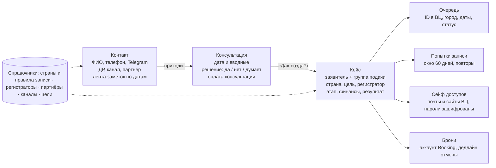
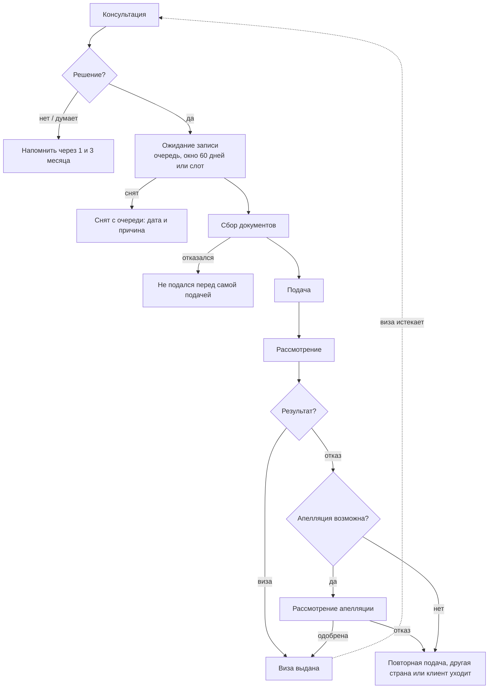

# Модуль «Клиенты»: детальная спецификация

> Экспорт из Claude Docs от 15.10.2026. Макеты экранов — в docs/prototype/.

Oct 9, 2026 · @Maksim Rubanets

Модуль заменяет семь таблиц визовика одной базой со связкой «контакт → консультации → кейсы». Две основные таблицы становятся карточками и воронкой, а пять вспомогательных — сохранёнными видами по очередям, попыткам записи и броням. Это первая часть этапа 1.

## Откуда это

У визовика сейчас две основные таблицы и пять вспомогательных, и одни и те же данные (ФИО, регистратор, даты) переписываются между ними вручную. В системе данные вводятся один раз, а «таблицы» по Польше или броням собираются из общей базы автоматически.

| Таблица сейчас | Что в ней ведётся | Что становится в системе |
| --- | --- | --- |
| Консультации | Контакты, дата, решение, число заявителей, заметки по кейсу, месяц, оплата | Контакт и его консультации с лентой заметок по датам |
| Клиенты в работе | Контакты, ДР, канал, страна, цель, регистратор, даты, результат, финансы, почты и пароли | Кейс в карточке контакта; почты и пароли — в сейф |
| Польша, Латвия, Италия | Дата постановки, ID в ВЦ, город, цель, письмо с датой, подача, снятие | Записи в лист ожидания; вид «Очередь: страна» на каждую страну |
| Франция | Номер анкеты, доступы к сайтам посольства и ВЦ, дата заявки, 60-й день, повторы | Попытки записи с окном 60 дней и счётчиком повторов |
| Букинг | Аккаунт, число броней, крайняя дата бесплатной отмены | Брони кейса; вид «Брони: ближайшие дедлайны» |

Ручные приёмы визовика становятся функциями: жёлтая заливка даты подачи — статусом и напоминанием, сводные таблицы — отчётами, счёт 60 дней — автоматическим дедлайном.

## Модель данных

В центре — контакт: на нём висят консультации и кейсы, а к кейсу привязано всё, что сейчас лежит во вспомогательных таблицах.

Кейс ведётся на одного заявителя, а семья, которая подаётся вместе, — это группа подачи из нескольких кейсов. У каждого члена семьи своя карточка, стоимость, ДР и результат.

## Контакт и консультации

Контакт создаётся на первой консультации и живёт дольше любого кейса. Если человек вернётся через 8 месяцев, визовик видит всю его историю и не переспрашивает.

### Карточка контакта

| Поле | Тип | Зачем |
| --- | --- | --- |
| ФИО | Фамилия, имя, отчество — отдельные поля; нужна фамилия или имя (+ латиницей фамилия и имя, как в паспорте) | Поиск, анкеты, шаблоны документов |
| Паспорт | Номер, личный номер, гражданство, пол, дата выдачи, срок действия, кем выдан, место рождения | Анкеты; срок проверяется по правилам страны (анкета консультации) |
| Телефон | Номер с кодом страны | Поиск, предупреждение о дубле (с 2026-11-26 номер может быть у нескольких карточек — задача 1.24) |
| Telegram | Ник или имя | Основной канал, переход в чат в один клик |
| Другой мессенджер | WhatsApp или Viber + номер | Если клиента нет в Telegram |
| Email клиента | Email | Связь, учётные записи |
| Дата рождения | Дата | Поздравления |
| Канал прихода | Список: Instagram, сарафан, партнёр, друзья, реклама… | Аналитика каналов |
| Партнёр | Ссылка на справочник | Кому платить процент, если канал «партнёр» |
| Лента заметок | Записи, дата ставится автоматически | Таймлайн по человеку вместо поля «Кейс» |
| Согласие на обработку данных | Дата подписания + файл | Визовик подписывает его с каждым клиентом; система не даст забыть |
| Договор | Номер, дата, файл | Договор заключается с каждым клиентом; на этапе 2 — генерация из шаблона |

Документы для пакета клиент может загрузить сам на страницу своего кейса (2.9): визовик отправляет ему ссылку из кейса, клиент входит по коду (он действует, пока собираются документы; на рассмотрении ссылка и код удаляются), видит список документов из чек-листа и загружает файлы к пунктам, а визовик принимает каждый или возвращает с причиной (decisions.md → «Портал клиента и вход по коду»). Эти файлы хранятся зашифрованными и удаляются через 7 дней после решения по визе.

Сканы паспортов и документов сейчас остаются только в переписке с клиентом в Telegram, в таблицы и на диски визовик их не выгружает. Система по умолчанию тоже не хранит сканы: в карточку попадают только нужные данные, например срок паспорта, а хранение файлов — отдельная опция этапа 2. Данные карточек хранятся бессрочно: это стоит прямо указать в согласии клиента, а по его просьбе карточка удаляется или обезличивается.

Карточку визовик удаляет кнопкой «Удалить карточку» — дубль, заведённый по ошибке, или по просьбе клиента. Карточка удаляется сразу со всей историей клиента: кейсами со всем, что в них есть, консультациями, заметками, учётками в сейфе, файлами согласия и договора (они удаляются и из хранилища), поездками и выданными шаблонами (decisions.md → «Удаление кейса и карточки со всем содержимым»). Перед удалением окно подтверждения списком перечисляет, что уйдёт вместе с этой карточкой, с числом: номера кейсов и их платежи с суммой, расходы, талоны, очередь, брони и остальное, консультации (сколько из них оплачено), заметки, учётки, файлы, поездки, шаблоны, паспортные данные и ответы анкеты. Под списком — что записи о карточке в журнале действий останутся и что вернуть её будет нельзя. Удаляет только красная кнопка «Удалить карточку» в этом окне, «Отмена» и Escape ничего не меняют. Пока идёт загрузка файла импорта, карточка не удаляется. Сотрудник карточки не удаляет (1.15.13, 1.15.15).

### Консультация

| Поле | Тип | Зачем |
| --- | --- | --- |
| Дата консультации | Дата | Найти диалог по дате |
| Месяц обращения | Считается из даты | Отчёт по месяцам, вручную не вводится |
| Вводные | Анкета консультации (ниже) + свободный текст | Вопросы, которые визовик и так задаёт, в одном порядке |
| Количество заявителей | Число | Сколько человек придёт в работу |
| Решение по визе | Да / Нет / Думает | Конверсия в работу |
| Канал прихода | Берётся из контакта, можно изменить | Конверсия по каналам |
| Оплата консультации | Сумма, дата, оплачено да/нет | Засчитывается в стоимость, когда бы клиент ни пришёл в работу |

- При решении «Да» кнопка «Создать кейс» создаёт кейс на каждого заявителя и объединяет их в группу подачи; страна и оплата консультации переносятся сами, цель выбирают в кейсе: она часто меняется (ответ визовика 2026-11-26).
- Заявители в форме кейса: сам клиент и те, кто уже подавался с ним в одной группе или на кого открывался кейс из его консультации; другого клиента с карточкой находят по имени («+ Заявитель с карточкой»), человека без карточки вводят по ФИО («+ Заявитель без карточки»). Кем заявитель приходится клиенту, не спрашивается: связей между клиентами в CRM нет, при желании визовик пишет это в заметках (decisions.md → «Пилот: правки визовика (2026-11-24)»).
- Пришедший на консультацию не обязательно заявитель: дочь консультируется, кейс открывается на отца. Связь видна с обеих сторон: в консультации дочери — «Открыт кейс №3 — NAUMIK MIKALAI, Польша · Ожидание записи» со ссылкой на карточку отца, в кейсе отца — «Из консультации 9 нояб. — Наумик Наталья» со ссылкой на её карточку. Консультация, по которой кейс уже открыт (в том числе в группе подачи из консультации другого члена семьи), больше не предлагает «Создать кейс»; новый кейс — кнопкой «+ Кейс». Если у заявителя уже есть кейс в работе, сайт переспрашивает: «У Кулик Никита уже есть кейс в работе: №9 Испания. Создать ещё один?» (пилот, правки 2 и 8; decisions.md → «Пилот: правки визовика»).
- Решение «Думает» ставит напоминание вернуться к клиенту через 1 и 3 месяца (сроки настраиваются).
- Повторное обращение — новая консультация в той же карточке, старые заметки остаются в ленте.

### Анкета консультации

Анкета повторяет обязательные вопросы визовика и сразу превращает ответы в проверки и подсказки. Ответы сохраняются в контакте, поэтому при повторном обращении их не нужно спрашивать заново.

Паспортные данные (номер, личный номер, даты выдачи и окончания, кем выдан, место рождения) хранятся только до решения по визе: через 7 дней после решения, если у клиента нет другого кейса в работе, они удаляются (задача 2.8, decisions.md → «Удаление паспортных данных после решения»). Ответы анкеты, гражданство, пол, ФИО и дата рождения остаются; при следующей поездке визовик вносит паспорт заново или распознаёт его (2.5).

| Вопрос | Что делает система |
| --- | --- |
| Срок действия паспорта: с … по … (вносится в блоке «Паспорт» карточки) | Проверяет правила страны из справочника: паспорт не старше 10 лет и действует ещё 3–6 месяцев после окончания визы |
| Визы за последние 5 лет: тип (Шенген, национальная, Азия, UK…), страна, цель (туризм, гостевая, учёба… — общие цели платформы), срок, куда ездили | Ведёт визовую историю контакта; новые визы из кейсов добавляются туда сами: кейс с итогом «Виза» — строка истории со страной, целью и сроком из кейса и ссылкой «Кейс №…» на него, пока в кейсе стоит этот итог (decisions.md → «Визы из кейсов в истории виз»). В карточке каждая виза — отдельной строкой («Польша · Шенген · Туризм», срок и метка «действует» или «истекла»), отказы — тоже построчно, депортация — заметным блоком с примечанием |
| Родственники или друзья за границей | Отмечает, в какой стране возможно приглашение |
| Отказы: когда, страна, причина | Предупреждает в кейсе при подаче в ту же страну |
| Депортации | Ставит отметку риска в карточке |
| Поездки в детстве по гуманитарным программам в Италию или Испанию (например, Чернобыльская программа) | Подсказка: в эти страны возможна виза по приглашению |
| Когда планируется поездка | Сравнивает со сроками получения визы по стране и показывает срочность |
| Куда планируется поездка | Помогает решить, открывать ли целевую визу |
| Сколько человек и кто поедет | Готовит группу подачи и карточки заявителей |

99% консультаций проходят онлайн. Длительность берётся из справочника стран: около часа для Великобритании, США, Австралии и Канады, 15–30 минут для Шенгена, Японии и Азии.

## Кейс в работе

Кейс — одна виза для одного заявителя: у каждого своя страна, категория, стоимость и результат, даже при семейной подаче. Члены семьи, которые подаются вместе, объединяются в группу подачи: её видно в карточке каждого (кейс, открытый отдельно, визовик добавляет в группу кнопкой «Добавить в группу» — находит члена семьи по имени и выбирает его кейс), а очередь и запись можно вести сразу для группы. Страну, место подачи, цель, регистратора, дату подачи, срок опросника и этап группа меняет вместе: правка одного кейса по умолчанию уходит всем, у кого ещё нет результата, а результат, стоимость и оплаты у каждого свои (decisions.md → «Правка группы подачи»). Семья обычно получает одинаковые визы, поэтому, когда визовик вносит или меняет результат в кейсе группы, форма предлагает отдельную отметку «Такой же результат у всех в группе: …» (включена по умолчанию, в ней названы только те, у кого результата ещё нет): итог, дата решения, данные визы и апелляция записываются в их кейсы, и эти кейсы переходят в «Результат». Кейсы, где результат уже внесён, не меняются (decisions.md → «Пилот: правки визовика (2026-11-19)», T3).

В карточке клиента каждый кейс — отдельный блок в рамке: в шапке номер, страна, цель («№9 · Испания · Туризм») и этап, внутри — всё, что относится к кейсу. Когда кейсов два и больше, над ними стоит список кейсов (номер, страна, этап), который ведёт к каждому, а кейсы с результатом при открытии карточки свёрнуты. Формы платежа, расхода, стоимости, брони и правки кейса называют кейс в заголовке («Платёж в кейс №11 · Польша»), а после сохранения или удаления сайт повторяет, в какой кейс ушла запись (decisions.md → «Пилот: правки визовика (2026-11-19)», T4).

### Основное

| Поле | Тип | Зачем |
| --- | --- | --- |
| Заявители | Один заявитель + группа подачи | Страна, категория и стоимость у каждого свои |
| Страна визы | Справочник стран | Аналитика по направлениям, правила записи |
| Цель визы | Справочник: туризм, гостевая, бизнес, учёба… | Аналитика; у каждой цели своя очередь |
| Где подаётся | Страна, город и центр подачи: Беларусь (все города с консульством или ВЦ), а также Турция, Сербия, Грузия, Армения | В каждом городе своя очередь |
| Регистратор | Справочник регистраторов | Где искать клиента и кому платить за талон |
| Этап | Этап воронки (см. «Этапы кейса») | Движение по канбану |
| Дата постановки в очередь, письмо с датой | Подтягиваются из записи в очередь | Не дублируются вручную |
| Дата подачи | Дата | Подсветка «скоро» и «подались» вместо ручной заливки |
| Документы: собрать до | Дата, по желанию; общая для группы подачи | Срок, который визовик называет клиенту для документов: от него считается напоминание «Документы не собраны», без него — от даты подачи (ответ визовика на вопрос 26, 24.11.2026) |

### Результат визы

Вместо одного списка на сотни вариантов результат состоит из пяти полей. «Мульти на 15 дней» в отчётах попадает в «многократные», а её срок виден в карточке.

| Поле | Значения |
| --- | --- |
| Итог | Виза / Отказ / Не подавался |
| Тип визы | Однократная / Двукратная / Многократная |
| Срок действия | С … по … |
| Дней пребывания | Число |
| После апелляции | Да / Нет |

В аналитике многократные визы делятся по сроку действия: до 3 месяцев, 3–12 месяцев, 1–5 лет, так что «мульти на 15 дней» не смешивается с пятилетней. Итог «Не подавался» ставится, когда клиент получил дату, но отказался перед самой подачей, или ушёл, не дождавшись даты записи: такие кейсы не теряются в воронке. Отказы сейчас — около 2–4% подач.

### Финансы

Учёт ведётся в базовой валюте визовика — валюте учёта (по умолчанию белорусские рубли; визовик выбирает её сама среди принимаемых валют на странице «Моя учётная запись» → «Валюта учёта и налог», правка пилота T8), а платежи принимаются в BYN, PLN, USD и EUR. Каждый платёж хранит сумму и валюту, курс и сумму в базовой валюте: курс — последний курс Нацбанка на сайте (через BYN, если база другая), его можно поправить. Стоимость кейса визовик называет в своей валюте кейса — BYN, PLN, USD или EUR из принимаемых (правка пилота 4, decisions.md → «Пилот: правки визовика»): в ней стоимость, предоплата, зачёт консультации и остаток. Налог, талон, выплата партнёру, расходы и прибыль — в базовой валюте, итоги и аналитика тоже.

**Смена валюты учёта** (decisions.md → «Пилот: правки визовика», T8). Всё, что визовик внесла, сохраняет свою сумму и валюту: платёж, расход, талон, стоимость кейса. Пересчитывается только то, что хранится в базовой валюте: сумма платежа, расхода и талона в базовой — из исходной суммы по последнему курсу Нацбанка на сайте, через BYN (строка уже в новой валюте — по курсу 1), курс, поправленный вручную, заменяется курсом банка; курс кейса к новой базе (стоимость остаётся в валюте кейса); фиксированная выплата партнёру переводится из старой валюты учёта в новую, с округлением один раз и не меньше 0,01. Предоплаты справочника остаются в своих валютах. Старая валюта остаётся среди принимаемых. Перед сменой страница спрашивает ещё раз. Всё — одним действием с одной записью в журнале; если на сайте нет нужного курса или идёт загрузка файла, валюта не меняется. Платёж, внесённый в ту же секунду, дожидается смены и считается уже в новой валюте.

Обычно клиент платит в два приёма: предоплата в начале работы (не по всем направлениям), остаток — по факту записи, после чего визовик отправляет талон и список документов. Сроков оплаты нет, страховку визовик не оформляет — в финансах её нет (ответы 26.10.2026).

| Поле | Как заполняется |
| --- | --- |
| Стоимость | Сколько озвучено клиенту, в валюте кейса (по умолчанию — базовая). Кейс хранит курс этой валюты к базовой: последний курс Нацбанка на сайте, можно поправить |
| Предоплата | Фиксированная сумма из справочника по стране и цели визы, в валюте кейса: если в справочнике она в другой валюте, подставляется по последнему курсу Нацбанка; можно изменить |
| Платежи клиента | Список: дата, сумма, валюта, курс, сумма в базовой валюте, оплачено официально или нет. Платёж — доход, в кейсе показан без минуса, в валюте кейса |
| Оплата консультации | Из консультации, засчитывается в стоимость |
| Остаток | В валюте кейса: стоимость − оплата консультации − платежи. Платёж в валюте кейса — как есть, в другой — его сумма в базовой валюте по курсу кейса; округление один раз. Без стоимости остаток не считается: «укажите стоимость» |
| Талон регистратору | Из прайса регистратора (страна, цель, зал) в его валюте с пересчётом в базовую валюту; списывается в расчёты с регистратором. Визовик может убрать талон, стерев его сумму: тогда он уходит и из расчётов, кейс пропадает из «Без талона» у регистратора, а прайс больше не подставляет талон; вернуть его можно суммой в форме (пилот 1.15.12) |
| Выплата партнёру | Тип условий выбирает визовик: процент, фиксированная сумма, «не платит» или «не указывать». Процент берётся от всей стоимости услуги в базовой валюте, без вычета талона и налога. Условия подставляются из справочника по партнёру и стране, в кейсе их можно изменить; отметка «выплачено». При «не указывать» CRM выплату не считает и не хранит, прибыль по кейсу показывается без неё |
| Налог | 10% от платежей, оплаченных официально (НПД), в базовой валюте; ставку визовик задаёт сама в «Моей учётной записи», 0 — без налога. Пока ставка не задана (поле пустое), кейс пишет «ставка не задана», налог не считается |
| Прочие расходы | То, за что визовик платит сам: дата, сумма, валюта. Сюда же — авиабронь: её делает и оплачивает визовик, цена уже в стоимости услуги (ответ визовика 2026-11-26). Настоящие билеты покупает клиент, это не расход визовика |
| Прибыль | В базовой валюте: стоимость (по курсу кейса) − талон − выплата партнёру − налог − прочие расходы. Без стоимости не считается: «укажите стоимость», никогда не минус из-за пустой стоимости. Это прибыль кейса целиком; в «Аналитике» прибыль за период и по месяцам считается по датам денег (раздел «Аналитика», 1.18) |

Пустые поля формы «Стоимость и условия» подставляются из справочников и консультации: предоплата, зачёт консультации (в кейсе в базовой валюте), талон, условия партнёра. Поле, которое визовик стёрла и сохранила, остаётся пустым: при следующем открытии формы оно не подставляется заново, пока визовик сама не введёт значение (пилот 1.15.12, ответ владельца 24.11.2026; decisions.md → «Пилот: правки визовика (2026-11-24)»).

## Этапы кейса

Этапы — колонки канбана: консультация, ожидание записи, сбор документов, подача, рассмотрение, результат. Документы собираются после того, как пришла дата записи; кейс переходит дальше сам, когда внесена дата или результат. Сам по себе прошедший день подачи кейс не двигает: из «Сбора документов» в «Подачу» и «Рассмотрение» визовик переводит его на шкале этапов, а через 14 дней после подачи без результата приходит напоминание «внесите результат». В «Результат» кейс попадает только с итогом визы: если перетащить его туда без итога на канбане или нажать этап на шкале, откроется форма кейса на итоге. Если итог стереть, кейс вернётся на этап по датам (decisions.md → «Аудит по скиллу crm-management»).

Кейс визовик удаляет кнопкой «Удалить кейс» в карточке кейса, сразу и вместе со всем, что в нём есть, деньгами тоже. Окно подтверждения списком перечисляет, что уйдёт: платежи клиента с суммой, расходы, талон регистратору (баланс регистратора пересчитается), отмеченную выплату партнёру, заявки, очередь, отметки пакета, брони, результат, доступ сотрудников, стоимость и условия кейса. Под списком — что останется в карточке клиента (учётки сейфа и шаблоны, выданные для этого кейса), что остальные кейсы группы подачи останутся и что вернуть кейс будет нельзя. Платёж или расход, удалённый только что, пока предлагается «Отменить», сначала удаляется и в окне не называется. Убранный в финансах талон прайс больше не подставляет (decisions.md → «Пилот: правки визовика (2026-11-24)», T12). Номер удалённого кейса больше не выдаётся; кейс из группы подачи выходит из неё. Сотрудник кейсы не удаляет (decisions.md → «Пилот: правки визовика (2026-11-19)», T1, и «Удаление кейса и карточки со всем содержимым»).

Ветки справа не теряются: «думающие» получают напоминание, а снятые с очереди и не подавшиеся остаются в аналитике. При отказе система смотрит в справочнике, принимает ли это консульство или центр апелляции в Беларуси, и ставит напоминание о сроке подачи. Если апелляция невозможна или тоже закончилась отказом, визовик выбирает повторную подачу в тот же центр (новый кейс, связанный с прошлым), другую страну или закрывает кейс.

## Очереди и попытки записи

Четыре вспомогательные таблицы по странам сводятся к двум типам записи: лист ожидания и заявка с окном. Тип и срок окна хранятся в справочнике страны, поэтому новая страна с похожими правилами добавляется настройкой, а не новой таблицей.

В лист ожидания клиента ставит регистратор в своей CRM: визовик вносит туда данные, а система регистратора отправляет их на сайт визового центра. Наша система данные в центр не отправляет: она ведёт учёт — кто, когда, через какого регистратора и под каким номером стоит в очереди.

Через регистраторов так идут Польша, Латвия и Италия. Перед постановкой визовик создаёт клиенту кабинет и загружает фото паспорта, а клиент проходит верификацию видеоселфи. Германию и страны, которые подаются через её посольство, визовик ставит в очередь сама — короткой заявкой на сайте посольства Германии. Как идёт запись по каждой стране — PRD → «Запись в Беларуси сейчас» (ответ визовика от 27.10.2026).

### Лист ожидания (Польша, Латвия, Италия, Германия, Австрия, Бельгия, Нидерланды, Люксембург, Словения)

| Поле | Зачем |
| --- | --- |
| Заявитель, кейс | Связь с карточкой |
| Страна, оператор ВЦ, город | В каждом городе своя очередь |
| Категория (цель визы) | У каждой цели свой темп очереди |
| Регистратор | В чьей CRM искать клиента |
| Дата постановки в очередь | Начало отсчёта ожидания |
| Номер в ВЦ | Вид номера задаётся страной: ID (Польша, Латвия, Италия), номер заявки (Германия, Австрия, Бельгия, Нидерланды, Люксембург, Словения), номер анкеты (Франция), имя пользователя (Греция). Называется при звонке в ВЦ |
| Статус | В очереди / Дата получена / Подан / Снят |
| Дата письма с записью | Когда письмо пришло в кабинет клиента |
| Дата подачи | Переход кейса на этап «Подача» |
| Дата и причина снятия | Клиент не дождался очереди |
| Дней ожидания | Считается: дата письма − дата постановки |
| Почта заявки | Почта, на которую создан аккаунт и отправлена заявка, и чья она: клиента, созданная визовиком или регистратора. Называется вместе с номером |
| Зал подачи | Обычный или премиум: влияет на цену талона |

Вид «Очередь: Польша» — это фильтр по стране с этими колонками. В нём видно, кто сколько ждёт, и среднее ожидание по городу и категории.

### Заявка с окном (Франция)

1. Кабинет на сайте посольства, анкета, номер анкеты.
2. Кабинет на сайте ВЦ, привязка номера анкеты, заявка на очередь.
3. Ожидание до 60 дней. Пришло письмо о назначении слота — 48 часов на онлайн-оплату сервисного сбора, после неё слот подтверждён. Не пришло — заявка удаляется.
4. Повторная отправка, если клиент хочет, — новая попытка со своим сроком. Кабинет на сайте ВЦ при этом создаётся заново, поэтому в сейфе появляется новая учётная запись.

| Поле | Зачем |
| --- | --- |
| Номер анкеты посольства | Привязка к кабинету ВЦ |
| Учётки посольства и ВЦ | Ссылки на записи в сейфе |
| Попытки | №, дата отправки, дедлайн (дата + 60 дней, считается), итог: дата пришла / истекла / отменена |
| Число попыток | Без ограничения: у коллег бывает до 6 |

За 5 дней до дедлайна и в день дедлайна визовик получает напоминание, а кнопка «Отправить повторно» создаёт следующую попытку. Позже сюда же подключится модуль слотов: для стран с прямой записью статус попытки будет обновлять мониторинг.

## Учётные записи и брони

### Сейф учётных записей

Логины и пароли переезжают из таблицы в зашифрованный сейф. Сейчас они лежат в таблице открытым текстом, и любой с доступом к ней видит доступы всех клиентов.

| Поле | Зачем |
| --- | --- |
| Система | Почта, сайт ВЦ (VFS, TLScontact, BLS…), сайт посольства, Booking |
| Заявитель, кейс | Чей это доступ |
| Логин или email | — |
| Чья почта | Клиента / резервная визовика / создана для клиента / регистратора — чтобы не забыть, на какую почту создан аккаунт |
| Пароль | Хранится зашифрованно, показывается по кнопке, каждый показ пишется в журнал |
| Создан визовиком вручную | Отметка, как сейчас в таблице |
| Доп. идентификатор | Например, имя пользователя в ВЦ Греции (2 буквы + 2 цифры) |
| Заметка | Любые особенности доступа |

- Генератор паролей учитывает требования конкретного сайта: длина и набор символов задаются в справочнике систем.
- Резервные почты визовика ведутся списком, и видно, какие аккаунты на каждой созданы.

### Брони для пакета документов

Брони ведутся по кейсу, и главное в них — крайняя дата бесплатной отмены: система следит за ней, пока документы на рассмотрении.

| Поле | Зачем |
| --- | --- |
| Кейс | Чья бронь |
| Тип | Отель / авиабронь (авиабронь делает и оплачивает визовик, её цена — расход кейса в «Прочих расходах») |
| Аккаунт Booking | Ссылка на учётку в сейфе |
| Объект и даты | Название отеля, даты проживания |
| Номер брони | Быстро найти в аккаунте |
| Крайняя дата бесплатной отмены | Главное поле для напоминаний |
| Статус | Активна / Перенесена / Отменена |

- Число броней по кейсу считается само: у визовика бывало до 11 на одну поездку.
- Вид «Брони: дедлайны» показывает все активные брони всех клиентов по ближайшей дате отмены: сразу — прошедшие и ближайшие 14 дней, остальные — по кнопке «Показать все».
- Напоминание приходит за 3 дня и за 1 день до дедлайна, если кейс ещё не дошёл до результата.
- При закрытии кейса система показывает его активные брони, чтобы ни одна не осталась неотменённой.

Авиабронь (бронь, не настоящие билеты) делает и оплачивает визовик, её цена уже в стоимости услуги; сумму визовик вносит в «Прочие расходы» кейса, у самой брони суммы нет (ответ визовика 2026-11-26). Вместо даты отмены у неё срок действия: если он заканчивается раньше даты подачи, система предупреждает. Настоящие билеты, авиа и автобусные, клиент покупает сам, в CRM их нет.

## Справочники

Справочники заменяют выпадающие списки в таблицах и хранят то, что визовик сейчас держит в голове: сколько стоит талон у регистратора и какой процент у партнёра.

| Справочник | Что хранит | Где используется |
| --- | --- | --- |
| Регистраторы | Компания или частное лицо, контакт; прайс талона по стране, цели визы и залу (обычный / премиум); расчёты | Кейс и очередь: где искать клиента, сколько и кому платить |
| Партнёры | Имя (легализатор, коллега); условия по странам на выбор визовика: процент от стоимости услуги, фиксированная сумма, не платит или не указывать | Канал прихода, выплата в финансах кейса |
| Каналы прихода | Instagram, сарафан, партнёр, друзья, реклама | Контакт, консультация, аналитика |
| Страны и правила записи | Тип записи (лист ожидания / заявка с окном / прямой слот / посольство), срок окна в днях, оператор ВЦ, города, приём апелляций в Беларуси и срок их подачи | Очереди и попытки |
| Цели визы | Туризм, гостевая, бизнес, учёба… | Кейс, очередь, аналитика |
| Системы и требования к паролям | Сайты ВЦ и посольств, правила пароля | Сейф |
| Праздники | Дата, название, шаблон поздравления | Рассылки |
| Предоплаты | Фиксированная сумма по стране и цели визы, в своей валюте (её выбирают в строке) | Финансы кейса |
| Валюты и налоги | Валюты платежей, источник курса; здесь же видны валюта учёта и ставка налога (например, НПД 10%), а меняются они в «Моей учётной записи» → «Валюта учёта и налог» | Финансы, расчёты, аналитика |

Запись, которую уже используют, не удаляется, а выключается: из списков она пропадает, а карточки и кейсы её сохраняют. Неиспользуемую можно удалить: партнёра, которого нет ни в одной карточке клиента, вместе с его условиями; регистратора, которого нет в кейсах и которому не было платежей, вместе с прайсом (decisions.md → «Партнёра и регистратора можно удалить»).

Общие для платформы — страны и операторы визовых центров: их ведёт админ. Направления (правила записи «страна визы × страна подачи») и города подачи, как и остальные справочники, у каждого визовика свои: он настраивает их сам в «Направлениях» (задача 1.20, decisions.md → «Свои направления визовика»). Когда модуль слотов начнёт записывать клиентов, платформа появится в списке регистраторов, и визовик сможет сравнить её с другими по цене и скорости.

### Расчёты с регистраторами

У каждого регистратора своя лента расчётов, и система сама считает баланс: неизрасходованный аванс или долг.

- **Оплаты.** Дата, сумма, наличные или перевод, за какие талоны: за один, за несколько сразу или авансом вперёд.
- **Списания.** Каждая запись клиента списывает цену талона из прайса регистратора по стране, цели и залу.
- **Без талона.** Кейсы регистратора, у которых в финансах нет талона, перечислены с кнопкой «Списать» по прайсу. Кейса, где визовик сама убрала талон, в списке нет.
- **Аванс.** У регистратора с авансом остаток виден сразу, а когда он подходит к концу, приходит напоминание.

## Напоминания и поздравления

Всё, что визовик сейчас держит в голове или отмечает цветом, становится напоминанием. На этапе 1 напоминания показываются внутри CRM — в блоке «Требует внимания» на главном экране и в карточке клиента; в Telegram-бот они переедут вместе с ботом визовика на этапе 4. Сообщения клиенту тоже появятся на этапе 4, через Telegram-бота клиента, и уходят, только если клиент его запустил: бот не может написать человеку первым.

| Событие | Когда | Кому |
| --- | --- | --- |
| День рождения клиента | В день, утром | Визовику — список именинников и готовый текст; клиенту — через бота, если подключён |
| Праздник (Новый год и др.) | В день праздника | Рассылка по всем или выбранным клиентам |
| Пришла дата записи | Сразу после внесения | Клиенту |
| Дата подачи | За 3 дня и накануне | Визовику и клиенту |
| Остаток не оплачен | За 3 дня до подачи | Визовику |
| 60-й день заявки (Франция) | За 5 дней и в день дедлайна | Визовику |
| Дедлайн отмены брони | За 3 дня и за 1 день, пока нет результата | Визовику |
| Клиент «Думает» | Через 1 и 3 месяца после консультации | Визовику |
| Виза клиента истекает (новое) | За 2 месяца до конца срока | Визовику — повод предложить новую визу |
| Отказ, апелляция возможна | Сразу и за 3 дня до конца срока подачи | Визовику |
| Аванс у регистратора заканчивается | Когда остаток меньше заданной суммы | Визовику |
| Консультация (1.19) | Накануне и в день консультации. После дня консультации не приходит, даже без решения: о решении напоминает только «Связаться» (правка пилота 2026-11-19) | Визовику; клиенту — через бота |
| Договорились связаться после консультации (1.19) | Только если визовик поставила дату «Связаться о решении»: в этот день, держится месяц, пока нет решения или клиент «думает»; после этого дня — «просрочено» | Визовику |
| Договор не подписан (1.19) | Через 3 дня после открытия кейса, держится месяц | Визовику; клиенту — через бота |
| Опросник для анкеты не вернули (1.19) | Накануне срока и в день срока, потом — пока не получен | Визовику; клиенту — через бота |
| Остаток не оплачен после постановки в очередь (1.19) | В день постановки, пока не оплачен; перед подачей его сменяет «Остаток не оплачен» | Визовику; клиенту — через бота |
| Документы не собраны (2.3) | За 7 дней и накануне подачи, пока пакет неполный. Если в кейсе стоит дата «Документы: собрать до» (ответ на вопрос 26, 24.11.2026) — за 7 дней и накануне этой даты, а после неё — «просрочено», пока пакет неполный и день подачи не прошёл; если подача раньше этой даты — от дня подачи | Визовику; клиенту — через бота |
| Результат не внесён (аудит 2026-11-18) | Через 14 дней после подачи, пока не внесён итог визы: решение обычно приходит через 2 недели (ответ визовика на вопрос 34, 24.11.2026). Без отметки «сегодня» или «просрочено» и после напоминаний с настоящим сроком: 14 дней — догадка CRM, а не срок (ответ владельца 2026-11-20) | Визовику |
| Паспортные данные удалятся (2.8) | За 2 дня до удаления, то есть через 5 дней после решения по визе, если у клиента нет кейса в работе; не раньше дня, когда результат внесли. Кнопки «Отложить на 30 дней» и «Удалить сейчас» вместо «Готово». В первый запуск — сразу с дня выпуска, срок — выпуск + 14 дней | Визовику и сотруднику, если клиент из его кейса |
| Началась раздача слотов | Когда визовик о ней узнала | Клиентам в очереди страны — рассылкой (этап 4) |

Сроки в таблице — настройки по умолчанию, визовик меняет их у себя в настройках. Строки с номером задачи добавлены по ответу визовика 26.10.2026 — о чём она сейчас напоминает клиентам вручную (decisions.md → «Напоминания клиентам»); сроков оплаты она не ставит. Сроки она хочет выставлять сама (ответ на вопрос 26, 24.11.2026): срок опросника и срок документов — даты в кейсе, остальное — в настройках напоминаний.

## Картотека и главный экран

Клиенты и их ведение — центр этапа 1, а главный экран отвечает на вопрос «что сделать сегодня» и ведёт в карточку в один клик. Макеты всех четырёх экранов — в [docs/prototype/](prototype/README.md).

**Картотека.** Вкладки «Все», «В работе», «Консультации», «Думают», «Архив»; поиск по имени (слова ФИО в любом порядке: «Дарья Ковальчук» находит «Ковальчук Дарья»), телефону, Telegram и ID в ВЦ; фильтры по стране, этапу, каналу и регистратору; вид списком или канбаном по этапам кейса. Клиент, из чьей консультации открыт кейс на другого человека, идёт вместе с этим кейсом: во вкладке «В работе» с его этапом и меткой «Кейс открыт: NAUMIK MIKALAI», пока у кейса нет результата, потом в «Архиве»; в канбане — одна карточка кейса с подписью «через Наумик Наталья» (определения вкладок — decisions.md → «Картотека» и «Пилот: правки визовика», T2).

| Виджет главного экрана | Что показывает | Куда ведёт |
| --- | --- | --- |
| Показатели | Клиенты в работе, консультации месяца с конверсией, подачи на неделе, в очередях, долг клиентов, к выплате | Картотека или аналитика |
| Требует внимания | Подачи завтра, 60-й день, оплаты, дни рождения, дедлайны броней, «думающие» | Карточка клиента |
| Ближайшие подачи | Дата, клиент, страна, центр, готовность документов, остаток | Карточка клиента |
| Воронка месяца | Консультации → решили → в очереди → подали → виза | Аналитика |
| Очереди | Сколько людей ждёт по странам и среднее ожидание | Очереди и записи |

## Аналитика

Аналитика входит в этап 1: визовик уже сейчас считает её сводными таблицами, а в системе отчёты строятся сами из данных карточек.

| Отчёт | Что показывает |
| --- | --- |
| Каналы прихода (маркетинговая воронка) | Консультации → кейсы → визы → прибыль по каждому каналу и партнёру: сколько людей с таргета дошло до работы против сарафана; позже — расходы канала и стоимость клиента (4.8) |
| Консультации по месяцам | Обращения и переход в работу |
| Подачи и выдачи по странам | Подачи, визы, отказы, апелляции, «не подались», многократные визы по сроку, срок рассмотрения |
| Визовые центры и консульства | Подачи, ожидание записи, срок до паспорта, замечания визовика по центру |
| Очереди | Среднее ожидание и разброс по стране, городу и категории; сколько снялось |
| Финансы | Прибыль за период и по месяцам — деньги, которые пришли и ушли в этом месяце (1.18, ниже), долги клиентов, к выплате регистраторам и партнёрам |
| Заявители | Сколько людей, а не только кейсов, пришло в работу |

**Прибыль за период и по месяцам** (1.18; ответ визовика 26.11.2026: «чётко по приходам и оплатам всего»; decisions.md → «Ответы визовика (2026-11-26)»). Прибыль месяца в валюте учёта — деньги, которые в этом месяце пришли, минус деньги, которые в этом месяце ушли. Каждая сумма попадает в месяц своей даты, а стоимость кейса и день подачи в этом расчёте не участвуют.

| Что | Сумма | В каком месяце |
| --- | --- | --- |
| Платёж клиента (+) | Сумма платежа в валюте учёта | Дата платежа |
| Зачёт консультации (+) | Зачёт из финансов кейса по курсу кейса | Дата оплаты консультации, из которой открыт кейс; если её нет — день консультации; у кейса без консультации — день открытия кейса |
| Талон регистратору (−) | Сумма талона в валюте учёта, и у талона «оплачен до CRM» | Дата талона |
| Выплата партнёру (−) | По условиям кейса: процент от стоимости в валюте учёта или фикс | Дата, которой выплата отмечена выплаченной. Не выплаченная не входит ни в один месяц: она в «К выплате партнёрам» |
| Налог (−) | Ставка кабинета × официальные платежи месяца, округление один раз на месяц. Пока ставка не задана, налог не вычитается; с зачёта консультации налога нет | Месяц официального платежа |
| Прочий расход (−) | Сумма расхода в валюте учёта | Дата расхода |

- Пример: стоимость 1000, предоплата 200 в марте, остаток 800 и талон 150 в мае — март +200, май +650.
- Месяц может быть в минусе: талон оплачен в мае, клиент заплатил в июне — май −150, июнь +800. На экране это число с минусом и пустая полоса.
- Кейс без стоимости считается так же, по датам своих денег. Процент партнёру у такого кейса посчитать не из чего, он не вычитается; фикс вычитается.
- Консультация, после которой кейс не открыли, и оплата консультации, не засчитанная в кейс, в прибыль не входят.
- Итог периода равен сумме его месяцев. Фильтр по стране берёт деньги кейсов с этой страной визы. Сотрудник видит прибыль только по выданным ему кейсам. Без модуля «Финансы кейсов» прибыли нет.
- Прошлый месяц может измениться задним числом: консультация оплачена в марте, кейс с зачётом открыт в июне — вырастет март; выплату партнёру отметили прошедшей датой — уменьшится тот месяц; стоимость кейса внесли после того, как процент партнёру отмечен выплаченным, — процент появится в месяце выплаты; кейс удалили — его деньги уйдут из всех месяцев.
- Сотрудник, которому выдан кейс, но не видна консультация, из которой он открыт (консультировался не заявитель, а, например, его мать), видит зачёт этого кейса в месяце открытия кейса, а не оплаты консультации. Сумма та же (open-questions.md → «По продукту»).

Прибыль каналов и партнёров считается иначе: это прибыль кейсов, открытых из консультаций периода, целиком (стоимость − талон − выплата партнёру − налог − расходы, блок «Финансы» кейса), когда бы ни пришли деньги. Подачи, визы и одобрение — по дню подачи.

Плана на месяц визовик не ставит: аналитикой она смотрит число клиентов, каналы прихода и прибыльность (ответ 26.10.2026). Выгрузка отчётов в Excel — эпик 4.9.

Одобрение считается по стране: решение принимает консульство, а визовый центр влияет на запись и сроки. Позже платформа сможет показывать обезличенную сводку по всем визовикам; для этого нужно согласие визовиков в условиях сервиса. Данные очередей пригодятся модулю слотов для прогноза ожидания.

## Импорт из текущих таблиц

> С задачи 1.21 импорт принимает только формат VisaCRM ([data-format.md](data-format.md)): свои таблицы визовик переводит в него с ИИ по универсальному промту ([import-prompt.md](import-prompt.md)), а правила чтения ячеек из пунктов ниже переезжают в промт (decisions.md → «Формат данных VisaCRM»).

Первая функция модуля — загрузка семи таблиц визовика: без неё она будет вести две системы параллельно. Импорт визовик запускает сам, без админа: так же свои таблицы будут переносить новые визовики на этапе SaaS (этап 3).

1. Загрузка файла XLSX, CSV или TSV (выгрузка из Google Таблиц).
2. Сопоставление колонок с полями системы; сопоставление запоминается для следующих загрузок.
3. Склейка дублей: один человек из «Консультаций» и «Клиентов в работе» становится одним контактом по телефону, нику Telegram или ФИО; пометки после ФИО («(коллега Анны)», «от Ольги») уходят в заметку карточки.
4. Таблицы Польши, Латвии и Италии становятся записями в очередь, Франции — попытками (с повторными заявками и «не ставим»), букинг — бронями.
5. Пароли переходят в сейф; после проверки импорта система предлагает удалить их из Google Таблиц.
6. Отчёт об импорте: сколько строк загружено, какие пропущены и почему, где значение прочитано с догадкой (дата без года, только месяц).
7. Талоны и выплаты партнёрам из таблиц — как уже оплаченные: в прибыли они есть, долга регистраторам в расчётах не создают (решение 2026-10-18).

Пока идёт переход, импорт можно запускать повторно: уже загруженные строки обновляются, а не дублируются.

## Открытые вопросы к визовику

Ответы нужны до проектирования экранов: они меняют поля и формулы.

- [x] Регистраторы — это сторонние люди или компании, которые ставят клиентов в очередь? Оплата им идёт за каждый талон или пакетом? Ответ: и компании, и частные лица; оплата за талон, пачкой или из аванса; цена зависит от страны, цели и зала.
- [x] Семья: одна стоимость на всю семью или отдельная на каждого заявителя? Ответ: у каждого своя карточка и стоимость.
- [x] Валюта: в чём озвучивается стоимость и платятся талоны и партнёрские проценты — одна валюта или несколько? Ответ: платят в BYN, PLN, USD, EUR, учёт в BYN.
- [x] Процент партнёру считается от полной стоимости или от прибыли? Ответ: по-разному по странам — от выручки, от прибыли или фикс.
- [x] Оплата консультации засчитывается всегда или только если клиент пришёл в работу в какой-то срок? Ответ: всегда, даже через полгода.
- [x] Этапы кейса на схеме совпадают с реальной работой? Что добавить или убрать? Ответ: документы — после записи, плюс ветка апелляции; схема обновлена.
- [x] «Польша с 08.06» и «Латвия с 17.08» — это дата старта таблицы или дата, с которой страна перешла на лист ожидания? Ответ: дата перехода страны на лист ожидания, только для памяти.
- [ ] Для теста импорта нужна копия таблиц без паролей и с изменёнными личными данными — структура важнее содержимого. _Структура получена 18.10.2026 (описание с вымышленными примерами), импорт доработан под неё (1.16); копии самих таблиц — до пилота._

* [x] Процент партнёру «от прибыли» считается до или после налога и авиаброней? Ответ: от всей стоимости услуги, без вычетов. Авиабронь делает визовик, это расход кейса (ответ 2026-11-26), на процент он не влияет.
* [x] Курс для пересчёта: по Нацбанку на дату платежа подходит или нужен курс обмена, по которому вы реально меняете? Ответ: на этапе 1 считаем по курсу Нацбанка, реальный курс обмена — позже.
