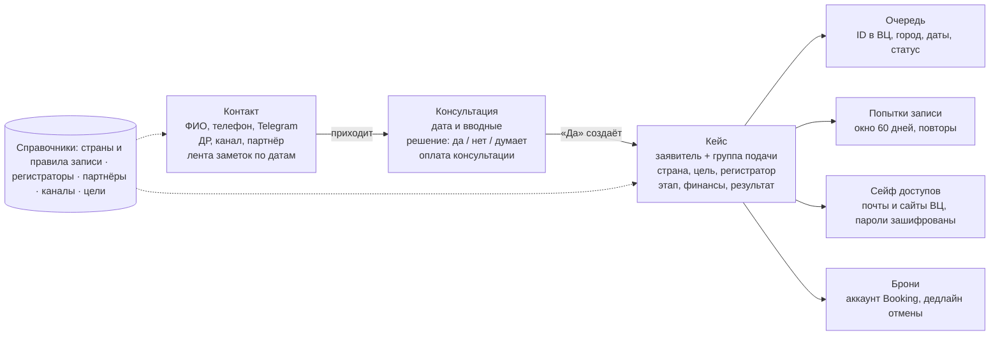
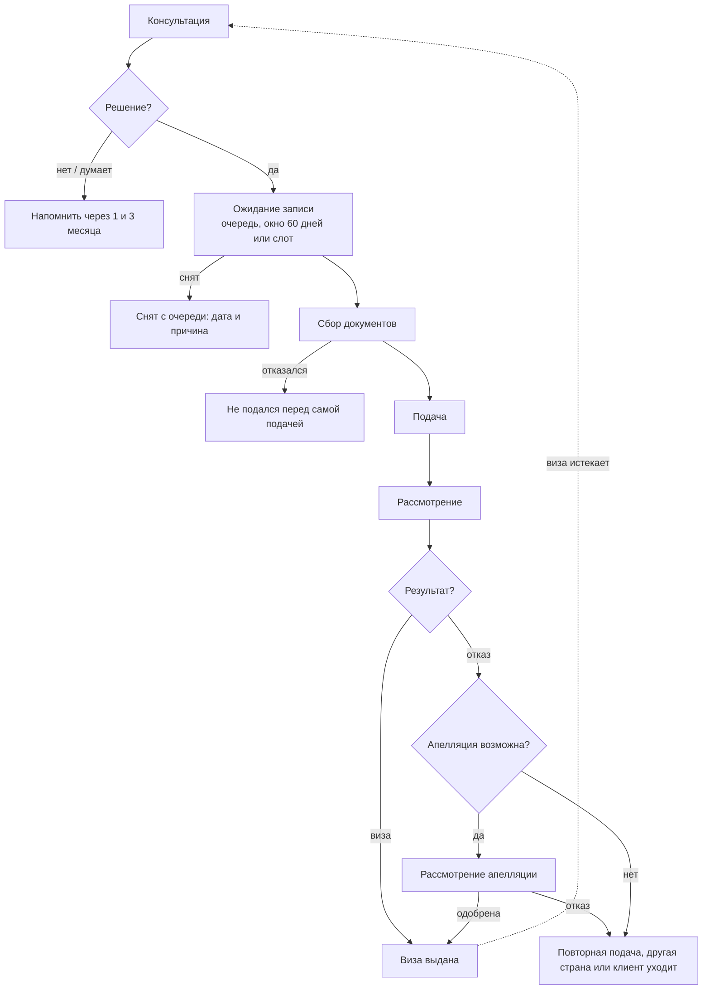

# Модуль «Клиенты»: детальная спецификация

> Экспорт из Claude Docs от 15.10.2026. Макеты экранов — в docs/prototype/.

Oct 9, 2026 · @Maksim Rubanets

Модуль заменяет семь таблиц визовика одной базой со связкой «контакт → консультации → кейсы». Две основные таблицы становятся карточками и воронкой, а пять вспомогательных — сохранёнными видами по очередям, попыткам записи и броням. Это первая часть этапа 1.

## Откуда это

У визовика сейчас две основные таблицы и пять вспомогательных, и одни и те же данные (ФИО, регистратор, даты) переписываются между ними вручную. В системе данные вводятся один раз, а «таблицы» по Польше или броням собираются из общей базы автоматически.

| Таблица сейчас | Что в ней ведётся | Что становится в системе |
| --- | --- | --- |
| Консультации | Контакты, дата, решение, число заявителей, заметки по кейсу, месяц, оплата | Контакт и его консультации с лентой заметок по датам |
| Клиенты в работе | Контакты, ДР, канал, страна, цель, регистратор, даты, результат, финансы, почты и пароли | Кейс в карточке контакта; почты и пароли — в сейф |
| Польша, Латвия, Италия | Дата постановки, ID в ВЦ, город, цель, письмо с датой, подача, снятие | Записи в лист ожидания; вид «Очередь: страна» на каждую страну |
| Франция | Номер анкеты, доступы к сайтам посольства и ВЦ, дата заявки, 60-й день, повторы | Попытки записи с окном 60 дней и счётчиком повторов |
| Букинг | Аккаунт, число броней, крайняя дата бесплатной отмены | Брони кейса; вид «Брони: ближайшие дедлайны» |

Ручные приёмы визовика становятся функциями: жёлтая заливка даты подачи — статусом и напоминанием, сводные таблицы — отчётами, счёт 60 дней — автоматическим дедлайном.

## Модель данных

В центре — контакт: на нём висят консультации и кейсы, а к кейсу привязано всё, что сейчас лежит во вспомогательных таблицах.

Кейс ведётся на одного заявителя, а семья, которая подаётся вместе, — это группа подачи из нескольких кейсов. У каждого члена семьи своя карточка, стоимость, ДР и результат.

## Контакт и консультации

Контакт создаётся на первой консультации и живёт дольше любого кейса. Если человек вернётся через 8 месяцев, визовик видит всю его историю и не переспрашивает.

### Карточка контакта

| Поле | Тип | Зачем |
| --- | --- | --- |
| ФИО | Фамилия, имя, отчество — отдельные поля; нужна фамилия или имя (+ латиницей фамилия и имя, как в паспорте) | Поиск, анкеты, шаблоны документов |
| Паспорт | Номер, личный номер, гражданство, пол, дата выдачи, срок действия, кем выдан, место рождения | Анкеты; срок проверяется по правилам страны (анкета консультации) |
| Телефон | Номер с кодом страны | Поиск, защита от дублей |
| Telegram | Ник или имя | Основной канал, переход в чат в один клик |
| Другой мессенджер | WhatsApp или Viber + номер | Если клиента нет в Telegram |
| Email клиента | Email | Связь, учётные записи |
| Дата рождения | Дата | Поздравления |
| Канал прихода | Список: Instagram, сарафан, партнёр, друзья, реклама… | Аналитика каналов |
| Партнёр | Ссылка на справочник | Кому платить процент, если канал «партнёр» |
| Связанные контакты | Ссылки | Семья, кто кого привёл |
| Лента заметок | Записи, дата ставится автоматически | Таймлайн по человеку вместо поля «Кейс» |
| Согласие на обработку данных | Дата подписания + файл | Визовик подписывает его с каждым клиентом; система не даст забыть |
| Договор | Номер, дата, файл | Договор заключается с каждым клиентом; на этапе 2 — генерация из шаблона |

Сканы паспортов и документов сейчас остаются только в переписке с клиентом в Telegram, в таблицы и на диски визовик их не выгружает. Система по умолчанию тоже не хранит сканы: в карточку попадают только нужные данные, например срок паспорта, а хранение файлов — отдельная опция этапа 2. Данные карточек хранятся бессрочно: это стоит прямо указать в согласии клиента, а по его просьбе карточка удаляется или обезличивается.

### Консультация

| Поле | Тип | Зачем |
| --- | --- | --- |
| Дата консультации | Дата | Найти диалог по дате |
| Месяц обращения | Считается из даты | Отчёт по месяцам, вручную не вводится |
| Вводные | Анкета консультации (ниже) + свободный текст | Вопросы, которые визовик и так задаёт, в одном порядке |
| Количество заявителей | Число | Сколько человек придёт в работу |
| Решение по визе | Да / Нет / Думает | Конверсия в работу |
| Канал прихода | Берётся из контакта, можно изменить | Конверсия по каналам |
| Оплата консультации | Сумма, дата, оплачено да/нет | Засчитывается в стоимость, когда бы клиент ни пришёл в работу |

- При решении «Да» кнопка «Создать кейс» создаёт кейс на каждого заявителя и объединяет их в группу подачи; страна, цель и оплата консультации переносятся сами.
- Решение «Думает» ставит напоминание вернуться к клиенту через 1 и 3 месяца (сроки настраиваются).
- Повторное обращение — новая консультация в той же карточке, старые заметки остаются в ленте.

### Анкета консультации

Анкета повторяет обязательные вопросы визовика и сразу превращает ответы в проверки и подсказки. Ответы сохраняются в контакте, поэтому при повторном обращении их не нужно спрашивать заново.

| Вопрос | Что делает система |
| --- | --- |
| Срок действия паспорта: с … по … (вносится в блоке «Паспорт» карточки) | Проверяет правила страны из справочника: паспорт не старше 10 лет и действует ещё 3–6 месяцев после окончания визы |
| Визы за последние 5 лет: тип (Шенген, национальная, Азия, UK…), страна, срок, куда ездили | Ведёт визовую историю контакта; новые визы из кейсов добавляются туда сами |
| Родственники или друзья за границей | Отмечает, в какой стране возможно приглашение |
| Отказы: когда, страна, причина | Предупреждает в кейсе при подаче в ту же страну |
| Депортации | Ставит отметку риска в карточке |
| Поездки в детстве по гуманитарным программам в Италию или Испанию (например, Чернобыльская программа) | Подсказка: в эти страны возможна виза по приглашению |
| Когда планируется поездка | Сравнивает со сроками получения визы по стране и показывает срочность |
| Куда планируется поездка | Помогает решить, открывать ли целевую визу |
| Сколько человек и кто поедет | Готовит группу подачи и карточки заявителей |

99% консультаций проходят онлайн. Длительность берётся из справочника стран: около часа для Великобритании, США, Австралии и Канады, 15–30 минут для Шенгена, Японии и Азии.

## Кейс в работе

Кейс — одна виза для одного заявителя: у каждого своя страна, категория, стоимость и результат, даже при семейной подаче. Члены семьи, которые подаются вместе, объединяются в группу подачи: её видно в карточке каждого, а очередь и запись можно вести сразу для группы.

### Основное

| Поле | Тип | Зачем |
| --- | --- | --- |
| Заявители | Один заявитель + группа подачи | Страна, категория и стоимость у каждого свои |
| Страна визы | Справочник стран | Аналитика по направлениям, правила записи |
| Цель визы | Справочник: туризм, гостевая, бизнес, учёба… | Аналитика; у каждой цели своя очередь |
| Где подаётся | Страна, город и центр подачи: Беларусь (все города с консульством или ВЦ), а также Турция, Сербия, Грузия, Армения | В каждом городе своя очередь |
| Регистратор | Справочник регистраторов | Где искать клиента и кому платить за талон |
| Этап | Этап воронки (см. «Этапы кейса») | Движение по канбану |
| Дата постановки в очередь, письмо с датой | Подтягиваются из записи в очередь | Не дублируются вручную |
| Дата подачи | Дата | Подсветка «скоро» и «подались» вместо ручной заливки |

### Результат визы

Вместо одного списка на сотни вариантов результат состоит из пяти полей. «Мульти на 15 дней» в отчётах попадает в «многократные», а её срок виден в карточке.

| Поле | Значения |
| --- | --- |
| Итог | Виза / Отказ / Не подавался |
| Тип визы | Однократная / Двукратная / Многократная |
| Срок действия | С … по … |
| Дней пребывания | Число |
| После апелляции | Да / Нет |

В аналитике многократные визы делятся по сроку действия: до 3 месяцев, 3–12 месяцев, 1–5 лет, так что «мульти на 15 дней» не смешивается с пятилетней. Итог «Не подавался» ставится, когда клиент получил дату, но отказался перед самой подачей: такие кейсы не теряются в воронке. Отказы сейчас — около 2–4% подач.

### Финансы

Учёт ведётся в базовой валюте визовика (сейчас это белорусские рубли), а платежи принимаются в BYN, PLN, USD и EUR. Каждый платёж хранит сумму и валюту, курс и сумму в рублях: курс подставляется по Нацбанку на дату платежа, его можно поправить. Поэтому долги и прибыль, как и сейчас, всегда в одной валюте, только пересчёт делает система.

Обычно клиент платит в два приёма: предоплата в начале работы (не по всем направлениям), остаток — по факту записи, после чего визовик отправляет талон и список документов. Сроков оплаты нет, страховку визовик не оформляет — в финансах её нет (ответы 26.10.2026).

| Поле | Как заполняется |
| --- | --- |
| Стоимость | Вводится в базовой валюте: сколько озвучено клиенту |
| Предоплата | Фиксированная сумма из справочника по стране и цели визы, можно изменить |
| Платежи клиента | Список: дата, сумма, валюта, курс, сумма в BYN, оплачено официально или нет |
| Оплата консультации | Из консультации, засчитывается в стоимость |
| Остаток | Стоимость − оплата консультации − платежи (в BYN) |
| Талон регистратору | Из прайса регистратора (страна, цель, зал) в его валюте с пересчётом в BYN; списывается в расчёты с регистратором |
| Выплата партнёру | Тип условий выбирает визовик: процент, фиксированная сумма, «не платит» или «не указывать». Процент берётся от всей стоимости услуги, без вычета талона и налога. Условия подставляются из справочника по партнёру и стране, в кейсе их можно изменить; отметка «выплачено». При «не указывать» CRM выплату не считает и не хранит, прибыль по кейсу показывается без неё |
| Налог | 10% от платежей, оплаченных официально (НПД); ставка задаётся в настройках визовика |
| Прочие расходы | То, за что визовик платит сам: дата, сумма, валюта. Авиабронь делает и оплачивает клиент, это не расход визовика |
| Прибыль | Стоимость − талон − выплата партнёру − налог − прочие расходы |

## Этапы кейса

Этапы — колонки канбана: консультация, ожидание записи, сбор документов, подача, рассмотрение, результат. Документы собираются после того, как пришла дата записи; кейс переходит дальше сам, когда внесена дата или результат.

Ветки справа не теряются: «думающие» получают напоминание, а снятые с очереди и не подавшиеся остаются в аналитике. При отказе система смотрит в справочнике, принимает ли это консульство или центр апелляции в Беларуси, и ставит напоминание о сроке подачи. Если апелляция невозможна или тоже закончилась отказом, визовик выбирает повторную подачу в тот же центр (новый кейс, связанный с прошлым), другую страну или закрывает кейс.

## Очереди и попытки записи

Четыре вспомогательные таблицы по странам сводятся к двум типам записи: лист ожидания и заявка с окном. Тип и срок окна хранятся в справочнике страны, поэтому новая страна с похожими правилами добавляется настройкой, а не новой таблицей.

В лист ожидания клиента ставит регистратор в своей CRM: визовик вносит туда данные, а система регистратора отправляет их на сайт визового центра. Наша система данные в центр не отправляет: она ведёт учёт — кто, когда, через какого регистратора и под каким номером стоит в очереди.

Через регистраторов так идут Польша, Латвия и Италия. Перед постановкой визовик создаёт клиенту кабинет и загружает фото паспорта, а клиент проходит верификацию видеоселфи. Германию и страны, которые подаются через её посольство, визовик ставит в очередь сама — короткой заявкой на сайте посольства Германии. Как идёт запись по каждой стране — PRD → «Запись в Беларуси сейчас» (ответ визовика от 27.10.2026).

### Лист ожидания (Польша, Латвия, Италия, Германия, Австрия, Бельгия, Нидерланды, Люксембург, Словения)

| Поле | Зачем |
| --- | --- |
| Заявитель, кейс | Связь с карточкой |
| Страна, оператор ВЦ, город | В каждом городе своя очередь |
| Категория (цель визы) | У каждой цели свой темп очереди |
| Регистратор | В чьей CRM искать клиента |
| Дата постановки в очередь | Начало отсчёта ожидания |
| Номер в ВЦ | Вид номера задаётся страной: ID (Польша, Латвия, Италия), номер заявки (Германия, Австрия, Бельгия, Нидерланды, Люксембург, Словения), номер анкеты (Франция), имя пользователя (Греция). Называется при звонке в ВЦ |
| Статус | В очереди / Дата получена / Подан / Снят |
| Дата письма с записью | Когда письмо пришло в кабинет клиента |
| Дата подачи | Переход кейса на этап «Подача» |
| Дата и причина снятия | Клиент не дождался очереди |
| Дней ожидания | Считается: дата письма − дата постановки |
| Почта заявки | Почта, на которую создан аккаунт и отправлена заявка, и чья она: клиента, созданная визовиком или регистратора. Называется вместе с номером |
| Зал подачи | Обычный или премиум: влияет на цену талона |

Вид «Очередь: Польша» — это фильтр по стране с этими колонками. В нём видно, кто сколько ждёт, и среднее ожидание по городу и категории.

### Заявка с окном (Франция)

1. Кабинет на сайте посольства, анкета, номер анкеты.
2. Кабинет на сайте ВЦ, привязка номера анкеты, заявка на очередь.
3. Ожидание до 60 дней. Пришло письмо о назначении слота — 48 часов на онлайн-оплату сервисного сбора, после неё слот подтверждён. Не пришло — заявка удаляется.
4. Повторная отправка, если клиент хочет, — новая попытка со своим сроком. Кабинет на сайте ВЦ при этом создаётся заново, поэтому в сейфе появляется новая учётная запись.

| Поле | Зачем |
| --- | --- |
| Номер анкеты посольства | Привязка к кабинету ВЦ |
| Учётки посольства и ВЦ | Ссылки на записи в сейфе |
| Попытки | №, дата отправки, дедлайн (дата + 60 дней, считается), итог: дата пришла / истекла / отменена |
| Число попыток | Без ограничения: у коллег бывает до 6 |

За 5 дней до дедлайна и в день дедлайна визовик получает напоминание, а кнопка «Отправить повторно» создаёт следующую попытку. Позже сюда же подключится модуль слотов: для стран с прямой записью статус попытки будет обновлять мониторинг.

## Учётные записи и брони

### Сейф учётных записей

Логины и пароли переезжают из таблицы в зашифрованный сейф. Сейчас они лежат в таблице открытым текстом, и любой с доступом к ней видит доступы всех клиентов.

| Поле | Зачем |
| --- | --- |
| Система | Почта, сайт ВЦ (VFS, TLScontact, BLS…), сайт посольства, Booking |
| Заявитель, кейс | Чей это доступ |
| Логин или email | — |
| Чья почта | Клиента / резервная визовика / создана для клиента / регистратора — чтобы не забыть, на какую почту создан аккаунт |
| Пароль | Хранится зашифрованно, показывается по кнопке, каждый показ пишется в журнал |
| Создан визовиком вручную | Отметка, как сейчас в таблице |
| Доп. идентификатор | Например, имя пользователя в ВЦ Греции (2 буквы + 2 цифры) |
| Заметка | Любые особенности доступа |

- Генератор паролей учитывает требования конкретного сайта: длина и набор символов задаются в справочнике систем.
- Резервные почты визовика ведутся списком, и видно, какие аккаунты на каждой созданы.

### Брони для пакета документов

Брони ведутся по кейсу, и главное в них — крайняя дата бесплатной отмены: система следит за ней, пока документы на рассмотрении.

| Поле | Зачем |
| --- | --- |
| Кейс | Чья бронь |
| Тип | Отель / авиабронь клиента |
| Аккаунт Booking | Ссылка на учётку в сейфе |
| Объект и даты | Название отеля, даты проживания |
| Номер брони | Быстро найти в аккаунте |
| Крайняя дата бесплатной отмены | Главное поле для напоминаний |
| Статус | Активна / Перенесена / Отменена |

- Число броней по кейсу считается само: у визовика бывало до 11 на одну поездку.
- Вид «Брони: дедлайны» показывает все активные брони всех клиентов по ближайшей дате отмены: сразу — прошедшие и ближайшие 14 дней, остальные — по кнопке «Показать все».
- Напоминание приходит за 3 дня и за 1 день до дедлайна, если кейс ещё не дошёл до результата.
- При закрытии кейса система показывает его активные брони, чтобы ни одна не осталась неотменённой.

Авиабронь делает и оплачивает клиент, визовик только вносит её в кейс. Вместо даты отмены у неё срок действия: если он заканчивается раньше даты подачи, система предупреждает.

## Справочники

Справочники заменяют выпадающие списки в таблицах и хранят то, что визовик сейчас держит в голове: сколько стоит талон у регистратора и какой процент у партнёра.

| Справочник | Что хранит | Где используется |
| --- | --- | --- |
| Регистраторы | Компания или частное лицо, контакт; прайс талона по стране, цели визы и залу (обычный / премиум); расчёты | Кейс и очередь: где искать клиента, сколько и кому платить |
| Партнёры | Имя (легализатор, коллега); условия по странам на выбор визовика: процент от стоимости услуги, фиксированная сумма, не платит или не указывать | Канал прихода, выплата в финансах кейса |
| Каналы прихода | Instagram, сарафан, партнёр, друзья, реклама | Контакт, консультация, аналитика |
| Страны и правила записи | Тип записи (лист ожидания / заявка с окном / прямой слот / посольство), срок окна в днях, оператор ВЦ, города, приём апелляций в Беларуси и срок их подачи | Очереди и попытки |
| Цели визы | Туризм, гостевая, бизнес, учёба… | Кейс, очередь, аналитика |
| Системы и требования к паролям | Сайты ВЦ и посольств, правила пароля | Сейф |
| Праздники | Дата, название, шаблон поздравления | Рассылки |
| Предоплаты | Фиксированная сумма по стране и цели визы | Финансы кейса |
| Валюты и налоги | Базовая валюта (сейчас BYN), валюты платежей, источник курса, налоговый режим и ставка (сейчас НПД 10%) | Финансы, расчёты, аналитика |

Справочник стран и правил записи общий для платформы: его ведёт админ и обновляет AI-агент. Остальные справочники у каждого визовика свои. Когда модуль слотов начнёт записывать клиентов, платформа появится в списке регистраторов, и визовик сможет сравнить её с другими по цене и скорости.

### Расчёты с регистраторами

У каждого регистратора своя лента расчётов, и система сама считает баланс: неизрасходованный аванс или долг.

- **Оплаты.** Дата, сумма, наличные или перевод, за какие талоны: за один, за несколько сразу или авансом вперёд.
- **Списания.** Каждая запись клиента списывает цену талона из прайса регистратора по стране, цели и залу.
- **Аванс.** У регистратора с авансом остаток виден сразу, а когда он подходит к концу, приходит напоминание.

## Напоминания и поздравления

Всё, что визовик сейчас держит в голове или отмечает цветом, становится напоминанием. На этапе 1 напоминания показываются внутри CRM — в блоке «Требует внимания» на главном экране и в карточке клиента; в Telegram-бот они переедут вместе с ботом визовика на этапе 4. Сообщения клиенту тоже появятся на этапе 4, через Telegram-бота клиента, и уходят, только если клиент его запустил: бот не может написать человеку первым.

| Событие | Когда | Кому |
| --- | --- | --- |
| День рождения клиента | В день, утром | Визовику — список именинников и готовый текст; клиенту — через бота, если подключён |
| Праздник (Новый год и др.) | В день праздника | Рассылка по всем или выбранным клиентам |
| Пришла дата записи | Сразу после внесения | Клиенту |
| Дата подачи | За 3 дня и накануне | Визовику и клиенту |
| Остаток не оплачен | За 3 дня до подачи | Визовику |
| 60-й день заявки (Франция) | За 5 дней и в день дедлайна | Визовику |
| Дедлайн отмены брони | За 3 дня и за 1 день, пока нет результата | Визовику |
| Клиент «Думает» | Через 1 и 3 месяца после консультации | Визовику |
| Виза клиента истекает (новое) | За 2 месяца до конца срока | Визовику — повод предложить новую визу |
| Отказ, апелляция возможна | Сразу и за 3 дня до конца срока подачи | Визовику |
| Аванс у регистратора заканчивается | Когда остаток меньше заданной суммы | Визовику |
| Консультация (1.19) | Накануне и в день консультации | Визовику; клиенту — через бота |
| Договорились связаться после консультации (1.19) | В условленный день, держится месяц, пока нет решения | Визовику |
| Договор не подписан (1.19) | Через 3 дня после открытия кейса, держится месяц | Визовику; клиенту — через бота |
| Опросник для анкеты не вернули (1.19) | Накануне срока и в день срока, потом — пока не получен | Визовику; клиенту — через бота |
| Остаток не оплачен после постановки в очередь (1.19) | В день постановки, пока не оплачен; перед подачей его сменяет «Остаток не оплачен» | Визовику; клиенту — через бота |
| Документы не собраны (2.3) | Перед подачей, если пакет неполный | Визовику; клиенту — через бота |
| Началась раздача слотов | Когда визовик о ней узнала | Клиентам в очереди страны — рассылкой (этап 4) |

Сроки в таблице — настройки по умолчанию, визовик меняет их у себя в настройках. Строки с номером задачи добавлены по ответу визовика 26.10.2026 — о чём она сейчас напоминает клиентам вручную (decisions.md → «Напоминания клиентам»); сроков оплаты она не ставит, а за сколько дней напоминать — вопрос 26.

## Картотека и главный экран

Клиенты и их ведение — центр этапа 1, а главный экран отвечает на вопрос «что сделать сегодня» и ведёт в карточку в один клик. Макеты всех четырёх экранов — в [docs/prototype/](prototype/README.md).

**Картотека.** Вкладки «Все», «В работе», «Консультации», «Думают», «Архив»; поиск по имени, телефону, Telegram и ID в ВЦ; фильтры по стране, этапу, каналу и регистратору; вид списком или канбаном по этапам кейса.

| Виджет главного экрана | Что показывает | Куда ведёт |
| --- | --- | --- |
| Показатели | Клиенты в работе, консультации месяца с конверсией, подачи на неделе, в очередях, долг клиентов, к выплате | Картотека или аналитика |
| Требует внимания | Подачи завтра, 60-й день, оплаты, дни рождения, дедлайны броней, «думающие» | Карточка клиента |
| Ближайшие подачи | Дата, клиент, страна, центр, готовность документов, остаток | Карточка клиента |
| Воронка месяца | Консультации → решили → в очереди → подали → виза | Аналитика |
| Очереди | Сколько людей ждёт по странам и среднее ожидание | Очереди и записи |

## Аналитика

Аналитика входит в этап 1: визовик уже сейчас считает её сводными таблицами, а в системе отчёты строятся сами из данных карточек.

| Отчёт | Что показывает |
| --- | --- |
| Каналы прихода (маркетинговая воронка) | Консультации → кейсы → визы → прибыль по каждому каналу и партнёру: сколько людей с таргета дошло до работы против сарафана; позже — расходы канала и стоимость клиента (4.8) |
| Консультации по месяцам | Обращения и переход в работу |
| Подачи и выдачи по странам | Подачи, визы, отказы, апелляции, «не подались», многократные визы по сроку, срок рассмотрения |
| Визовые центры и консульства | Подачи, ожидание записи, срок до паспорта, замечания визовика по центру |
| Очереди | Среднее ожидание и разброс по стране, городу и категории; сколько снялось |
| Финансы | Прибыль по месяцам — по месяцу оплаты клиента (1.18), долги клиентов, к выплате регистраторам и партнёрам |
| Заявители | Сколько людей, а не только кейсов, пришло в работу |

Плана на месяц визовик не ставит: аналитикой она смотрит число клиентов, каналы прихода и прибыльность (ответ 26.10.2026). Выгрузка отчётов в Excel — эпик 4.9.

Одобрение считается по стране: решение принимает консульство, а визовый центр влияет на запись и сроки. Позже платформа сможет показывать обезличенную сводку по всем визовикам; для этого нужно согласие визовиков в условиях сервиса. Данные очередей пригодятся модулю слотов для прогноза ожидания.

## Импорт из текущих таблиц

Первая функция модуля — загрузка семи таблиц визовика: без неё она будет вести две системы параллельно. Импорт визовик запускает сам, без админа: так же свои таблицы будут переносить новые визовики на этапе SaaS (этап 3).

1. Загрузка файла XLSX, CSV или TSV (выгрузка из Google Таблиц).
2. Сопоставление колонок с полями системы; сопоставление запоминается для следующих загрузок.
3. Склейка дублей: один человек из «Консультаций» и «Клиентов в работе» становится одним контактом по телефону, нику Telegram или ФИО; пометки после ФИО («(коллега Анны)», «от Ольги») уходят в заметку карточки.
4. Таблицы Польши, Латвии и Италии становятся записями в очередь, Франции — попытками (с повторными заявками и «не ставим»), букинг — бронями.
5. Пароли переходят в сейф; после проверки импорта система предлагает удалить их из Google Таблиц.
6. Отчёт об импорте: сколько строк загружено, какие пропущены и почему, где значение прочитано с догадкой (дата без года, только месяц).
7. Талоны и выплаты партнёрам из таблиц — как уже оплаченные: в прибыли они есть, долга регистраторам в расчётах не создают (решение 2026-10-18).

Пока идёт переход, импорт можно запускать повторно: уже загруженные строки обновляются, а не дублируются.

## Открытые вопросы к визовику

Ответы нужны до проектирования экранов: они меняют поля и формулы.

- [x] Регистраторы — это сторонние люди или компании, которые ставят клиентов в очередь? Оплата им идёт за каждый талон или пакетом? Ответ: и компании, и частные лица; оплата за талон, пачкой или из аванса; цена зависит от страны, цели и зала.
- [x] Семья: одна стоимость на всю семью или отдельная на каждого заявителя? Ответ: у каждого своя карточка и стоимость.
- [x] Валюта: в чём озвучивается стоимость и платятся талоны и партнёрские проценты — одна валюта или несколько? Ответ: платят в BYN, PLN, USD, EUR, учёт в BYN.
- [x] Процент партнёру считается от полной стоимости или от прибыли? Ответ: по-разному по странам — от выручки, от прибыли или фикс.
- [x] Оплата консультации засчитывается всегда или только если клиент пришёл в работу в какой-то срок? Ответ: всегда, даже через полгода.
- [x] Этапы кейса на схеме совпадают с реальной работой? Что добавить или убрать? Ответ: документы — после записи, плюс ветка апелляции; схема обновлена.
- [x] «Польша с 08.06» и «Латвия с 17.08» — это дата старта таблицы или дата, с которой страна перешла на лист ожидания? Ответ: дата перехода страны на лист ожидания, только для памяти.
- [ ] Для теста импорта нужна копия таблиц без паролей и с изменёнными личными данными — структура важнее содержимого. _Структура получена 18.10.2026 (описание с вымышленными примерами), импорт доработан под неё (1.16); копии самих таблиц — до пилота._

* [x] Процент партнёру «от прибыли» считается до или после налога и авиаброней? Ответ: от всей стоимости услуги, без вычетов; авиабронь делает клиент.
* [x] Курс для пересчёта: по Нацбанку на дату платежа подходит или нужен курс обмена, по которому вы реально меняете? Ответ: на этапе 1 считаем по курсу Нацбанка, реальный курс обмена — позже.
