# Как мы работаем: обсуждение, разработка, проверки

Задача проходит тот же путь, что в IT-компании: идею обсуждают с владельцем, аналитик превращает её в задачи, дизайнер рисует экран, разработчик пишет код через тесты, а перед выпуском работу принимают проверяющие, каждый по своей области. Ветку нельзя отправить на GitHub, пока каждая затронутая область не принята: это держит хук, а не память. Проверки стоят токенов, на задачу с экраном уходит 4–6 агентов. Владелец выбрал это сознательно (decisions.md → «Как ведём разработку»): так дешевле, чем переделывать после production.

## Путь задачи

```mermaid
flowchart LR
  I["Идея"] --> D["Сессия обсуждения"]
  D -->|"/handoff: аналитик, «да» владельца"| B["Пункт бэклога<br/>«Готово к разработке»"]
  B -->|"/deliver X.Y"| P["План → «да»"]
  P --> M["Макет → «да»<br/>(если экран)"]
  M --> C["БД, код через тесты"]
  C --> R["Проверки команды"]
  R -->|"на доработку"| C
  R -->|"всё принято"| PR["Коммит и PR → «да»"]
  PR --> CI["CI зелёный → мерж → «да»"]
  CI --> S["На проверке → production → Готово"]
```

1. **Идея.** Обсуждаем в сессии обсуждения: варианты, вопросы, что не так. На странице «Дорожная карта VisaCRM» — статус «Предложение».
2. **Передача в разработку** — `/handoff` в той же сессии. Агент `product-analyst` сверяет идею с PRD, решениями, открытыми вопросами и кодом и режет её на пункты бэклога. После «да» владельца пункты, решения и вопросы записываются в документы одним PR только с документами, а на странице пункт получает «Не начато» с заметкой «Готово к разработке». Для пунктов, которые можно начинать сразу, предлагаются сессии разработки.
3. **Разработка** — `/deliver X.Y` в своей сессии: план (ждёт «да»), макет экрана (ждёт «да»), миграция с ранней проверкой БД, код через тесты, свои проверки CI, проверки команды, исправления, отчёт. Коммит и PR — по «да», мерж — по «да», когда CI зелёный.
4. **После мержа** — «На проверке» в трёх местах (backlog.md, roadmap.md, страница), «Готово» — после проверки в production.

## Сессии

| Сессия | Для чего | Как начинается | Чем заканчивается | Раздел в боковой панели |
| --- | --- | --- | --- | --- |
| Обсуждение | идеи, варианты, вопросы владельцу; код не пишем | владелец пишет, что обсудить | `/handoff`: пункты бэклога, решения, вопросы, предложенные сессии разработки | «Обсуждения» |
| Разработка | одна задача из бэклога: одна сессия, свой worktree, ветка, PR | `/deliver X.Y`, обычно с карточки из сессии обсуждения | PR, который прошёл проверки и CI | «Разработка» |
| Проверка | аудит всего сайта, а не одной ветки: безопасность (`ecc-vulnerability-hunter`, `ecc-site-security-tester`), работа визовика (`specialist-simulator`), удобство (`ecc-ux-reviewer`), единообразие экранов (скилл `ui-audit --preset key`) | по просьбе владельца, перед пилотом и выпуском этапа | список находок, который идёт в обсуждение и оттуда в бэклог | «Проверка» |

Сессия обсуждения работает как штаб: когда сессия разработки, запущенная из неё, заканчивает ход, сюда приходит её отчёт. Облачные сессии отчётов не присылают.

## Готово к разработке

Пункт бэклога можно отдавать в разработку, когда в нём есть:

1. что получает визовик (сотрудник, админ), её словами;
2. «Готово, когда …» — критерии, которые доказывает тест или взгляд на production;
3. затронутые области: БД, API, экраны (новый экран или заметная перекладка — нужен макет), тексты, безопасность;
4. ни одного открытого вопроса в open-questions.md, от которого он зависит, и ни одного противоречия с decisions.md;
5. зависимости, которые уже влиты.

Чего-то нет — `/deliver` останавливается и возвращает пункт в обсуждение. Ответ никто не придумывает.

## Команда

| Роль | Кто | Когда | Область в воротах |
| --- | --- | --- | --- |
| Владелец | Максим | «да» на пункты, план, макет, коммит и PR, мерж; ответы на вопросы | — |
| Аналитик | агент `product-analyst` | `/handoff` | — |
| Техлид | процедура `/ecc-plan` внутри `/deliver` | каждая задача | — |
| Дизайнер | агент `screen-designer` | новый экран, блок или форма, заметная перекладка экрана | — |
| Инженер БД | скилл `ecc-database-migrations`, агент `ecc-database-reviewer` | изменение схемы: проверка сразу после миграции | `db` |
| Разработчик | сама сессия: скиллы `ecc-tdd-workflow`, `ecc-i18n-sync`, `ecc-e2e-testing`, `buttons-and-spacing` | каждая задача | — |
| Редактор текстов | агент `copy-editor` | новые и изменённые строки интерфейса и уведомлений; идёт первым, потому что правит | `copy` |
| Дизайн-ревью | агент `design-qa` со скиллом `ui-audit` | любое изменение `.tsx` и `.css` | `design` |
| Код-ревью | агент `ecc-code-reviewer` | любой код | `code` |
| Безопасность | агент `ecc-security-reviewer` | вход, сессии, доступ, сейф, файлы, загрузки, портал | `security` |
| Углублённое ревью | агенты `ecc-fastapi-reviewer`, `ecc-python-reviewer`, `ecc-react-reviewer`, `ecc-typescript-reviewer` | план средний или большой | — |
| Визовик-тестировщик | агент `specialist-simulator` | задача меняет работу с клиентами: поток, деньги, напоминания | — |

Проверяющие запускаются по 2–3 одновременно, следующая партия — после них. Находки CRITICAL и HIGH и всё, что дизайн-ревью вернуло на доработку, исправляются до PR; MEDIUM — когда дёшево.

### Дизайн-ревью

`design-qa` собирает ветку, открывает каждый изменённый экран и каждую форму, которая открывается по кнопке, на телефоне (390px) и на десктопе (1280px) во всех четырёх темах, на русском и английском. Скрипт скилла `ui-audit` меряет то, что глаз видит как недоделку: галочки, поля и кнопки одного вида разного размера, кнопки без зазора 8px, страницу шире экрана, шрифт 13 или 15px, жирность больше 600, шрифт не из темы, мелкие цели нажатия, обрезанный текст, отступы не из шкалы 4px. Потом агент сам смотрит снимки: сверяет экран с утверждённым макетом и соседними экранами, проверяет пустые состояния и ошибки, читает дифф на цвета вне темы и строки вне локалей. Вердикт — «ПРИНЯТО» или «НА ДОРАБОТКУ» со снимками. Старые недочёты, которые ветка не трогала, не блокируют её, а идут списком в бэклог.

Макеты лежат в `docs/prototype/<область>-<что>.html` и собраны из стилей самого приложения, так что их проверяет тот же скрипт (`--file`).

## Проверки перед PR

Хук `.claude/hooks/review-gate.cjs` срабатывает перед `git push`, `gh pr create` и созданием PR через GitHub. Он смотрит, какие файлы меняет ветка, и требует свежее «принято» от проверяющего каждой затронутой области:

| Область | Файлы | Проверяющий |
| --- | --- | --- |
| `code` | `backend/`, `frontend/` (кроме локалей), `ops/`, `Dockerfile` | `ecc-code-reviewer` |
| `db` | `backend/app/models/`, `backend/migrations/` | `ecc-database-reviewer` |
| `design` | `frontend/src/**/*.tsx`, `*.css`, `frontend/index.html` | `design-qa` |
| `copy` | `frontend/src/locales/`, `backend/app/core/notices/` | `copy-editor` |
| `security` | вход, сессии, доступ, сейф, файлы, загрузки, портал (список — `SECURITY` в хуке) | `ecc-security-reviewer` |

- Вердикт записывает сам проверяющий в конце работы: `node .claude/hooks/review-gate.cjs record <область> pass|fail`. Запись хранит содержимое файлов области, какими их видел проверяющий. Изменился такой файл после проверки — проверка устарела, и повторить нужно только её.
- `node .claude/hooks/review-gate.cjs status` показывает, какие проверки нужны рабочей копии и какие пройдены. Хук перед отправкой сверяет закоммиченное.
- Записи лежат в `.claude/session-data/review-gates/` (не в git): у каждой рабочей копии свои.
- Ветка только с документами и `.claude/` проверок не требует.
- Пропустить проверку можно только по прямым словам владельца в чате, например для срочного исправления в production: `REVIEW_GATE=skip` перед командой. В PR тогда пишется, какая проверка пропущена и почему.
- Ворота не заменяют CI (backend, frontend, ui, security) и не заменяют владельца: мерж — по его «да».

## Параллельная работа

- **Каждая сессия разработки — в своём worktree.** Главную папку используют другие сессии.
- **Одновременно — 2–3 сессии разработки**, больше владелец не успеет проверить.
- **Задача с миграцией — одна за раз.** Две ветки с миграциями берут один номер ревизии, и деплой одной из них ломается. Следующая задача с миграцией начинается после мержа.
- **Один экран, один компонент или один блок `styles.css` — одна задача за раз.**
- **Локали.** Задачи, которые добавляют строки в одни и те же разделы `ru.json` и `en.json`, вливаются по очереди с rebase.
- **Параллелить лучше задачи из разных областей**: бэкенд одной, экран другой, документы третьей.

## Боковая панель

В приложении Claude (вкладка Code) сессии разложены по разделам «Обсуждения», «Разработка», «Проверка». `/handoff` кладёт новые сессии разработки в «Разработку».

## Статусы

| Страница «Дорожная карта VisaCRM» | roadmap.md | Значит |
| --- | --- | --- |
| Предложение (`idea`) | 💡 | идея, обсуждается, в разработку не брать |
| Ждёт решения (`waiting`) | ⏳ | нужен ответ владельца или визовика |
| Не начато (`todo`) | ⬜ | у пункта бэклога — готово к разработке (заметка «Готово к разработке, <дата>»); у эпика будущего этапа — ещё не разложено на задачи |
| В работе (`active`) | 🔄 | идёт сессия разработки |
| На проверке (`review`) | 🔄 | влито, осталась проверка в production |
| Готово (`done`) | ✅ | проверено в production |
| Отложено (`paused`) | ⏸ | решили не делать сейчас |
