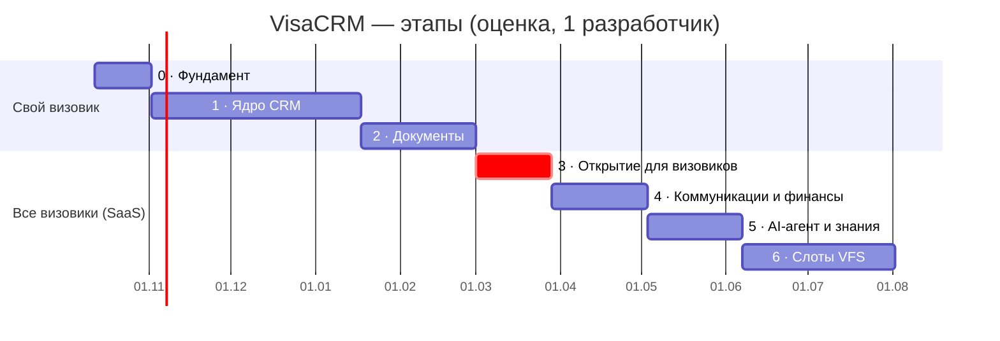
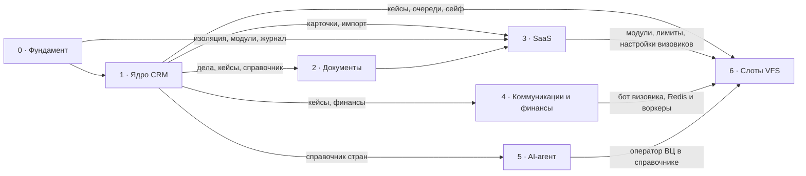

# Дорожная карта разработки

Весь путь от фундамента до слотов: семь этапов, у каждого — цель, гейт, модули, задачи, зависимости и вопросы, которые нужно закрыть до старта. Продуктовые требования — в [PRD.md](PRD.md), детальные задачи ближайших этапов с критериями готовности — в [backlog.md](backlog.md), спецификация клиентов — в [clients-module.md](clients-module.md).

**Как пользоваться.** Этап начинается, когда пройден гейт предыдущего. Перед стартом этапа его эпики из этого файла раскладываются в задачи [backlog.md](backlog.md) (одна задача — одна ветка и PR). Статусы обновляются после мержа в `main`.

Статусы: ✅ готово (в `main`) · 🔄 в работе · ⏸ отложено · ⬜ не начато.

## Сводка

Порядок изменён 2026-10-15: другим визовикам платформа открывается на этапе 3, сразу после документов, когда готовы карточки клиентов. Раньше SaaS был последним этапом.

| Этап | Недели | Ориентировочно | Цель | Гейт (условие перехода дальше) | Статус |
| --- | --- | --- | --- | --- | --- |
| 0 · Фундамент | 1–3 | 12.10 – 01.11.2026 | Безопасная основа: изоляция данных, вход, роли, шифрование, RU/EN | Тестовый второй визовик не видит чужих данных | 🔄 |
| 1 · Ядро CRM | 4–14 | 02.11.2026 – 17.01.2027 | Визовик ведёт всех клиентов в системе вместо 7 таблиц | Все новые кейсы ведутся только в системе | 🔄 |
| 2 · Документы | 15–20 | 18.01 – 28.02.2027 | Пакет документов собирается из дела | Пакет собирается из дела без ручного набора | ⬜ |
| 3 · Открытие для визовиков (SaaS) | 21–24 | 01.03 – 28.03.2027 | Другие визовики подключаются и работают в своих кабинетах; админ ведёт их оплаты | Новый визовик подключается и переносит свои таблицы без помощи разработчика | ⬜ |
| 4 · Коммуникации и финансы | 25–29 | 29.03 – 02.05.2027 | Клиент и визовик получают статусы и напоминания в Telegram | Статусы и напоминания клиентам уходят без ручных сообщений | ⬜ |
| 5 · AI-агент и знания | 30–34 | 03.05 – 06.06.2027 | Справочник обновляется по официальным источникам с одобрения админа | Справочник меняется только через одобренные правки | ⬜ |
| 6 · Слоты VFS | 35–42 | 07.06 – 01.08.2027 | Система находит слоты и подбирает клиента, визовик записывает | Успешные слоты фиксируются в кейсах без ручного учёта | ⬜ |

Сроки — оценка PRD для одного разработчика на полный день с AI-инструментами, отсчёт от 12.10.2026, без праздников и отпусков. При работе на полставки они примерно удваиваются. Первый рабочий результат — визовик ведёт клиентов в системе — после этапа 1 (неделя 14); другие визовики подключаются после этапа 3 (неделя 24). Всё, что выходит на этапах 4–6, сразу получают все подключённые визовики.

## Ключевые точки

| Точка | Когда | Что значит |
| --- | --- | --- |
| Первый деплой (staging) | Когда в `main` есть частично рабочая версия. Предложение: после входа с 2FA, админки и сотрудников (0.5–0.7) | Задача 0.2: Railway, EU West, staging с PostgreSQL и PITR |
| Production и бэкапы | Production — до пилота (1.15); внешний бэкап (0.11) — когда сервис полностью в работе | Окружение production со встроенными снимками Railway; позже ежедневный `pg_dump` во внешнее хранилище и проверка восстановления |
| Пилот | Недели 13–14 | Визовик переносит свои таблицы и работает в системе каждый день |
| ~~Юридическая проверка (РБ)~~ | — | Не проводится: платформа и серверы вне Беларуси (решение 2026-10-17, decisions.md) |
| Юридическая проверка (RODO) и документы | До этапа 3 | DPA с Railway, umowa powierzenia с визовиками, пользовательское соглашение, политика конфиденциальности |
| Открытие для визовиков | Неделя 24 | Первые внешние визовики подключены, их оплаты ведутся в админке |
| Слоты и оплата | До этапа 6 | Влияют ли успешные слоты на оплату визовика; если да — цена, правила отмены и переноса |

## Зависимости между этапами

---

## Этап 0 · Фундамент — 3 недели

**Цель.** Основа, которую не придётся переделывать к открытию для других визовиков (этап 3): каждый визовик изолирован на уровне базы, вход безопасен, роли и модули заложены, все тексты переводятся.

**Гейт.** Тестовый второй визовик не видит чужих данных — ни через интерфейс, ни через API, ни прямым SQL через сессию приложения.

| # | Задача | Статус |
| --- | --- | --- |
| 0.1 | Каркас: FastAPI + React + Alembic + CI + Dockerfile, lock-файлы | ✅ |
| 0.2 | Деплой на Railway (staging) | ⏸ ждёт решения: частично рабочая версия уже в `main` |
| 0.3 | Арендаторы, пользователи, Row-Level Security | ✅ |
| 0.4 | Вход: пароль (argon2), сессии в cookie, блокировка после 10 попыток, смена временного пароля | ✅ |
| 0.5 | Двухфакторный вход (TOTP) и коды восстановления | ✅ |
| 0.6 | Админка: визовики, налог, модули | ✅ |
| 0.7 | Сотрудники визовика: приглашение, модули, кейсы | ✅ (выбор кейсов — с 1.4) |
| 0.8 | Неизменяемый журнал действий | ✅ |
| 0.9 | Шифрование сейфа (AES-GCM, мастер-ключ) | ✅ |
| 0.10 | i18n и оболочка интерфейса | ✅ RU/EN, меню, стиль A по умолчанию и выбор B/C/D в настройках |
| 0.11 | Бэкапы во внешнее S3-хранилище в ЕС | ⏸ отложено: когда сервис полностью в работе |
| 0.12 | Смена почты с подтверждением; тестовый стенд (staging и стенды PR с демо-данными), проверки безопасности в CI | ✅ почтовый сервис для production — открытый вопрос |

**Стиль интерфейса решён:** A по умолчанию, B/C/D — на выбор в настройках (см. decisions.md). Этап 1 верстается на переменных темы, без жёстких цветов.

---

## Этап 1 · Ядро CRM — 11 недель

**Цель.** Семь таблиц визовика заменяются одной базой «контакт → консультации → кейсы»: картотека, карточки, очереди, финансы в BYN, главный экран, аналитика и импорт. Подробно — [clients-module.md](clients-module.md).

**Гейт.** Все новые кейсы визовик ведёт только в системе.

**Модули:** личные дела клиентов, кейсы, сейф учётных записей, финансы кейсов, задачи и календарь (напоминания внутри CRM), справочник стран и виз, главный экран и аналитика.

| Блок | Задачи backlog | Срок |
| --- | --- | --- |
| Карточки и картотека | 1.1 справочники ✅ · 1.2 контакт ✅ (файлы согласия и договора ✅; хранилище подключается настройкой после выбора провайдера) · 1.3 консультация ✅ · 1.4 кейс ✅ (доступ сотрудника к отдельным кейсам — вопрос 17) · 1.5 картотека списком и канбаном ✅ | 4 нед. |
| Очереди, сейф, брони, финансы | 1.6 очереди и попытки ✅ · 1.7 сейф учётных записей ✅ · 1.8 брони ✅ · 1.9 финансы кейса ✅ · 1.10 расчёты с регистраторами ✅ | 2 нед. |
| Главный экран и аналитика | 1.11 «Требует внимания» ✅ · 1.12 главный экран ✅ · 1.13 аналитика ✅ | 2 нед. |
| Импорт | 1.14 импорт XLSX/CSV, который визовик запускает сам ✅ (проверка на настоящих таблицах — с их копиями) | 1 нед. |
| Пилот | 1.15 перенос таблиц, ежедневная работа, правки | 2 нед. |

**Инфраструктура.** S3-хранилище в ЕС (согласия и договоры клиентов), cron-сервис (курсы Нацбанка РБ, бэкап), Sentry, production-окружение к пилоту.

**Решить до старта или по ходу** (вопросы к визовику из [open-questions.md](open-questions.md)):
- что в прототипе непонятно, лишнее или не хватает; список или канбан (№ 12);
- план на месяц для главного экрана (№ 5), расходы на рекламу по каналам (№ 6), выгрузка в Excel/PDF (№ 7);
- о чём и за сколько дней она напоминает клиентам (№ 4) — правила блока «Требует внимания»;
- копии 7 таблиц без паролей — проверить на них импорт (1.14) перед пилотом 1.15.

---

## Этап 2 · Документы — 6 недель

**Цель.** Документы и анкеты собираются из данных дела по шаблонам; система подсвечивает, чего не хватает в пакете.

**Гейт.** Пакет документов собирается из дела без ручного набора.

**Модули:** шаблоны документов, автозаполнение анкет, распознавание паспорта, проверка пакета, калькулятор 90/180, AI-помощник по документам.

| # | Эпик | Что входит |
| --- | --- | --- |
| 2.1 | Шаблоны документов | Спонсорские письма, справки, cover letter, доверенности, договор; подстановка полей дела; выгрузка в DOCX/PDF; общие шаблоны (админ) и свои (визовик) |
| 2.2 | Чек-листы в справочнике | Список документов по стране, цели и типу визы — основа для проверки пакета |
| 2.3 | Проверка пакета | Сверка документов кейса с чек-листом, подсветка недостающего и просроченного |
| 2.4 | Автозаполнение анкет | Шенгенская анкета, UK-форма, данные для профиля VFS из дела |
| 2.5 | Распознавание паспорта (MRZ) | Чтение MRZ и срока действия; скан обрабатывается и не сохраняется (решение: сканы не храним) |
| 2.6 | Калькулятор 90/180 | Допустимые дни пребывания по истории поездок из дела |
| 2.7 | AI-помощник по документам | Черновики писем, переводы, подсказки по рискам отказа |

**Зависит от:** личного дела и кейса (1.2–1.4), справочника (1.1).

**Решить до старта:** какие документы визовик готовит сама и шаблоны от неё (№ 2, материалы); выбор LLM и бюджет на AI-запросы; нужно ли хранить сгенерированные документы или только выдавать файл.

---

## Этап 3 · Открытие для визовиков (SaaS) — 4 недели

**Цель.** Другие визовики получают свои кабинеты: админ подключает их, они сами входят, настраивают валюту и налог, переносят свои таблицы и работают. Админ ведёт индивидуальные условия оплаты каждого визовика. Всё, что выйдет дальше, визовики получают автоматически.

**Гейт.** Новый визовик подключается и переносит свои таблицы без помощи разработчика.

**Модули:** админ-панель SaaS, переключатели модулей и лимиты, настройки визовика, оплаты визовиков.

| # | Эпик | Что входит |
| --- | --- | --- |
| 3.1 | Модули и лимиты | Переключатели модулей на визовика (продолжение 0.6); лимиты активных кейсов и AI-запросов |
| 3.2 | Настройки визовика | Своя базовая валюта, валюты платежей, источник курса (Нацбанк РБ подходит только для BYN), налог и его ставка, часовой пояс |
| 3.3 | Онбординг | Создание админом и временный пароль (есть), 2FA по желанию (0.5), подсказки первого входа, самостоятельный импорт таблиц (1.14) |
| 3.4 | Доступ поддержки | Вход админа в кабинет визовика только с его разрешения, каждый доступ — в журнал (0.8) |
| 3.5 | Усиление изоляции | Отдельный пользователь БД без прав суперпользователя (решение от 2026-10-15); повторная проверка гейта этапа 0 на нескольких визовиках |
| 3.6 | Юридическое и документы | Пользовательское соглашение и политика конфиденциальности для визовиков, umowa powierzenia, DPA с Railway; согласие визовика при первом входе |
| 3.7 | Эксплуатация | Production на тарифе, который выдержит нескольких визовиков; Sentry и оповещения; проверенное восстановление из бэкапа; канал поддержки |
| 3.8 | Оплаты визовиков | Индивидуальные условия: стоимость и валюта для каждого визовика, календарь оплат с датами, отметка «оплачено» с датой и суммой, просроченные и ближайшие оплаты на главной админки, история оплат. Онлайн-оплаты нет — админ отмечает сам |
| 3.9 | Аналитика платформы | Сколько визовиков подключено и активно, сколько у них кейсов, поступления по календарю оплат |

**Зависит от:** изоляции, входа, админки, журнала и сейфа (этап 0), карточек и импорта (этап 1).

**Решить до старта:** проверка у юриста по RODO и тексты документов; кого подключаем первыми; периодичность оплат по умолчанию (раз в месяц или иначе) и нужны ли напоминания админу о приближающихся оплатах.

---

## Этап 4 · Коммуникации и финансы — 5 недель

**Цель.** Клиент получает статусы, напоминания и запросы документов в Telegram, визовик — свои уведомления; счета и договоры формируются в системе.

**Гейт.** Статусы и напоминания клиентам уходят без ручных сообщений.

**Модули:** Telegram-бот клиента, Telegram-бот визовика, единый inbox, счета и оплаты, договоры, калькулятор стоимости.

| # | Эпик | Что входит |
| --- | --- | --- |
| 4.1 | Фоновые воркеры | Redis и arq: боты и рассылки работают постоянно, cron для них не подходит |
| 4.2 | Бот визовика | Напоминания из «Требует внимания» (этап 1) переезжают в Telegram; дедлайны, новые лиды; позже — слоты. Один бот на платформу, привязка к аккаунту визовика |
| 4.3 | Бот клиента | Привязка клиента к контакту по ссылке-приглашению, согласие; статусы кейса, напоминания, запросы документов; клиенты разных визовиков не пересекаются |
| 4.4 | Единый inbox | Переписка с клиентами в карточке, шаблоны сообщений, рассылки |
| 4.5 | Счета и оплаты | Прайс, счета клиенту, консульские и сервисные сборы; продолжение финансов кейса (1.9) |
| 4.6 | Договоры | Договор из шаблона (2.1), электронная подпись |
| 4.7 | Калькулятор стоимости | Цена визы под ключ: сборы плюс услуги |

**Зависит от:** кейсов и финансов (1.4, 1.9), шаблонов (2.1), настроек визовиков (3.2).

**Решить до старта:** тексты и сроки напоминаний клиентам (№ 4); как визовик узнаёт о решении и готовности паспорта (№ 3); страховка — доход или расход (№ 1); сервис электронной подписи; один бот клиента на платформу или свой бот у каждого визовика.

---

## Этап 5 · AI-агент и знания — 5 недель

**Цель.** Справочник стран и правил записи обновляется по официальным источникам; агент ничего не публикует сам, правка попадает в базу только после одобрения админом. С этапа 3 справочник общий для всех подключённых визовиков, поэтому ошибка в нём бьёт по всем сразу.

**Гейт.** Справочник меняется только через одобренные правки.

**Модули:** AI-агент изменений, база отказов, подсказки по процессу.

| # | Эпик | Что входит |
| --- | --- | --- |
| 5.1 | Источники | Список сайтов консульств, МИД, VFS, gov.uk, Еврокомиссии; админ добавляет, отключает, задаёт частоту |
| 5.2 | Поиск изменений | Сравнение с прошлой версией страницы, отсев косметики, тип изменения (документы, сборы, сроки, запись, законы) |
| 5.3 | Черновик правки | Поле, было и стало, цитата, ссылка, дата, уверенность агента |
| 5.4 | Решение админа | Принять, отредактировать или отклонить с причиной; причины — для настройки агента |
| 5.5 | Версии справочника | Новая версия с датой вступления в силу; затронутые чек-листы и кейсы всех визовиков помечаются |
| 5.6 | Срочные изменения | Приостановка приёма, закрытие центра — админу сразу, вне очереди |
| 5.7 | Заметки визовика | Свои заметки к справочнику без изменения общей версии |
| 5.8 | База отказов | Причины отказов и что сработало при повторной подаче |
| 5.9 | Подсказки по процессу | Где зависают кейсы, какие этапы тормозят |

**Зависит от:** справочника (1.1), чек-листов (2.2), воркеров (4.1), бота визовика (4.2) для уведомлений.

**Решить до старта:** стартовый список источников по странам первой волны; модель и бюджет на AI-запросы с учётом всех визовиков.

---

## Этап 6 · Слоты VFS — 8 недель

**Цель.** Система следит за слотами и предлагает клиента из очереди, визовик записывает его и вносит номер; успешный слот учитывается. Капча и финальное подтверждение — всегда за человеком.

**Гейт.** Успешные слоты фиксируются в кейсах без ручного учёта.

**Модуль:** модуль слотов VFS.

| # | Эпик | Что входит |
| --- | --- | --- |
| 6.1 | Инфраструктура мониторинга | Отдельно от основного сервиса: визовые центры блокируют облачные IP; лимиты частоты на центр |
| 6.2 | Каркас коннекторов и VFS | Общий интерфейс коннектора; первый — VFS (73 пары стран) |
| 6.3 | Подписки | Страна, центр, категория визы, диапазон дат; одно уведомление на слот; лимит подписок на визовика (3.1) |
| 6.4 | Очередь ожидания и подбор | Параметры кейса (центр, категория, желаемые и недоступные даты, приоритет); подбор по приоритету; слоты без кандидата — в журнал |
| 6.5 | Сейф аккаунтов VFS | На базе шифрования сейфа (0.9, 1.7); каждое открытие — в журнал |
| 6.6 | Карточка слота и уведомление | Через бота визовика (4.2); данные заявителя под рукой |
| 6.7 | Фиксация успешного слота | Номер записи и письмо или скриншот VFS в кейсе |
| 6.8 | Слоты в оплате | Если успешные слоты влияют на оплату визовика: цена за слот в его условиях, успешные слоты попадают в календарь оплат (3.8), споры по отменам и переносам |
| 6.9 | Защита от блокировок | Пауза центра при росте капчи или ошибок, уведомление админу; сбой одного центра не влияет на другие |
| 6.10 | TLScontact, затем BLS | Следующие коннекторы (13 и 10 пар); вероятно, выходят за 8 недель |

**Зависит от:** кейсов и очередей (1.4, 1.6), сейфа (0.9, 1.7), модулей, лимитов и оплат (3.1, 3.8), воркеров и бота визовика (4.1, 4.2), оператора ВЦ в справочнике (5.x).

**Решить до старта:** целевое время доставки уведомления о слоте и метрики; подтвердить 42 пары со знаком «?»; операторы для Турции и Сербии; как визовик ищет слоты сейчас и сколько минут есть, чтобы занять слот (№ 11); влияют ли слоты на оплату визовика.

---

## Сквозные направления

Идут через все этапы, а не отдельным этапом.

- **Безопасность.** Изоляция на уровне базы для каждой новой таблицы (колонка `tenant_id`, политика RLS, тест изоляции), 2FA, шифрование сейфа, неизменяемый журнал, никаких персональных данных в логах и URL.
- **Персональные данные.** Сканы не храним, согласие и договор — с датой и файлом; удаление или обезличивание карточки по просьбе клиента; хостинг и бэкапы в ЕС.
- **Качество.** Тест на бизнес-правило до кода (деньги, сроки, права); CI на каждый PR; Playwright-сценарии ключевых путей начиная с этапа 1; Sentry с первого деплоя.
- **Локализация.** Каждая строка интерфейса и бота — в `ru.json` и `en.json`.
- **Документы проекта.** Решения — в [decisions.md](decisions.md), нерешённое — в [open-questions.md](open-questions.md), задачи ближайшего этапа — в [backlog.md](backlog.md), статусы — здесь.

## Вне плана

Отложено или вне скоупа (PRD, «Вне скоупа и отложенное»): верификация клиента (KYC), вход клиента в систему, доступ клиента к аккаунту VFS, запись без участия человека, мобильное приложение.
