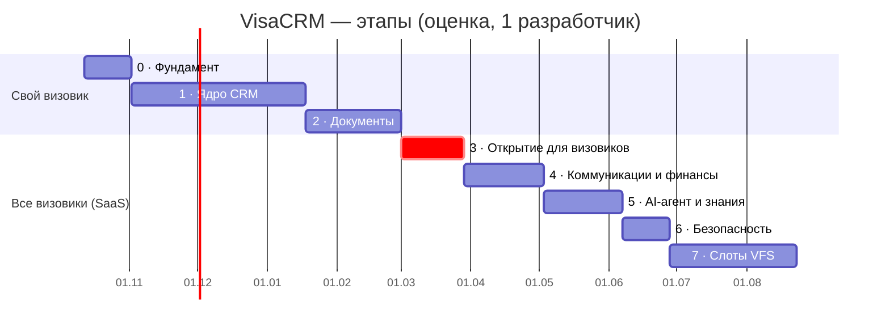
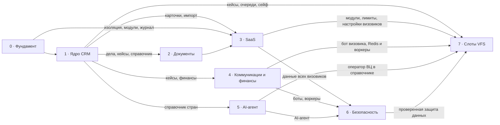

# Дорожная карта разработки

Весь путь от фундамента до слотов: восемь этапов, у каждого — цель, гейт, модули, задачи, зависимости и вопросы, которые нужно закрыть до старта. Продуктовые требования — в [PRD.md](PRD.md), детальные задачи ближайших этапов с критериями готовности — в [backlog.md](backlog.md), спецификация клиентов — в [clients-module.md](clients-module.md).

**Как пользоваться.** Этап начинается, когда пройден гейт предыдущего. Перед стартом этапа его эпики из этого файла раскладываются в задачи [backlog.md](backlog.md) (одна задача — одна ветка и PR). Статусы обновляются после мержа в `main`. Отложенные и отменённые задачи переезжают в раздел «Идеи и отложенное» в конце файла: он вне плана и без сроков, задачу оттуда возвращает в её этап владелец.

Статусы: ✅ готово (в `main`) · 🔄 в работе · ⏸ отложено · ❌ отменено · ⬜ не начато (у пункта бэклога — готово к разработке) · ⏳ ждёт решения · 💡 предложение, обсуждается. Как задача переходит из обсуждения в разработку — [process.md](process.md).

## Сводка

Порядок изменён 2026-10-15: другим визовикам платформа открывается на этапе 3, сразу после документов, когда готовы карточки клиентов. Раньше SaaS был последним этапом.

| Этап | Недели | Ориентировочно | Цель | Гейт (условие перехода дальше) | Статус |
| --- | --- | --- | --- | --- | --- |
| 0 · Фундамент | 1–3 | 12.10 – 01.11.2026 | Безопасная основа: изоляция данных, вход, роли, шифрование, RU/EN | Тестовый второй визовик не видит чужих данных | ✅ |
| 1 · Ядро CRM | 4–14 | 02.11.2026 – 17.01.2027 | Визовик ведёт всех клиентов в системе вместо 7 таблиц | Все новые кейсы ведутся только в системе | 🔄 идёт пилот: визовик работает в production и постепенно переносит старых клиентов, импорт старых таблиц — позже; с 01.12.2026 все консультации и клиенты только в CRM, две недели пилота считаются с этой даты (ответы 26.11.2026); правки пилота 1.15.1–1.15.15 проверены в production 24.11.2026; 1.21 (выгрузка) на проверке с 24.11.2026 (PR #162); готовы к разработке 1.18 (вопрос 25 отвечен), 1.24–1.26 |
| 2 · Документы | 15–20 | 18.01 – 28.02.2027 | Пакет документов собирается из дела | Пакет собирается из дела без ручного набора | 🔄 начат 17.10.2026, до пилота: сначала задачи без материалов визовика; готовы 2.1, 2.2, 2.3, 2.5, 2.6, осталось 2.4 и 2.16–2.18 (2.7 и 2.9–2.14 с 26.11.2026 — в «Идеях и отложенном»); 2.8 (удаление паспортных данных после решения) — на staging, в production выключено до ответов на вопросы (решение 24.11.2026) |
| 3 · Открытие для визовиков (SaaS) | 21–24 | 01.03 – 28.03.2027 | Другие визовики подключаются и работают в своих кабинетах по подписке; админ ведёт её оплаты | Новый визовик подключается и переносит свои таблицы без помощи разработчика | ⬜ заранее сделаны подписка (3.8, PR #70) и часть настроек визовика (3.2: валюта учёта и ставка налога, PR #115) |
| 4 · Коммуникации и финансы | 25–29 | 29.03 – 02.05.2027 | Клиент и визовик получают статусы и напоминания в Telegram | Статусы и напоминания клиентам уходят без ручных сообщений | ⬜ |
| 5 · AI-агент и знания | 30–34 | 03.05 – 06.06.2027 | Справочник обновляется по официальным источникам с одобрения админа | Справочник меняется только через одобренные правки | ⬜ |
| 6 · Безопасность и защита данных | 35–37 | 07.06 – 27.06.2027 | Данные визовиков и клиентов не могут попасть к злоумышленникам; законы ЕС о хранении и защите данных выполнены | Сканирование и AI-проверка не находят критичных и высоких уязвимостей, утечка не воспроизводится | ⬜ заранее: аудиты кода (6.2) 04.11 и 20.11.2026, исправления S1–S21 — в [backlog.md](backlog.md): S1–S12 влиты 21–22.11.2026 |
| 7 · Слоты VFS | 38–45 | 28.06 – 22.08.2027 | Система находит слоты и подбирает клиента, визовик записывает | Успешные слоты фиксируются в кейсах без ручного учёта | ⬜ |
| Идеи и отложенное | — | без сроков | Отложенные и отменённые задачи и идеи на потом — вне плана | — (задачу возвращает в её этап владелец) | ⏸ 2.7, 2.11–2.13 · ❌ 2.9, 2.10, 2.14 |

Сроки — оценка PRD для одного разработчика на полный день с AI-инструментами, отсчёт от 12.10.2026, без праздников и отпусков. При работе на полставки они примерно удваиваются. Первый рабочий результат — визовик ведёт клиентов в системе — после этапа 1 (неделя 14); другие визовики подключаются после этапа 3 (неделя 24). Всё, что выходит на этапах 4–7, сразу получают все подключённые визовики.

## Ключевые точки

| Точка | Когда | Что значит |
| --- | --- | --- |
| Первый деплой (staging) | Когда в `main` есть частично рабочая версия. Предложение: после входа с 2FA, админки и сотрудников (0.5–0.7) | Задача 0.2: Railway, EU West, staging с PostgreSQL и PITR |
| Production и бэкапы | Production работает с 2026-10-15; бэкапы — до пилота (1.15) | Два слоя с 2026-10-25: Railway Pro — снимки Daily, Weekly и Monthly и PITR; внешний бэкап (0.11) — зашифрованная копия базы и бакета файлов в Backblaze B2 каждую ночь. Первая проверка восстановления из B2 — 2026-10-26 |
| Пилот | Идёт (по плану — недели 13–14): визовик работает в production, первые замечания — 19.11.2026 | Визовик переносит свои таблицы и работает в системе каждый день |
| ~~Юридическая проверка (РБ)~~ | — | Не проводится: платформа и серверы вне Беларуси (решение 2026-10-17, decisions.md) |
| Юридическая проверка (RODO) и документы | До этапа 3 | DPA с Railway и Backblaze, umowa powierzenia с визовиками, пользовательское соглашение, политика конфиденциальности |
| Открытие для визовиков | Неделя 24 | Первые внешние визовики подключены, их подписки ведутся в админке |
| Оплата за слоты | До этапа 7 | Слоты оплачиваются отдельно от подписки (решение 2026-10-28): цена за слот, правила отмены и переноса |

## Зависимости между этапами

---

## Этап 0 · Фундамент — 3 недели

**Цель.** Основа, которую не придётся переделывать к открытию для других визовиков (этап 3): каждый визовик изолирован на уровне базы, вход безопасен, роли и модули заложены, все тексты переводятся.

**Гейт.** Тестовый второй визовик не видит чужих данных — ни через интерфейс, ни через API, ни прямым SQL через сессию приложения.

| # | Задача | Статус |
| --- | --- | --- |
| 0.1 | Каркас: FastAPI + React + Alembic + CI + Dockerfile, lock-файлы | ✅ |
| 0.2 | Деплой на Railway (staging) | ✅ staging, стенды PR и production; снимки и PITR production — с 2026-10-25 |
| 0.3 | Арендаторы, пользователи, Row-Level Security | ✅ |
| 0.4 | Вход: пароль (argon2), сессии в cookie, блокировка после 10 попыток, смена временного пароля | ✅ |
| 0.5 | Двухфакторный вход (TOTP) и коды восстановления | ✅ |
| 0.6 | Админка: визовики, налог, модули | ✅ |
| 0.7 | Сотрудники визовика: приглашение, модули, кейсы | ✅ (выбор кейсов — Т.13, «Сквозные направления») |
| 0.8 | Неизменяемый журнал действий | ✅ |
| 0.9 | Шифрование сейфа (AES-GCM, мастер-ключ) | ✅ |
| 0.10 | i18n и оболочка интерфейса | ✅ RU/EN, меню, стиль A по умолчанию и выбор B/C/D в настройках |
| 0.11 | Бэкапы во внешнее S3-хранилище в ЕС | ✅ зашифрованная копия базы и зеркало бакета файлов в Backblaze B2 каждую ночь с 2026-10-25 ([backup.md](backup.md)); первая проверка восстановления пройдена 2026-10-26, дальше — раз в месяц (раздел 5) |
| 0.12 | Смена почты с подтверждением; тестовый стенд (staging и стенды PR с демо-данными), проверки безопасности в CI | ✅ почтовый сервис для production — открытый вопрос |

**Стиль интерфейса решён:** A по умолчанию, B/C/D — на выбор в настройках (см. decisions.md). Этап 1 верстается на переменных темы, без жёстких цветов.

---

## Этап 1 · Ядро CRM — 11 недель

**Цель.** Семь таблиц визовика заменяются одной базой «контакт → консультации → кейсы»: картотека, карточки, очереди, финансы в BYN, главный экран, аналитика и импорт. Подробно — [clients-module.md](clients-module.md).

**Гейт.** Все новые кейсы визовик ведёт только в системе.

**Модули:** личные дела клиентов, кейсы, сейф учётных записей, финансы кейсов, задачи и календарь (напоминания внутри CRM), справочник стран и виз, главный экран и аналитика.

| Блок | Задачи backlog | Срок |
| --- | --- | --- |
| Карточки и картотека | 1.1 справочники ✅ · 1.2 контакт ✅ (файлы согласия и договора ✅; хранилище — бакет Railway `Files`, в production с 25.10.2026; аудит данных клиентов 18.11.2026, PR #109: номера России и Казахстана в местном виде и ссылки на Telegram сохраняются верно) · 1.3 консультация ✅ · 1.4 кейс ✅ (доступ сотрудника к отдельным кейсам — Т.13) · 1.5 картотека списком и канбаном ✅ (перенос на канбане с подтверждением — PR #85, 16.11.2026; колонка «Результат» — за месяц, полгода, год, всё время или свои даты — PR #113, #114, 19.11.2026) | 4 нед. |
| Очереди, сейф, брони, финансы | 1.6 очереди и попытки ✅ · 1.7 сейф учётных записей ✅ · 1.8 брони ✅ · 1.9 финансы кейса ✅ · 1.10 расчёты с регистраторами ✅ | 2 нед. |
| Главный экран и аналитика | 1.11 «Требует внимания» ✅ · 1.12 главный экран ✅ · 1.13 аналитика ✅ | 2 нед. |
| Импорт | 1.14 импорт XLSX/CSV, который визовик запускает сам ✅ · 1.16 импорт под структуру таблиц визовика ✅ (по описанию таблиц от 18.10.2026; проверка на настоящих таблицах — с их копиями) · 1.21 формат данных VisaCRM: импорт и выгрузка одного файла XLSX, промт для ИИ — на проверке (заменяет 1.14 и 1.16; часть 1 в `main` с 28.10.2026 (PR #65, #66): импорт формата, «Скачать шаблон» и «Скопировать промт», проверка и загрузка в фоне с ходом работы; 16.11.2026 (PR #93) — импорт устойчивее: отклонённые строки, файлы с отступлениями от формата, одинаковые платежи, общий телефон семьи; 18.11.2026 (PR #109) — не склеивает людей по общему нику Telegram и с разной датой рождения; 24.11.2026 (PR #162) — выгрузка всего кабинета одним файлом формата: каждая по паролю аккаунта, с паролями сейфа — ещё и по коду 2FA, если она включена; старые сопоставления колонок удалены; осталась проверка в production; [data-format.md](data-format.md), [import-prompt.md](import-prompt.md)) · 1.22 карточки до загрузки: файл ждёт на сервере, пробные карточки, проверка всех карточек и подтверждение ✅ (PR #81, 05.11.2026; исправления — PR #93, 16.11.2026; осталась проверка в production) | 1 нед. |
| Пилот | 1.17 удобство интерфейса перед пилотом ✅ · 1.20 свои направления и города визовика ✅ (PR #64, 28.10.2026: раздел «Направления» вместо «Стран и виз»; у админа — страны, операторы и общие чек-листы) · 1.15 перенос таблиц, ежедневная работа, правки — порядок в [pilot.md](pilot.md) (готовность, репетиция на стенде, перенос, проверка, гейт) 🔄 идёт: визовик работает в production и постепенно переносит старых клиентов, старые таблицы через «Импорт таблиц» загрузит позже (ответы визовика 24.11.2026, decisions.md → «Ответы визовика (2026-11-24)»); правки 1.15.1–1.15.15 визовик проверила в production 24.11.2026, всё в порядке; первая пачка замечаний 1.15.1–1.15.9 ✅ (PR #115, влит 20.11.2026: удаление кейса-дубля, связь консультации и кейса, напоминание о решении только по дате, валюта цены кейса, валюта учёта и налог у визовика, направления, результат на семью, кейсы в карточке блоками; decisions.md → «Пилот: правки визовика (2026-11-19)»; новые вопросы — [open-questions.md](open-questions.md) → «По продукту»); вторая пачка 1.15.10–1.15.13 ✅ (PR #145, влит 24.11.2026: кнопка «Сгенерировать» в форме сейфа не залезает в соседнюю колонку, родственных связей между клиентами больше нет, убранный талон регистратора не возвращается и кейс удаляется, перед удалением карточки — что уйдёт вместе с ней; decisions.md → «Пилот: правки визовика (2026-11-24)»); 1.15.14 ✅ (PR #150, влит 24.11.2026: в справочник всегда можно добавить запись, даже если у одной из записей списка уже порядок 999); 1.15.15 ✅ (PR #156, влит 24.11.2026: кейс и карточка клиента удаляются сразу со всем содержимым, окно перед удалением перечисляет, что уйдёт и что останется) · третья пачка (замечания 28.11.2026): 1.15.16 «Новый клиент» одним экраном — контакт, анкета, консультация и заметка одной кнопкой, паспорт и договор свёрнуты ⬜, 1.15.17 карточка клиента по вкладкам ⬜ — decisions.md → «Пилот: правки визовика (2026-11-28)» · 1.23 удаление всех данных кабинета ✅ (PR #88, 16.11.2026: визовик сама удаляет все данные в «Настройках» — только с двухфакторной защитой, по паролю и коду из приложения; вход, настройки, подписка и журнал остаются) · аудит CRM по скиллу crm-management ✅ (PR #108, в production с 18.11.2026: «Результат» — только с итогом визы; напоминание «внесите результат» через 15 дней после подачи (с 24.11.2026 — через 14, ответ визовика на вопрос 34); консультация без решения напоминает месяц — с 20.11.2026 отменено (1.15.3, PR #115): о решении клиента CRM напоминает только в день «Связаться»; вопросы визовику — 32–34 в [open-questions.md](open-questions.md); decisions.md → «Аудит по скиллу crm-management») | 2 нед. |
| По ответам визовика (26.10.2026) | 1.18 прибыль по месяцу оплаты 🔄 влит 26.11.2026 (PR #189), на проверке в production: визовик сверяет один месяц со своей таблицей; ответ на № 25 — вариант А, деньги в своём месяце (decisions.md → «Ответы визовика (2026-11-26)»; прибыль — только по кейсам, оплата консультации входит, когда засчитана в стоимость кейса, — решение владельца 28.10.2026) · 1.19 напоминания о консультации, договоре, опроснике, связи после консультации и остатке после записи ✅ (сроки по умолчанию — до ответа на № 26) | — |
| По ответам визовика (26.11.2026) | 1.24 общий телефон: предупреждение вместо запрета ⬜ (первая в очереди миграций) · 1.25 срок заявки Франции при переносе таблиц считает CRM — на проверке (PR #188, влит 26.11.2026; осталась проверка в production) · 1.26 авиабронь делает визовик: тексты сайта — на проверке (PR #187, влит 26.11.2026; осталась проверка в production) — все готовы к разработке 26.11.2026 (decisions.md → «Ответы визовика (2026-11-26)») | — |

**Инфраструктура.** Бакет Railway в EU West (согласия, договоры, шаблоны) ✅, cron-сервис бэкапа ✅, курсы Нацбанка РБ — веб-сервис скачивает сам при запуске и каждые 3 часа ✅ (PR #66, 28.10.2026), production-окружение ✅; Sentry для бэкенда — на проверке: код в `main` с 24.11.2026 (PR #161), отчёты без данных клиентов (decisions.md → «Отчёты об ошибках в Sentry»); осталось завести организацию Sentry в ЕС, вставить `SENTRY_DSN` в Railway и проверить командой `check-error-reports` ([deploy.md](deploy.md), шаг 4).

**Решить до старта или по ходу** (вопросы к визовику из [open-questions.md](open-questions.md)):
- что в прототипе непонятно, лишнее или не хватает; список или канбан (№ 12);
- ~~план на месяц для главного экрана (№ 5), расходы на рекламу по каналам (№ 6), выгрузка в Excel/PDF (№ 7)~~ — ответы 26.10.2026: плана нет; расходы по каналам и выгрузка в Excel — эпики 4.8 и 4.9;
- ~~о чём и за сколько дней она напоминает клиентам (№ 4)~~ — ответ 26.10.2026: задача 1.19; за сколько дней — № 26;
- ~~прибыль по месяцу подачи, оплаты или выдачи (№ 18)~~ — ответ 26.10.2026: по месяцу оплаты, задача 1.18; ~~как делить прибыль кейса между месяцами (№ 25)~~ — ответ 26.11.2026: вариант А, деньги в своём месяце;
- ~~60-й день Франции (№ 21), цель в консультации (№ 30), причины отказа (№ 32), дубли с историей (№ 33)~~ — ответы 26.11.2026: дата отправки + 60 дней (1.25); цель — только в кейсе; причину визовик пишет в заметках карточки; склейки нет, телефон — предупреждение (1.24);
- ~~телефон или компьютер (№ 8), сколько клиентов (№ 9)~~ — ответ 27.10.2026: почти всегда компьютер; 88 клиентов в работе, новых 5–20 в месяц (decisions.md → «Основное устройство — компьютер», «Объём работы»);
- ~~как идёт запись по странам (№ 11), операторы Бельгии, Люксембурга, Словении, Португалии и Румынии (№ 16)~~ — ответ 27.10.2026: PRD → «Запись в Беларуси сейчас»; правки справочника — шаг «Справочник стран» в pilot.md. Где подаётся Австрия и вся группа посольства Германии — № 27; напоминать ли о 48–72 часах после письма — № 28; страны без ответа — № 13;
- что помощникам нельзя видеть и как им платить (№ 10) — визовик ответит после того, как попробует CRM;
- копии 7 таблиц без паролей — проверить на них перевод по промту и импорт (1.21) перед пилотом 1.15; структура таблиц получена 18.10.2026.

---

## Этап 2 · Документы — 6 недель

**Цель.** Документы и анкеты собираются из данных дела по шаблонам; система подсвечивает, чего не хватает в пакете.

**Гейт.** Пакет документов собирается из дела без ручного набора.

**Модули:** шаблоны документов, автозаполнение анкет, распознавание паспорта, проверка пакета, калькулятор 90/180. AI-помощник по документам (2.7), страница загрузки для клиента, подписание договора и бот клиента (2.9–2.14) с 26.11.2026 — в «Идеях и отложенном».

| # | Эпик | Что входит | Статус |
| --- | --- | --- | --- |
| 2.1 | Шаблоны документов | Свои шаблоны визовика: файлы Word с кодами в `{{…}}` и инструкция со списком кодов; шаблон добавляется клиенту, файл заполняется при скачивании и называется по клиенту; PDF и общие шаблоны — позже | ✅ хранилище файлов для шаблонов — в production с 25.10.2026 |
| 2.2 | Чек-листы в справочнике | Список документов по стране, цели и типу визы — основа для проверки пакета | ✅ общий список (админ) и свои пункты визовика; наполнение — каждый визовик сам (решение владельца 26.11.2026), быстрое наполнение — 2.18 |
| 2.3 | Проверка пакета | Сверка документов кейса с чек-листом, подсветка недостающего и просроченного | ✅ PR #61, 27.10.2026: блок «Документы» в карточке кейса («есть / нет / не нужен», дата документа, готовность к дате подачи), «Требует внимания» — неполный пакет за 7 дней до подачи и накануне, на главной — готовность пакета вместо этапа; наполнение — каждый визовик сам (решение владельца 26.11.2026); напоминание по «Собрать до» без чек-листа — 2.17 |
| 2.4 | Автозаполнение анкет | Шенгенская анкета, UK-форма, данные для профиля VFS из дела | 🔄 в карточке с 24.10: ФИО по частям и блок «Паспорт» с местом рождения и «кем выдан»; дальше экран «Для анкеты» в кейсе |
| 2.5 | Распознавание паспорта (MRZ) | Чтение MRZ и срока действия; скан обрабатывается и не сохраняется (решение: сканы не храним) | ✅ с 27.10.2026 фото читается несколькими способами и берётся вариант, где сошлись контрольные цифры; читаются белорусские паспорта с неверно распознанной строкой имени (PR #62, #63) |
| 2.6 | Калькулятор 90/180 | Допустимые дни пребывания по истории поездок из дела | ✅ |
| 2.8 | Удаление паспортных данных после решения | Через 7 дней после решения паспорт клиента удаляется, за 2 дня — «Отложить на 30 дней» и «Удалить сейчас» в «Требует внимания»; первый запуск — выпуск + 14 дней (решение 24.11.2026) | на staging, в production выключено (PR #160, влит 24.11.2026; решение 24.11.2026: сначала ответы на вопросы). Включение — переменная `PASSPORT_PURGE_FROM`, срок первого запуска считается от неё |
| 2.12.0 | Каркас бота | Первая часть 2.12 (сама 2.12 — в «Идеях и отложенном»): подменённый Telegram API в тестах, вебхук с секретом, флаг `CLIENT_BOT`, команда регистрации вебхука, без ключей и без миграции | ✅ готово: влит 25.11.2026 (PR #179), проверен в production 26.11.2026; бот в production выключен (`CLIENT_BOT`, ключей нет) |
| 2.16 | Убрать страницу клиента из кода | Форма загрузки отменена: страница `/u/…`, вход по коду, приём файлов в кейсе и флаг `CLIENT_PORTAL` убираются, таблицы удаляет новая миграция; отметки пакета остаются | ⬜ готово к разработке 26.11.2026 |
| 2.15 | Поля и кнопки одного размера, жирность по шкале | Повторный ui-audit 25.11.2026: высоты полей и списков в строках, зазор переключателя месяцев, жирность 600, поле ссылки портала, цели касания 44 px, заголовки карточек 16 px в `warm` и `minimal` | ✅ готово: влит 25.11.2026 (PR #178), проверен в production 26.11.2026 |
| 2.17 | Напоминание по «Собрать до» без чек-листа | Срок документов из кейса напоминает и у кейса, для которого чек-листа ещё нет | ⬜ готово к разработке 26.11.2026, после 2.16 |
| 2.18 | Быстрое наполнение своих чек-листов | «Вставить список» и «Скопировать из другой страны» на странице чек-листов: каждый визовик собирает свои | ⬜ готово к разработке 26.11.2026, нужен макет |

Порядок без материалов визовика (решение 2026-10-17): 2.6 → 2.5 → 2.4 → структура 2.2 → 2.3. Шаблоны 2.1 взяты раньше 2.4 и 2.3, когда владелец решил, что шаблоны у каждого визовика свои (2026-10-18). Задачи с критериями готовности — в [backlog.md](backlog.md). На 30.10.2026 из задач без материалов визовика остался экран «Для анкеты» (2.4).

**Зависит от:** личного дела и кейса (1.2–1.4), справочника (1.1).

**Решить до старта:** ~~какие анкеты визовик заполняет сама (№ 2)~~ — ответ 26.10.2026: анкеты, брони, маршрутный лист, письма, переводы и апелляции, набор зависит от страны и цели (decisions.md → «Что визовик готовит сама»); ~~анкеты каких стран — № 22~~ — ответ 26.11.2026: все анкеты визовик заполняет сама, 2.4 начинается с шенгенской (полную анкету BLS для Португалии и Словакии визовик заполняет прямо во время ловли слота, 5–10 минут, — ответ на № 11 от 27.10.2026), ~~авиабронь и автобусные билеты — № 23 и 24~~ — ответ 26.11.2026: авиабронь делает и оплачивает визовик (расход кейса, 1.26), настоящие билеты покупает клиент; ~~выбор LLM и бюджет на AI-запросы~~ — не нужен: AI-помощник 2.7 отложен 26.11.2026 (решение владельца). Решено 18.10.2026: шаблоны документов у каждого визовика свои, заполненные файлы не храним — только выдаём (decisions.md → «Шаблоны документов»).

---

## Этап 3 · Открытие для визовиков (SaaS) — 4 недели

**Цель.** Другие визовики получают свои кабинеты: админ подключает их, они сами входят, настраивают валюту и налог, переносят свои таблицы и работают. Визовики платят за подписку на CRM, админ ведёт подписки и отмечает оплаты. Оплаты за слоты на этом этапе нет — она отдельная и появится на этапе 7 (решение 2026-10-28). Всё, что выйдет дальше, визовики получают автоматически.

**Гейт.** Новый визовик подключается и переносит свои таблицы без помощи разработчика.

**Модули:** админ-панель SaaS, переключатели модулей и лимиты, настройки визовика, подписка визовиков.

| # | Эпик | Что входит |
| --- | --- | --- |
| 3.1 | Модули и лимиты | Переключатели модулей на визовика (продолжение 0.6); лимиты активных кейсов и AI-запросов |
| 3.2 | Настройки визовика | Своя базовая валюта, валюты платежей, источник курса (Нацбанк РБ подходит только для BYN), налог и его ставка, часовой пояс |
| 3.3 | Онбординг | Создание админом и временный пароль (есть), 2FA по желанию (0.5), подсказки первого входа, самостоятельный импорт таблиц (1.14) |
| 3.4 | Доступ поддержки | Вход админа в кабинет визовика только с его разрешения, каждый доступ — в журнал (0.8) |
| 3.5 | Усиление изоляции | Отдельный пользователь БД без прав суперпользователя (решение от 2026-10-15); повторная проверка гейта этапа 0 на нескольких визовиках |
| 3.6 | Юридическое и документы | Пользовательское соглашение и политика конфиденциальности для визовиков, umowa powierzenia, DPA с Railway; согласие визовика при первом входе |
| 3.7 | Эксплуатация | Production на тарифе, который выдержит нескольких визовиков; Sentry и оповещения (ошибки бэкенда — в `main` с 24.11.2026, PR #161, письмо владельцу о каждой новой ошибке; дальше — оповещения о сбоях сервисов и, на этапе 3, UUID визовика в отчёте); проверенное восстановление из бэкапа; канал поддержки |
| 3.8 | Подписка визовиков | Тарифы, общие для всех (цена в месяц и валюта), тариф у каждого визовика, оплата раз в месяц, пробный период датой у визовика (решение 2026-10-30); даты оплат, отметка «оплачено» с датой и суммой, просроченные и ближайшие оплаты на главной админки, история оплат, подписка в «Настройках» визовика. Онлайн-оплаты нет — админ отмечает сам. Оплата за слоты сюда не входит — она отдельная, с этапа 7 (7.8) |
| 3.9 | Аналитика платформы | Сколько визовиков подключено и активно, сколько у них кейсов, поступления за подписку |

**Уже в `main`:** 3.8 ✅ — с 31.10.2026 (PR #70): тарифы, тариф и пробный период у визовика, отметка оплат, ближайшие и просроченные оплаты на главной админки, подписка в «Настройках» визовика; осталась проверка в production. Из 3.2 — визовик сама задаёт валюту учёта (суммы в базовой валюте пересчитываются по курсу Нацбанка) и ставку налога в «Моей учётной записи» (PR #115, 20.11.2026, по замечанию пилота); источник курса для других валют и часовой пояс — впереди.

**Зависит от:** изоляции, входа, админки, журнала и сейфа (этап 0), карточек и импорта (этап 1).

**Решить до старта:** проверка у юриста по RODO и тексты документов; кого подключаем первыми; ~~цена подписки, периодичность, пробный период и напоминания админу о приближающихся оплатах~~ — решено 2026-10-30: тарифы, общие для всех, оплата раз в месяц, пробный период датой у визовика, ближайшие оплаты — на главной админки (decisions.md → «Слоты и SaaS»).

---

## Этап 4 · Коммуникации и финансы — 5 недель

**Цель.** Клиент получает статусы, напоминания и запросы документов в Telegram, визовик — свои уведомления; счета и договоры формируются в системе.

**Гейт.** Статусы и напоминания клиентам уходят без ручных сообщений.

**Модули:** Telegram-бот клиента, Telegram-бот визовика, единый inbox, счета и оплаты, договоры, калькулятор стоимости.

| # | Эпик | Что входит |
| --- | --- | --- |
| 4.1 | Фоновые воркеры | Redis и arq: боты и рассылки работают постоянно, cron для них не подходит |
| 4.2 | Бот визовика | Напоминания из «Требует внимания» (этап 1) переезжают в Telegram; дедлайны, новые лиды; позже — слоты. Один бот на платформу, привязка к аккаунту визовика |
| 4.3 | Бот клиента | Привязка клиента к контакту по ссылке-приглашению, согласие; статусы кейса, напоминания, запросы документов; клиенты разных визовиков не пересекаются. Напоминания — о чём визовик пишет клиентам сейчас (№ 4): срок опросника для анкеты, сбор документов, подписание договора, консультация перед созвоном, связь после консультации, оплата. _С 25.11.2026 привязка, статус документов, договор и напоминания о документах и подаче — задача 2.12 этапа 2_ |
| 4.4 | Единый inbox | Переписка с клиентами в карточке, шаблоны сообщений, рассылки; рассылка «началась раздача» всем, кто ждёт в очереди страны, города или цели (№ 4) |
| 4.5 | Счета и оплаты | Прайс, счета клиенту, консульские и сервисные сборы; продолжение финансов кейса (1.9) |
| 4.6 | Договоры | Договор из шаблона (2.1), электронная подпись. _С 25.11.2026 — задача 2.11 этапа 2, подпись своя, без внешнего сервиса_ |
| 4.7 | Калькулятор стоимости | Цена визы под ключ: сборы плюс услуги |
| 4.8 | Расходы по каналам | Расход на канал прихода за месяц; в «Аналитике» — стоимость клиента и прибыль канала за вычетом расходов (№ 6) |
| 4.9 | Выгрузка в Excel | Отчёты «Аналитики» и платежи за месяц, в том числе официальные для налога (№ 7) |

**Зависит от:** кейсов и финансов (1.4, 1.9), шаблонов (2.1), настроек визовиков (3.2), аналитики (1.13).

**Решить до старта:** тексты напоминаний клиентам и за сколько дней (№ 26; о чём — ответ на № 4, decisions.md → «Напоминания клиентам»); ~~сервис электронной подписи; один бот клиента на платформу или свой бот у каждого визовика~~ — решено 25.11.2026: подпись своя, по личной ссылке, без внешнего сервиса; бот клиента один на платформу (decisions.md → «Подписание договора, страница группы и бот клиента», задачи 2.11 и 2.12). Решено 26.10.2026: решение по визе визовик узнаёт в EES или от клиента, трек-номер и смс показывают только движение паспорта (№ 3); страховку визовик не оформляет (№ 1).

---

## Этап 5 · AI-агент и знания — 5 недель

**Цель.** Справочник стран и правил записи обновляется по официальным источникам; агент ничего не публикует сам, правка попадает в базу только после одобрения админом. С этапа 3 справочник общий для всех подключённых визовиков, поэтому ошибка в нём бьёт по всем сразу. _С 27.10.2026 (1.20) общими остались только страны и операторы, а правила записи и города каждый визовик настраивает сам: цель этапа пересмотреть перед его началом._

**Гейт.** Справочник меняется только через одобренные правки.

**Модули:** AI-агент изменений, база отказов, подсказки по процессу.

| # | Эпик | Что входит |
| --- | --- | --- |
| 5.1 | Источники | Список сайтов консульств, МИД, VFS, gov.uk, Еврокомиссии; админ добавляет, отключает, задаёт частоту |
| 5.2 | Поиск изменений | Сравнение с прошлой версией страницы, отсев косметики, тип изменения (документы, сборы, сроки, запись, законы) |
| 5.3 | Черновик правки | Поле, было и стало, цитата, ссылка, дата, уверенность агента |
| 5.4 | Решение админа | Принять, отредактировать или отклонить с причиной; причины — для настройки агента |
| 5.5 | Версии справочника | Новая версия с датой вступления в силу; затронутые чек-листы и кейсы всех визовиков помечаются |
| 5.6 | Срочные изменения | Приостановка приёма, закрытие центра — админу сразу, вне очереди |
| 5.7 | Заметки визовика | Свои заметки к справочнику без изменения общей версии |
| 5.8 | База отказов | Причины отказов и что сработало при повторной подаче |
| 5.9 | Подсказки по процессу | Где зависают кейсы, какие этапы тормозят |

**Зависит от:** справочника (1.1), чек-листов (2.2), воркеров (4.1), бота визовика (4.2) для уведомлений.

**Решить до старта:** стартовый список источников по странам первой волны; модель и бюджет на AI-запросы с учётом всех визовиков.

---

## Этап 6 · Безопасность и защита данных — 3 недели

**Цель.** Перед последним этапом — отдельная проверка, что данные визовиков и их клиентов не могут попасть к злоумышленникам: сервер, который постоянно ищет уязвимости, AI-проверка кода и базы данных, выполнение законов ЕС о хранении и защите данных. Законодательство РБ и РФ не применяем — только ЕС (decisions.md).

**Гейт.** Сканирование и AI-проверка не находят критичных и высоких уязвимостей; утечка данных одного визовика другому или наружу не воспроизводится; требования GDPR (RODO) к хранению и защите данных закрыты.

**Модули:** сервер проверки уязвимостей, AI-аудит безопасности.

| # | Эпик | Что входит |
| --- | --- | --- |
| 6.1 | Сервер проверки уязвимостей | Отдельный сервис в ЕС, отдельно от основного: по расписанию сканирует стенд — активное сканирование (ZAP), зависимости и образ контейнера, TLS и заголовки; новые находки — отчётом и оповещением админу. Атакует только стенд с демо-данными, production — только пассивные проверки |
| 6.2 | AI-аудит кода и базы | AI-агент читает код и схему базы и ищет пути утечки: таблицы без RLS, запросы в обход области визовика, лишние права ролей, персональные данные в логах, URL и ошибках; на стенде пытается пробить изоляцию визовиков. Находки — с приоритетом и предложенным исправлением, исправляет и принимает человек |
| 6.3 | Защита базы | Аудит ролей и прав, отдельный логин приложения без прав суперпользователя, база закрыта извне, шифрованные бэкапы и проверка восстановления |
| 6.4 | Ключи и секреты | Ротация мастер-ключа сейфа и ключей хранилища по расписанию; проверка, что секреты не попали в репозиторий, логи и образы |
| 6.5 | Обнаружение атак | Оповещения о подозрительном: волна неудачных входов, массовые выгрузки и показы паролей, входы из новых мест; план действий при инциденте |
| 6.6 | GDPR (RODO) | Данные и бэкапы — только в ЕС; сроки хранения, удаление и обезличивание по запросу клиента, выгрузка его данных; реестр обработки и DPA с поставщиками; уведомление об утечке в течение 72 часов |
| 6.7 | Внешний пентест | По желанию: проверка независимой компанией перед открытием слотов |

**Сделано заранее (6.2).** Аудит 03.11.2026 — исправления 04.11.2026: персональные данные не попадают в лог сервера (PR #73), блокировка подбора пароля при входе и в настройках (PR #74), дневные лимиты сотрудника на все пути к карточке (PR #75). Документация API и схема скрыты на production (PR #111, 18.11.2026). Аудит всего кода 20.11.2026 — изоляция кабинетов держится, исправления S1–S21: S1 ✅ (лимит тела запроса по маршруту, PR #119, 21.11.2026), S2 ✅ (группы подачи меняет только визовик, PR #118, 21.11.2026), S3 ✅ («Осталось сменить» по журналу, сотрудник удаляет только свои записи сейфа, PR #122), S4 ✅ (лимиты разбора и заполнения шаблонов DOCX, PR #123), S5 ✅ (файлы импорта разбираются в отдельном процессе с лимитами, PR #126), S6 ✅ (ключ кабинета без долгой блокировки и таймауты базы, PR #124), S7 ✅ (дневной лимит во всех разделах карточки, PR #127), S8 ✅ (без модуля «Кейсы» поиск не отвечает по кейсам, PR #128), S9 ✅ (вход не выдаёт аккаунты, пароль без транзакции, лимит по клиенту, 2FA завершает другие сессии, PR #130), S10 ✅ (код смены почты считается атомарно, до 10 писем в сутки, PR #129), S11 ✅ (восстановление из копии без старых сессий и подброшенных копий, PR #131), S12 ✅ (квота документов: 50 на клиента, 10 ГиБ на кабинет, PR #132) — S3–S12 влиты 22.11.2026; S13 ✅ (кэш интерфейса очищается при смене аккаунта, PR #135), S14 ✅ (CI и образ закреплены, образ собирается в CI, контейнер не от root, PR #134), S15 ✅ (демо-данные только при явном `ENV`, свой пароль у стенда PR, PR #136), S16 ✅ (смена ключа данных при утечке, коды восстановления — HMAC, PR #137), S18 ✅ (cookie `__Host-`, PR #140), S20 ✅ (политики базы, миграция 0043, PR #139), S19 ✅ (без `ENV` — режим production, `SECRET_KEY` от 32 символов, проверка источника изменяющих запросов, PR #138) — влиты 22–23.11.2026; S17 ✅ (адрес клиента за прокси, промах считается и при отказе журнала, PR #142), S22 ✅ (исправление S17: адрес — из `X-Real-IP`, проверено на стенде PR, PR #152), S21 ✅ (два ключа B2 без права удалять копии, ежемесячные копии под блокировкой Compliance на год, PR #143; ключи сменены 24.11) — влиты 23–24.11.2026 (X-Forwarded-For на staging, права ключа B2) ([backlog.md](backlog.md) → «Безопасность: исправления по аудиту 2026-11»).

**Зависит от:** всех путей данных этапов 0–5 (картотека, сейф, файлы, SaaS, боты, AI-агент), внешнего бэкапа (0.11), Sentry и оповещений.

**Решить до старта:** сервис и бюджет для AI-аудита; где поднимать сервер проверки (Railway или отдельный хостинг в ЕС); нужен ли внешний пентест.

---

## Этап 7 · Слоты VFS — 8 недель

**Цель.** Система следит за слотами и предлагает клиента из очереди, визовик записывает его и вносит номер; успешный слот учитывается и оплачивается визовиком отдельно от подписки. Капча и финальное подтверждение — всегда за человеком.

**Гейт.** Успешные слоты фиксируются в кейсах без ручного учёта.

**Модуль:** модуль слотов VFS.

| # | Эпик | Что входит |
| --- | --- | --- |
| 7.1 | Инфраструктура мониторинга | Отдельно от основного сервиса: визовые центры блокируют облачные IP; лимиты частоты на центр |
| 7.2 | Каркас коннекторов и VFS | Общий интерфейс коннектора; первый — VFS (73 пары стран) |
| 7.3 | Подписки | Страна, центр, категория визы, диапазон дат; одно уведомление на слот; лимит подписок на визовика (3.1) |
| 7.4 | Очередь ожидания и подбор | Параметры кейса (центр, категория, желаемые и недоступные даты, приоритет); подбор по приоритету; слоты без кандидата — в журнал |
| 7.5 | Сейф аккаунтов VFS | На базе шифрования сейфа (0.9, 1.7); каждое открытие — в журнал |
| 7.6 | Карточка слота и уведомление | Через бота визовика (4.2); данные заявителя под рукой |
| 7.7 | Фиксация успешного слота | Номер записи и письмо или скриншот VFS в кейсе |
| 7.8 | Оплата за слоты | Отдельно от подписки (3.8): каждый успешный слот (7.7) — начисление визовику по цене за слот из админки, отметка «оплачено», споры по отменам и переносам |
| 7.9 | Защита от блокировок | Пауза центра при росте капчи или ошибок, уведомление админу; сбой одного центра не влияет на другие |
| 7.10 | TLScontact, затем BLS | Следующие коннекторы (13 и 10 пар); вероятно, выходят за 8 недель |

**Зависит от:** кейсов и очередей (1.4, 1.6), сейфа (0.9, 1.7), модулей, лимитов и оплат (3.1, 3.8), воркеров и бота визовика (4.1, 4.2), оператора ВЦ в справочнике (5.x).

**Решить до старта:** целевое время доставки уведомления о слоте и метрики; подтвердить 42 пары со знаком «?»; операторы для Турции и Сербии; ~~как визовик ищет слоты сейчас и сколько минут есть, чтобы занять слот (№ 11)~~ — ответ 27.10.2026, PRD → «Запись в Беларуси сейчас»: горячие раздачи ловят боты регистраторов, сама визовик ловит Португалию и Словакию (BLS и VFS) и Грецию; отсюда — пересмотреть порядок коннекторов (для первого визовика BLS важнее TLScontact), оператор у визового центра, а не у пары стран, зал (согласен ли клиент на премиум) в параметрах очереди; как идёт запись в Турции, Сербии, Армении и Грузии (№ 29); ~~влияют ли слоты на оплату визовика~~ — решено 28.10.2026: оплачиваются отдельно от подписки; цена за слот и правила отмены и переноса.

---

## Сквозные направления

Идут через все этапы, а не отдельным этапом.

- **Безопасность.** Отдельная проверка с сервером уязвимостей и AI-аудитом — этап 6; до него в каждом этапе: изоляция на уровне базы для каждой новой таблицы (колонка `tenant_id`, политика RLS, тест изоляции; для данных клиента ещё и политика `employee_scope`), 2FA, шифрование сейфа, неизменяемый журнал, никаких персональных данных в логах и URL. Аудит безопасности всего кода 20.11.2026: исправления S1–S21 — [backlog.md](backlog.md) → «Безопасность: исправления по аудиту 2026-11» 🔄 (влиты S1–S22; на проверке — ежемесячная копия бэкапа под блокировкой, 01.12.2026).
- **Сотрудники визовика** (решение 2026-10-25, [backlog.md](backlog.md) → «Сотрудники: защита данных клиентов»): только свои кейсы (Т.13) ✅, журнал просмотров и дневные лимиты с сигналом визовику (Т.14) ✅, отключение со списком открытых паролей (Т.15) ✅ — в `main` с 26.10.2026 (PR #49); с 27.10.2026 партнёры и регистраторы видны сотруднику только по имени (PR #58); осталась проверка на стенде.
- **Персональные данные.** Сканы не храним, согласие и договор — с датой и файлом; удаление или обезличивание карточки по просьбе клиента; хостинг и бэкапы в ЕС. Ориентир — законы ЕС (GDPR/RODO); законодательство РБ и РФ не применяем (decisions.md).
- **Интерфейс.** Аудиты 12–18.11.2026 по просьбе владельца (unslop, Impeccable, Taste Skill, UI UX Pro Max, анимации), без пунктов бэклога, решения — в decisions.md: отделка и читаемость во всех темах (PR #83, #97, #98, #100), отклик на нажатие (PR #96), кнопки трёх видов и отступы (PR #94), окно подтверждения в стиле сайта и «Отменить» для мелких удалений (PR #103), сортировка таблиц по заголовкам (PR #104), ошибка под своим полем (PR #105), показ пароля при вводе (PR #102), свои шрифты вместо Google Fonts (PR #106), разделы и второй язык загружаются по мере открытия (PR #99, #101), страницы не прыгают при загрузке (PR #107).
- **Качество.** Тест на бизнес-правило до кода (деньги, сроки, права); CI на каждый PR; Playwright-сценарии ключевых путей начиная с этапа 1; Sentry с первого деплоя (ошибки бэкенда — в `main` с 24.11.2026, PR #161, на проверке в production). Аудит всего сайта без безопасности 27.11.2026 (файловая структура, Python, API, база, фронтенд, локали, браузерные тесты, вид экранов, работа визовика): исправления A1, A2… — [backlog.md](backlog.md) → «Аудит сайта 27.11.2026: исправления» 🔄 (A1 «Уборка структуры» ✅ PR #194, влит 27.11.2026 и проверен в production; A2 поиск по имени и фамилии в любом порядке (PR #195), A3 визы из кейсов в истории виз клиента (PR #196), A4 повторная загрузка файла не меняет курс (PR #198) — влиты 27.11.2026, на проверке в production).
- **Локализация.** Каждая строка интерфейса и бота — в `ru.json` и `en.json`.
- **Документы проекта.** Решения — в [decisions.md](decisions.md), нерешённое — в [open-questions.md](open-questions.md), задачи ближайшего этапа — в [backlog.md](backlog.md), статусы — здесь.

## Идеи и отложенное

Вне плана и без сроков: задачи, которые владелец отложил или отменил, и идеи на потом. Номера задач остаются прежними. Чтобы вернуть задачу, её строку переносят обратно в этап со статусом ⬜, а пункт с критериями готовности — из раздела «Идеи и отложенное» в конце [backlog.md](backlog.md) обратно в этап; «Зависит от» и «Параллельно» сверяют с нынешним кодом. На странице «Дорожная карта VisaCRM» — этап «Идеи и отложенное».

**Страница клиента, подписание договора и бот клиента** (этап 2). Форма загрузки документов клиентов отменена 26.11.2026, файлы клиентов CRM не хранит (decisions.md → «Отмена формы загрузки документов клиентов»); ответы владельца от 25.11.2026 по этим задачам сохранены в decisions.md → «Подписание договора, страница группы и бот клиента», условия включения в production и вопросы юристу — в [open-questions.md](open-questions.md). Код 2.9 убирает задача 2.16, каркас бота 2.12.0 остался в этапе 2.

| # | Задача | Что входит | Статус |
| --- | --- | --- | --- |
| 2.9 | Страница загрузки документов для клиента | Ссылка у кейса, вход клиента по коду (действует, пока собираются документы), загрузка файлов к пунктам чек-листа, уведомление о данных и согласие на особые данные, приём и возврат визовиком | ❌ форма загрузки отменена 26.11.2026; в production не включалась, код убирает 2.16 |
| 2.10 | Страница группы и личные ссылки вместо кода | Переделка 2.9: общая страница группы по постоянной ссылке без кода (все заявители, короткие имена, загрузка за любого), личная страница по ссылке от визовика на сутки (человек и его дети) | ❌ отменено 26.11.2026 вместе с формой загрузки |
| 2.11 | Электронное подписание договора | Один договор на группу из шаблона Word в PDF (внутренний сервис Gotenberg), личная ссылка на подпись, вписанное имя, запись подписи с хэшем, за ребёнка — родитель, копия клиенту, даты в карточке заполняются сами; скан бумажного договора остаётся | ⏸ отложено 26.11.2026 вместе с формой загрузки; ответы владельца от 25.11.2026 сохранены |
| 2.12 | Бот клиента в Telegram | Один бот на платформу: находит карточку по телефону или нику, выдаёт личные ссылки на 30 минут, статус документов, уведомления, напоминания о сроках и подаче | ⏸ отложено 26.11.2026 вместе с формой загрузки; каркас 2.12.0 влит (PR #179), в production выключен |
| 2.13 | Проверка вместо подачи | «Как проверено» при приёме пункта без файла; пункт «только в списке» — клиент берёт его на подачу, пакет без него собран | ⏸ отложено 26.11.2026 вместе с формой загрузки |
| 2.14 | Удаление файлов клиента после подачи | Файлы пакета удаляются через 7 дней после перехода кейса на «рассмотрение», за 2 дня — в «Требует внимания» | ❌ отменено 26.11.2026: файлы клиентов не храним |

**AI-помощник** (этап 2).

| # | Задача | Что входит | Статус |
| --- | --- | --- | --- |
| 2.7 | AI-помощник по документам | Черновики писем, переводы, подсказки по рискам отказа | ⏸ отложено 26.11.2026: AI-помощника пока не вводим (решение владельца); до старта — выбор модели и бюджет на запросы |

**Вне скоупа продукта** (PRD, «Вне скоупа и отложенное»): верификация клиента (KYC), вход клиента в систему, доступ клиента к аккаунту VFS, запись без участия человека, мобильное приложение.
