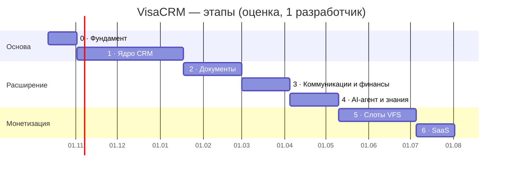
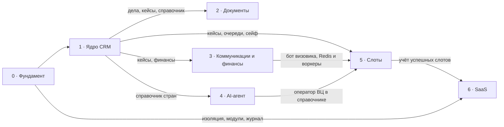

# Дорожная карта разработки

Весь путь от фундамента до SaaS: семь этапов, у каждого — цель, гейт, модули, задачи, зависимости и вопросы, которые нужно закрыть до старта. Продуктовые требования — в [PRD.md](PRD.md), детальные задачи ближайших этапов с критериями готовности — в [backlog.md](backlog.md), спецификация клиентов — в [clients-module.md](clients-module.md).

**Как пользоваться.** Этап начинается, когда пройден гейт предыдущего. Перед стартом этапа его эпики из этого файла раскладываются в задачи [backlog.md](backlog.md) (одна задача — одна ветка и PR). Статусы обновляются после мержа в `main`.

Статусы: ✅ готово (в `main`) · 🔄 в работе · ⏸ отложено · ⬜ не начато.

## Сводка

| Этап | Недели | Ориентировочно | Цель | Гейт (условие перехода дальше) | Статус |
| --- | --- | --- | --- | --- | --- |
| 0 · Фундамент | 1–3 | 12.10 – 01.11.2026 | Безопасная основа: изоляция данных, вход, роли, шифрование, RU/EN | Тестовый второй визовик не видит чужих данных | 🔄 |
| 1 · Ядро CRM | 4–14 | 02.11.2026 – 17.01.2027 | Визовик ведёт всех клиентов в системе вместо 7 таблиц | Все новые кейсы ведутся только в системе | ⬜ |
| 2 · Документы | 15–20 | 18.01 – 28.02.2027 | Пакет документов собирается из дела | Пакет собирается из дела без ручного набора | ⬜ |
| 3 · Коммуникации и финансы | 21–25 | 01.03 – 04.04.2027 | Клиент и визовик получают статусы и напоминания в Telegram | Статусы и напоминания клиентам уходят без ручных сообщений | ⬜ |
| 4 · AI-агент и знания | 26–30 | 05.04 – 09.05.2027 | Справочник обновляется по официальным источникам с одобрения админа | Справочник меняется только через одобренные правки | ⬜ |
| 5 · Слоты VFS | 31–38 | 10.05 – 04.07.2027 | Система находит слоты и подбирает клиента, визовик записывает | Успешные слоты фиксируются и начисляются без ручного учёта | ⬜ |
| 6 · SaaS | 39–42 | 05.07 – 01.08.2027 | Платформа открыта другим визовикам, оплата за слоты | — | ⬜ |

Сроки — оценка PRD для одного разработчика на полный день с AI-инструментами, отсчёт от 12.10.2026, без праздников и отпусков. При работе на полставки они примерно удваиваются. Первый рабочий результат — визовик ведёт клиентов в системе — после этапа 1 (неделя 14).

## Ключевые точки

| Точка | Когда | Что значит |
| --- | --- | --- |
| Первый деплой (staging) | Когда в `main` есть частично рабочая версия. Предложение: после входа с 2FA, админки и сотрудников (0.5–0.7) | Задача 0.2: Railway, EU West, staging с PostgreSQL и PITR |
| Production и бэкапы | До пилота (1.15) | Окружение production, ежедневный `pg_dump` во внешнее хранилище (0.11), проверка восстановления |
| Пилот | Недели 13–14 | Визовик переносит свои таблицы и работает в системе каждый день |
| Юридическая проверка (РБ) | До пилота | Трансграничная передача персональных данных клиентов в Нидерланды |
| Юридическая проверка (RODO) | До этапа 6 | DPA с Railway, umowa powierzenia с визовиками, роли администратора и обработчика |
| Цена за слот | В конце этапа 5 | Цена, правила отмены и переноса записи |

## Зависимости между этапами

---

## Этап 0 · Фундамент — 3 недели

**Цель.** Основа, которую не придётся переделывать к SaaS: каждый визовик изолирован на уровне базы, вход безопасен, роли и модули заложены, все тексты переводятся.

**Гейт.** Тестовый второй визовик не видит чужих данных — ни через интерфейс, ни через API, ни прямым SQL через сессию приложения.

| # | Задача | Статус |
| --- | --- | --- |
| 0.1 | Каркас: FastAPI + React + Alembic + CI + Dockerfile, lock-файлы | ✅ |
| 0.2 | Деплой на Railway (staging) | ⏸ до частично рабочей версии |
| 0.3 | Арендаторы, пользователи, Row-Level Security | ✅ |
| 0.4 | Вход: пароль (argon2), сессии в cookie, блокировка после 10 попыток, смена временного пароля | 🔄 в ветке, ждёт PR |
| 0.5 | Двухфакторный вход (TOTP) и коды восстановления | ⬜ |
| 0.6 | Админка: визовики | 🔄 есть создание, список, блокировка, сброс пароля; осталось: налог, переключатели модулей |
| 0.7 | Сотрудники визовика: приглашение, модули, кейсы | ⬜ |
| 0.8 | Неизменяемый журнал действий | ⬜ |
| 0.9 | Шифрование сейфа (AES-GCM, мастер-ключ) | ⬜ |
| 0.10 | i18n и оболочка интерфейса | 🔄 есть RU/EN, меню, тема варианта A; осталось: финальный стиль |
| 0.11 | Бэкапы во внешнее S3-хранилище в ЕС | ⬜ |

**Решить до конца этапа.** Финальный стиль интерфейса (варианты — `docs/prototype/Styles.dc.html`), чтобы этап 1 верстался уже в нём.

---

## Этап 1 · Ядро CRM — 11 недель

**Цель.** Семь таблиц визовика заменяются одной базой «контакт → консультации → кейсы»: картотека, карточки, очереди, финансы в BYN, главный экран, аналитика и импорт. Подробно — [clients-module.md](clients-module.md).

**Гейт.** Все новые кейсы визовик ведёт только в системе.

**Модули:** личные дела клиентов, кейсы, задачи и календарь (напоминания внутри CRM), справочник стран и виз, главный экран и аналитика.

| Блок | Задачи backlog | Срок |
| --- | --- | --- |
| Карточки и картотека | 1.1 справочники · 1.2 контакт · 1.3 консультация · 1.4 кейс · 1.5 картотека списком и канбаном | 4 нед. |
| Очереди, сейф, брони, финансы | 1.6 очереди и попытки · 1.7 сейф учётных записей · 1.8 брони · 1.9 финансы кейса · 1.10 расчёты с регистраторами | 2 нед. |
| Главный экран и аналитика | 1.11 «Требует внимания» · 1.12 главный экран · 1.13 аналитика | 2 нед. |
| Импорт | 1.14 импорт XLSX/CSV, который визовик запускает сам | 1 нед. |
| Пилот | 1.15 перенос таблиц, ежедневная работа, правки | 2 нед. |

**Инфраструктура.** S3-хранилище в ЕС (согласия и договоры клиентов), cron-сервис (курсы Нацбанка РБ, бэкап), Sentry, production-окружение к пилоту.

**Решить до старта или по ходу** (вопросы к визовику из [open-questions.md](open-questions.md)):
- что в прототипе непонятно, лишнее или не хватает; список или канбан (№ 12);
- план на месяц для главного экрана (№ 5), расходы на рекламу по каналам (№ 6), выгрузка в Excel/PDF (№ 7);
- о чём и за сколько дней она напоминает клиентам (№ 4) — правила блока «Требует внимания»;
- копии 7 таблиц для теста импорта — нужны к задаче 1.14.

---

## Этап 2 · Документы — 6 недель

**Цель.** Документы и анкеты собираются из данных дела по шаблонам; система подсвечивает, чего не хватает в пакете.

**Гейт.** Пакет документов собирается из дела без ручного набора.

**Модули:** шаблоны документов, автозаполнение анкет, распознавание паспорта, проверка пакета, калькулятор 90/180, AI-помощник по документам.

| # | Эпик | Что входит |
| --- | --- | --- |
| 2.1 | Шаблоны документов | Спонсорские письма, справки, cover letter, доверенности, договор; подстановка полей дела; выгрузка в DOCX/PDF; общие шаблоны (админ) и свои (визовик) |
| 2.2 | Чек-листы в справочнике | Список документов по стране, цели и типу визы — основа для проверки пакета |
| 2.3 | Проверка пакета | Сверка документов кейса с чек-листом, подсветка недостающего и просроченного |
| 2.4 | Автозаполнение анкет | Шенгенская анкета, UK-форма, данные для профиля VFS из дела |
| 2.5 | Распознавание паспорта (MRZ) | Чтение MRZ и срока действия; скан обрабатывается и не сохраняется (решение: сканы не храним) |
| 2.6 | Калькулятор 90/180 | Допустимые дни пребывания по истории поездок из дела |
| 2.7 | AI-помощник по документам | Черновики писем, переводы, подсказки по рискам отказа |

**Зависит от:** личного дела и кейса (1.2–1.4), справочника (1.1).

**Решить до старта:** какие документы визовик готовит сама и шаблоны от неё (№ 2, материалы); выбор LLM и бюджет на AI-запросы; нужно ли хранить сгенерированные документы или только выдавать файл.

---

## Этап 3 · Коммуникации и финансы — 5 недель

**Цель.** Клиент получает статусы, напоминания и запросы документов в Telegram, визовик — свои уведомления; счета и договоры формируются в системе.

**Гейт.** Статусы и напоминания клиентам уходят без ручных сообщений.

**Модули:** Telegram-бот клиента, Telegram-бот визовика, единый inbox, счета и оплаты, договоры, калькулятор стоимости.

| # | Эпик | Что входит |
| --- | --- | --- |
| 3.1 | Фоновые воркеры | Redis и arq: боты и рассылки работают постоянно, cron для них не подходит |
| 3.2 | Бот визовика | Напоминания из «Требует внимания» (этап 1) переезжают в Telegram; дедлайны, новые лиды; позже — слоты |
| 3.3 | Бот клиента | Привязка клиента к контакту по ссылке-приглашению, согласие; статусы кейса, напоминания, запросы документов |
| 3.4 | Единый inbox | Переписка с клиентами в карточке, шаблоны сообщений, рассылки |
| 3.5 | Счета и оплаты | Прайс, счета клиенту, консульские и сервисные сборы; продолжение финансов кейса (1.9) |
| 3.6 | Договоры | Договор из шаблона (2.1), электронная подпись |
| 3.7 | Калькулятор стоимости | Цена визы под ключ: сборы плюс услуги |

**Зависит от:** кейсов и финансов (1.4, 1.9), шаблонов (2.1).

**Решить до старта:** тексты и сроки напоминаний клиентам (№ 4); как визовик узнаёт о решении и готовности паспорта (№ 3); страховка — доход или расход (№ 1); сервис электронной подписи.

---

## Этап 4 · AI-агент и знания — 5 недель

**Цель.** Справочник стран и правил записи обновляется по официальным источникам; агент ничего не публикует сам, правка попадает в базу только после одобрения админом.

**Гейт.** Справочник меняется только через одобренные правки.

**Модули:** AI-агент изменений, база отказов, подсказки по процессу.

| # | Эпик | Что входит |
| --- | --- | --- |
| 4.1 | Источники | Список сайтов консульств, МИД, VFS, gov.uk, Еврокомиссии; админ добавляет, отключает, задаёт частоту |
| 4.2 | Поиск изменений | Сравнение с прошлой версией страницы, отсев косметики, тип изменения (документы, сборы, сроки, запись, законы) |
| 4.3 | Черновик правки | Поле, было и стало, цитата, ссылка, дата, уверенность агента |
| 4.4 | Решение админа | Принять, отредактировать или отклонить с причиной; причины — для настройки агента |
| 4.5 | Версии справочника | Новая версия с датой вступления в силу; затронутые чек-листы и кейсы визовиков помечаются |
| 4.6 | Срочные изменения | Приостановка приёма, закрытие центра — админу сразу, вне очереди |
| 4.7 | Заметки визовика | Свои заметки к справочнику без изменения общей версии |
| 4.8 | База отказов | Причины отказов и что сработало при повторной подаче |
| 4.9 | Подсказки по процессу | Где зависают кейсы, какие этапы тормозят |

**Зависит от:** справочника (1.1), чек-листов (2.2), воркеров (3.1), бота визовика (3.2) для уведомлений.

**Решить до старта:** стартовый список источников по странам первой волны; модель и бюджет на AI-запросы.

---

## Этап 5 · Слоты VFS — 8 недель

**Цель.** Система следит за слотами и предлагает клиента из очереди, визовик записывает его и вносит номер; успешный слот учитывается для оплаты. Капча и финальное подтверждение — всегда за человеком.

**Гейт.** Успешные слоты фиксируются и начисляются без ручного учёта.

**Модуль:** модуль слотов VFS.

| # | Эпик | Что входит |
| --- | --- | --- |
| 5.1 | Инфраструктура мониторинга | Отдельно от основного сервиса: визовые центры блокируют облачные IP; лимиты частоты на центр |
| 5.2 | Каркас коннекторов и VFS | Общий интерфейс коннектора; первый — VFS (73 пары стран) |
| 5.3 | Подписки | Страна, центр, категория визы, диапазон дат; одно уведомление на слот |
| 5.4 | Очередь ожидания и подбор | Параметры кейса (центр, категория, желаемые и недоступные даты, приоритет); подбор по приоритету; слоты без кандидата — в журнал |
| 5.5 | Сейф аккаунтов VFS | На базе шифрования сейфа (0.9, 1.7); каждое открытие — в журнал |
| 5.6 | Карточка слота и уведомление | Через бота визовика (3.2); данные заявителя под рукой |
| 5.7 | Фиксация и учёт | Номер записи и письмо или скриншот VFS в кейсе; начисление по цене из админки |
| 5.8 | Защита от блокировок | Пауза центра при росте капчи или ошибок, уведомление админу; сбой одного центра не влияет на другие |
| 5.9 | TLScontact, затем BLS | Следующие коннекторы (13 и 10 пар); вероятно, выходят за 8 недель |

**Зависит от:** кейсов и очередей (1.4, 1.6), сейфа (0.9, 1.7), воркеров и бота визовика (3.1, 3.2), оператора ВЦ в справочнике (4.x).

**Решить до старта:** целевое время доставки уведомления о слоте и метрики; подтвердить 42 пары со знаком «?»; операторы для Турции и Сербии; как визовик ищет слоты сейчас и сколько минут есть, чтобы занять слот (№ 11).

---

## Этап 6 · SaaS — 4 недели

**Цель.** Другие визовики подключаются к платформе и платят только за успешные слоты; подписки и пробного периода нет.

**Модули:** админ-панель SaaS, переключатели модулей и лимиты, начисления.

| # | Эпик | Что входит |
| --- | --- | --- |
| 6.1 | Онбординг визовиков | Создание админом (есть с этапа 0), 2FA, самостоятельный импорт (1.14), подсказки первого входа |
| 6.2 | Модули и лимиты | Переключатели модулей на визовика; лимиты активных кейсов, подписок на слоты, AI-запросов |
| 6.3 | Начисления и оплата | Цена за слот в админке, начисления, счета визовикам, споры по отменам и переносам |
| 6.4 | Доступ поддержки | Вход в кабинет визовика только с его разрешения, каждый доступ — в журнал |
| 6.5 | Настройки визовика | Своя базовая валюта, валюты платежей, источник курса, налог |
| 6.6 | Аналитика платформы | Платящие визовики, выручка за слоты, активность |
| 6.7 | Усиление изоляции | Отдельный пользователь БД без прав суперпользователя (решение от 2026-10-15) |

**Решить до старта:** цена за слот и правила отмены и переноса; проверка у юриста по RODO (роли, umowa powierzenia, DPA с Railway).

---

## Сквозные направления

Идут через все этапы, а не отдельным этапом.

- **Безопасность.** Изоляция на уровне базы для каждой новой таблицы (колонка `tenant_id`, политика RLS, тест изоляции), 2FA, шифрование сейфа, неизменяемый журнал, никаких персональных данных в логах и URL.
- **Персональные данные.** Сканы не храним, согласие и договор — с датой и файлом; удаление или обезличивание карточки по просьбе клиента; хостинг и бэкапы в ЕС.
- **Качество.** Тест на бизнес-правило до кода (деньги, сроки, права); CI на каждый PR; Playwright-сценарии ключевых путей начиная с этапа 1; Sentry с первого деплоя.
- **Локализация.** Каждая строка интерфейса и бота — в `ru.json` и `en.json`.
- **Документы проекта.** Решения — в [decisions.md](decisions.md), нерешённое — в [open-questions.md](open-questions.md), задачи ближайшего этапа — в [backlog.md](backlog.md), статусы — здесь.

## Вне плана

Отложено или вне скоупа (PRD, «Вне скоупа и отложенное»): верификация клиента (KYC), вход клиента в систему, доступ клиента к аккаунту VFS, запись без участия человека, мобильное приложение.
